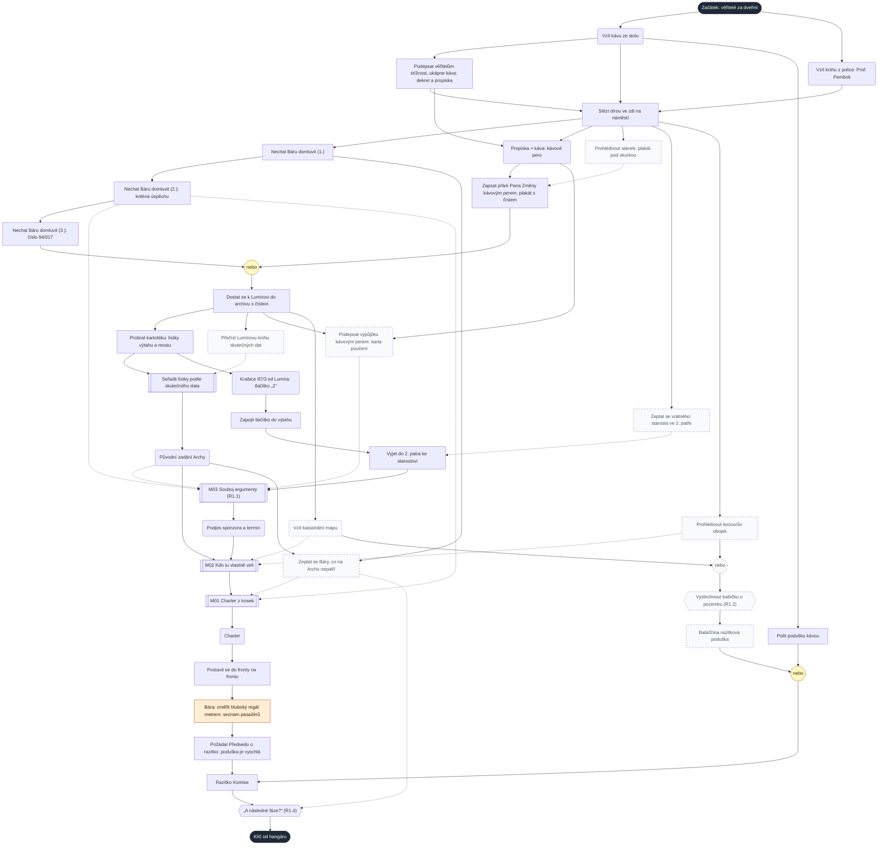
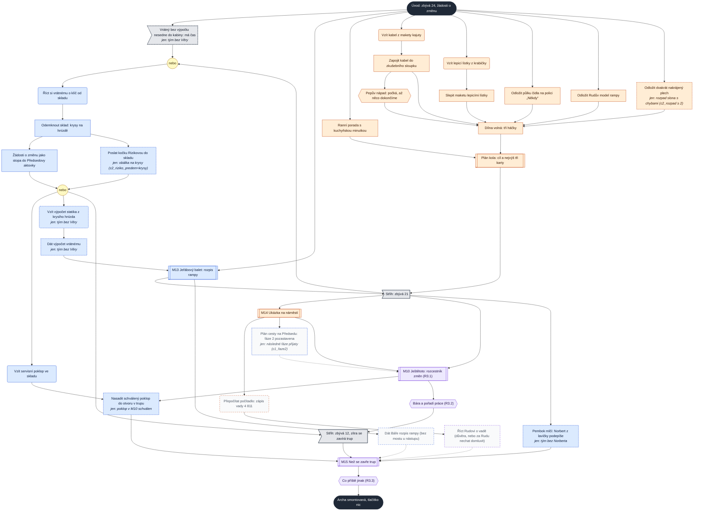
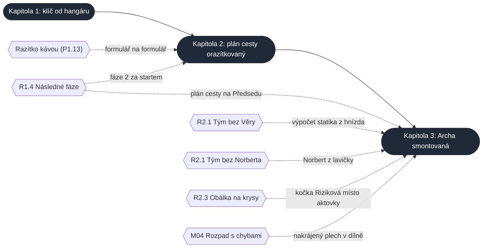

# Graf závislostí puzzlů: kapitoly 1–3

> Úplný graf závislostí podle Rona Gilberta pro kapitoly, které jsou v šedém prototypu, a co
> z něj plyne pro návrh. Grafy kapitol v návrzích ([1](kapitoly/01-iniciace.md#graf-závislostí-puzzlů),
> [2](kapitoly/02-planovani.md#graf-závislostí-puzzlů), [3](kapitoly/03-realizace.md#graf-závislostí-puzzlů))
> jsou kostry s hlavní linkou. Tady je každý krok, který hra opravdu vyžaduje, podle dat prototypu.
> Stav: **rozbor**, verze 0.3 (2026-11-02: D75 klíč od skladu až ve fázi B, D76 kapitola 1 beze změny hry)

## Jak graf číst

Ron Gilbert graf popisuje v článku
[Puzzle Dependency Charts](https://grumpygamer.com/puzzle_dependency_charts/) (Grumpy Gamer, 2014):

- **Uzel je krok k řešení:** úkol, získaný předmět, minihra. Šipka vede od předpokladu ke kroku,
  který na něm závisí. Graf neukazuje pořadí, ve kterém hráč hraje, ale co musí mít hotové.
  Gilbert to shrnuje větou „it's not flow, it's dependency“.
- **Staví se od cíle pozpátku:** co je potřeba, aby šel splnit cíl, a co je potřeba pro to.
- **Dobrý graf má tvar kosočtverců.** Jeden krok otevře dva nebo tři další a ty se zase
  sbíhají. Na konci aktu je **úzké hrdlo**: hráč uzavře celek, utřídí si, co ví, a vyprázdní
  kapsy. Lineární řetěz je nejhorší (hráč nemá na výběr) a příliš mnoho souběžných věcí taky
  (hráč se ztratí).
- **Gilbert kreslí zleva doprava.** Tady grafy běží shora dolů, aby se vešly na šířku stránky:
  cíl je dole, začátek nahoře.
- **Místa a postavy v grafu nejsou.** Příběh jen tehdy, když hru zamyká. Proto v kapitole 3
  zůstávají střihy fází: bez nich hra dál nepustí.

Úpravy pro tuhle hru:

| Značka | Význam |
|---|---|
| obdélník | úkol, který hráč udělá |
| zaoblený obdélník | získaný předmět |
| dvojitý obdélník | minihra |
| šestiúhelník | volba s následkem (RX.Y) |
| kroužek **nebo** | stačí jedna z cest; „3 z 5“ = stačí tři |
| praporek | střih, který hru posune (fáze v kapitole 3) |
| plná šipka | nutný předpoklad |
| čárkovaná šipka | pomáhá (lepší výsledek, znalost), ale nezamyká |
| čárkovaný rámeček | krok je volitelný, k cíli nevede |
| tečkovaný rámeček s *jen:* | krok existuje jen při určitém stavu z dřívější kapitoly |
| barva | v kapitole 3 kdo krok dělá: modrá Ruda, oranžová Bára, fialová obě postavy spolu (jako barvy postav v grafech Thimbleweed Parku); v kapitole 1 je oranžově úsek za Báru |

**Rozbor pod každým grafem** počítá skript. Kolo jsou kroky, které jdou udělat současně, když
hráč vždy udělá všechno, co už jde. Počet kol je nejkratší možný sled tahů, počet kroků v kole
ukazuje šířku grafu. Kroky, které se stanou samy (předmět z minihry, střih), tah nestojí.
**Úzké hrdlo** je povinný krok, před kterým nutně je, nebo za kterým nutně je každý jiný povinný
krok. „Nutně před“ znamená, že bez něj druhý krok nejde splnit vůbec, ani jinou cestou.

**Zdroj a kontrola:** grafy jsou data v `tools/graf/k1.mjs` až `k3.mjs`. Příkaz
`node tools/graf_zavislosti.mjs` ověří, že každý příznak a předmět uzlu v prototypu existuje,
že cíl jde splnit v každém stavu a že žádný volitelný krok není ve skutečnosti povinný. Potom
přepíše grafy a rozbory v tomhle dokumentu. Co je mezi značkami `graf:kN`, se ručně neupravuje.

## Kapitola 1: Iniciace

<!-- graf:k1 -->

**Výchozí stav:** 33 kroků, z toho 18 povinných; nejkratší možný sled 18 kol; v jednom kole nejvýš 2 kroky k cíli (5 i s volitelnými).

| Kolo | Kroky k cíli, které jdou udělat | Navíc volitelné |
|---|---|---|
| 1 | Vzít kávu ze stolu · Vzít knihu z police: Prof. Pembok | – |
| 2 | Podepsat věřitelům stížnost, ukápne káva: dekret a propiska · Polít podušku kávou *(větev)* | – |
| 3 | Slézt dírou ve zdi na náměstí **⧗** | – |
| 4 | Nechat Báru domluvit (1.) *(větev)* · Propiska + káva: kávové pero *(větev)* | Prohlédnout stánek: plakát pod okurkou · Zeptat se vrátného: starosta ve 2. patře · Prohlédnout kocourův obojek |
| 5 | Nechat Báru domluvit (2.): kritéria úspěchu *(větev)* · Zapsat přání Pana Změny kávovým perem: plakát s číslem *(větev)* | Vyslechnout babičku o pozemku (R1.2) |
| 6 | Nechat Báru domluvit (3.): číslo 94/017 *(větev)* · Dostat se k Lumírovi do archivu s číslem **⧗** | Babiččina razítková poduška |
| 7 | Probrat kartotéku: lístky výtahu a mostu **⧗** | Přečíst Lumírovu knihu skutečných dat · Podepsat výpůjčku kávovým perem: karta poučení · Vzít katastrální mapu |
| 8 | Seřadit lístky podle skutečného data · Krabice 87/3 od Lumíra: tlačítko „2“ | – |
| 9 | Zapojit tlačítko do výtahu | Zeptat se Báry, co na Archu nepatří |
| 10 | Vyjet do 2. patra ke starostovi | – |
| 11 | M03 Souboj argumenty (R1.1) | – |
| 12 | M02 Kdo tu vlastně velí **⧗** | – |
| 13 | M01 Charter z trosek **⧗** | – |
| 14 | Postavit se do fronty na frontu **⧗** | – |
| 15 | Bára: změřit hluboký regál metrem: seznam pasažérů **⧗** | – |
| 16 | Požádat Předsedu o razítko: poduška je vyschlá **⧗** | – |
| 17 | Razítko Komise **⧗** | – |
| 18 | „A následné fáze?“ (R1.4) **⧗** | – |

**⧗** úzké hrdlo (10): všechny ostatní povinné kroky jsou nutně před ním, nebo nutně za ním. *(větev)*: jedna z cest rozcestí „nebo“, sama povinná není. *(teď nepotřebný)*: v tomhle stavu k cíli nevede, v jiném ano.
<!-- /graf:k1 -->

### Co z grafu plyne

1. **Začátek je správně keřovitý.** Útěk z bytu je malý kosočtverec (káva a kniha, z kávy
   dekret, všechno se sejde u díry). Číslo projektu má dvě nezávislé cesty (Bára, Pan Změna)
   a archiv se rozdělí na dvě větve, které se sejdou až v M02: zadání (kartotéka → řazení)
   a starosta (krabice → tlačítko → výtah → M03).
2. **Konec je dlouhý řetěz.** Od M02 je 7 povinných kroků za sebou a každý je úzké hrdlo:
   M02 → M01 → fronta → Bára u regálu → Předseda → razítko → R1.4. Je to 7 z 18 povinných
   tahů kapitoly. Návrh chce „lineární závěr, záměrně krátký“; krátký je dějově (všechno
   v kanceláři Komise), ale v tazích tvoří skoro polovinu kapitoly.
   M01 a M02 na sobě nezávisejí (obě potřebují podpis a zadání), ale stůl pustí M01 až po
   M02. **Rozhodnuto (D76): zůstává.** Všechno je v jedné kanceláři a hraje se rychle, pořadí
   „nejdřív kdo tu velí, potom charter“ drží Pembokova rada.
3. **Šířka je hlavně z volitelných věcí.** K cíli vedou v jednom kole nejvýš 2 kroky.
   „Rozdělané úkoly“ v [průchodu](kapitoly/01-pruchod.md#šířka-grafu) (v archivu tlačítko,
   zadání, karta, mapa) počítají i kartu poučení a mapu, které jsou volitelné. Hráč to ale
   nepozná, pro něj jsou otevřené. Šířka pro hráče je tedy 3–5, šířka k cíli 1–2.
4. **Vrátný nic nezamyká.** V návrhu je P1.1 povinný (`vratny --> vytah`), v prototypu tlačítko
   „2“ funguje i bez rozhovoru s vrátným. Rozhovor je jen znalost. V grafu je proto čárkovaně.
   **Rozhodnuto (D76):** zůstává znalostí; karta P1.1 a graf v návrhu kapitoly 1 jsou opravené.
5. **Měkké vstupy fungují.** M03 jde vyhrát i bez zadání, karty a kritérií (rychlými sliby
   s následkem R1.1). M02 a M01 jdou dohrát s horšími útržky. Řazení lístků jde i bez Lumírovy
   knihy (zkoušením). Žádný z těchto podkladů hráče nezastaví, jen zhorší výsledek.

## Kapitola 2: Plánování

<!-- graf:k2 -->

**Výchozí stav:** 22 kroků, z toho 12 povinných; nejkratší možný sled 8 kol; v jednom kole nejvýš 8 kroků k cíli (8 i s volitelnými).

| Kolo | Kroky k cíli, které jdou udělat | Navíc volitelné |
|---|---|---|
| 1 | Vzít křídu z tabule v hospodě · Vzít tácky z výčepu *(větev)* · Odemknout bránu klíčem: slon · Získat čtyři kandidáty | Vyzkoušet kandidáty (zkoušky) · Zjistit, kdo umí řídit jeřáb (cedule, štamgasti) |
| 2 | M04 Jak sníst slona | – |
| 3 | Vejít do hangáru: Archa je vrak | – |
| 4 | Potvrdit tým u dveří hospody (R2.1) · Vzít krabici od bot z kokpitu · Použít tabuli: přijde Ing. Framework | – |
| 5 | Tácky: odhady týmu potají *(větev)* · Přijmout sázku „dva dny“ (kotva) *(větev)* · Zapsat okousané kabely *(větev)* · Zapsat Předsedův úsměv (do R2.2) *(větev)* · Zapsat prasklé lano jeřábu *(větev)* · Zapsat obyvatele s kufry *(větev)* · Zapsat Pepovy „dva dny“ *(větev)* · Rozdělit Archu na tabuli (R2.2) | – |
| 6 | M07 Krabice od bot: obálka na jedno riziko (R2.3) | – |
| 7 | M06 Mapa do neznáma: plán cesty **⧗** | – |
| 8 | Komise orazítkuje plán cesty **⧗** | – |

**⧗** úzké hrdlo (2): všechny ostatní povinné kroky jsou nutně před ním, nebo nutně za ním. *(větev)*: jedna z cest rozcestí „nebo“, sama povinná není. *(teď nepotřebný)*: v tomhle stavu k cíli nevede, v jiném ano.

**Špatná kapitola 1 (razítko kávou, fáze 2):** 28 kroků, z toho 18 povinných; nejkratší možný sled 10 kol; v jednom kole nejvýš 9 kroků k cíli (9 i s volitelnými).

| Kolo | Kroky k cíli, které jdou udělat | Navíc volitelné |
|---|---|---|
| 1 | Vzít křídu z tabule v hospodě · Vzít tácky z výčepu *(větev)* · Odemknout bránu klíčem: slon · Získat čtyři kandidáty | Vyzkoušet kandidáty (zkoušky) · Zjistit, kdo umí řídit jeřáb (cedule, štamgasti) |
| 2 | M04 Jak sníst slona | – |
| 3 | Vejít do hangáru: Archa je vrak | – |
| 4 | Potvrdit tým u dveří hospody (R2.1) · Vzít krabici od bot z kokpitu · Použít tabuli: přijde Ing. Framework · Dostat od Předsedy formulář · Vzít list kalendáře „Den dopadu“ | – |
| 5 | Tácky: odhady týmu potají *(větev)* · Přijmout sázku „dva dny“ (kotva) *(větev)* · Zapsat okousané kabely *(větev)* · Zapsat Předsedův úsměv (do R2.2) *(větev)* · Zapsat prasklé lano jeřábu *(větev)* · Zapsat obyvatele s kufry *(větev)* · Zapsat Pepovy „dva dny“ *(větev)* · Rozdělit Archu na tabuli (R2.2) · Nechat formulář podepsat třemi z týmu | – |
| 6 | M07 Krabice od bot: obálka na jedno riziko (R2.3) · Odevzdat formulář Předsedovi | – |
| 7 | M06 Mapa do neznáma: plán cesty | – |
| 8 | Předseda chce fázi 2 za start | – |
| 9 | Ukázat list Předsedovi: fáze 2 pozastavena | – |
| 10 | Komise orazítkuje plán cesty **⧗** | – |

**⧗** úzké hrdlo (1): všechny ostatní povinné kroky jsou nutně před ním, nebo nutně za ním. *(větev)*: jedna z cest rozcestí „nebo“, sama povinná není. *(teď nepotřebný)*: v tomhle stavu k cíli nevede, v jiném ano.
<!-- /graf:k2 -->

### Co z grafu plyne

1. **Nejkeřovitější kapitola.** Po otevření hangáru běží souběžně tým, krabice s pěti lístky,
   tabule a odhad a všechno se sejde v M06. Je to učebnicový Gilbertův kosočtverec. Úzká hrdla
   jsou jen dvě, M06 a razítko Komise, tedy krátký konec.
2. **Slon na začátku je řetěz se zpáteční cestou.** Křída z hospody → slon → hangár. Tým jde
   potvrdit až po hangáru (záměr K2), takže se hráč do hospody vrací. Tácky taky potřebují
   potvrzený tým. Hospoda je tedy dvakrát; v grafu je to vidět jako dvě šipky do kroku
   „Potvrdit tým“, jedna z hospody, druhá z hangáru.
3. **Odhad má dvě cesty**, tácky a kotvu. Obě potřebují tým, kotva jen zhorší M06.
4. **Špatná kapitola 1 přidá jednu souběžnou větev a jeden řetěz na konci.** Formulář na
   formulář běží souběžně se vším ostatním (dobře). Fáze 2 přidá za M06 dva kroky za sebou
   (Předseda chce fázi 2 → list kalendáře → razítko). List jde vzít dřív, ale hráč se dozví,
   že ho potřebuje, až když předloží plán. Konec se tak natáhne z 2 na 4 kroky.

## Kapitola 3: Realizace

<!-- graf:k3 -->

**Výchozí stav:** 23 kroků, z toho 20 povinných; nejkratší možný sled 11 kol; v jednom kole nejvýš 6 kroků k cíli (6 i s volitelnými).

| Kolo | Kroky k cíli, které jdou udělat | Navíc volitelné |
|---|---|---|
| 1 | M13 Jeřábový balet: rozpis rampy (Ruda) · Ranní porada s kuchyňskou minutkou (Bára) · Vzít kabel z makety kajuty (Bára) · Vzít lepicí lístky z krabičky (Bára) · Odložit půlku čidla na polici „Někdy“ (Bára) · Odložit Rudův model rampy (Bára) | – |
| 2 | Zapojit kabel do zkušebního sloupku (Bára) · Slepit maketu lepicími lístky (Bára) | Dát Báře rozpis rampy (bez mostu u nástupu) |
| 3 | Pepův nápad: počká, až něco dokončíme (Bára) | – |
| 4 | Plán kola: cíl a nejvýš tři karty (Bára) | – |
| 5 | Říct si vrátnému o klíč od skladu (Ruda) · M14 Ukázka na náměstí (Bára) | – |
| 6 | Odemknout sklad: krysy na hnízdě (Ruda) · M10 Ještětoto: rozcestník změn (R3.1) (spolu) | Přepočítat počítadlo: zápis vady 4 811 |
| 7 | Žádosti o změnu jako stopa do Předsedovy aktovky (Ruda) · Bára a pořadí práce (R3.2) (spolu) | Říct Rudovi o vadě (důvěra, nebo za Rudu nechat domluvit) |
| 8 | Vzít servisní poklop ve skladu (Ruda) | – |
| 9 | Nasadit schválený poklop do otvoru v trupu (Ruda) | – |
| 10 | M15 Než se zavře trup (spolu) **⧗** | – |
| 11 | Co příště jinak (R3.3) (spolu) **⧗** | – |

**⧗** úzké hrdlo (2): všechny ostatní povinné kroky jsou nutně před ním, nebo nutně za ním. *(větev)*: jedna z cest rozcestí „nebo“, sama povinná není. *(teď nepotřebný)*: v tomhle stavu k cíli nevede, v jiném ano.

**Špatné kapitoly 1 a 2 (bez Věry i Norberta, fáze 2, rozpad):** 28 kroků, z toho 24 povinných; nejkratší možný sled 11 kol; v jednom kole nejvýš 7 kroků k cíli (7 i s volitelnými).

| Kolo | Kroky k cíli, které jdou udělat | Navíc volitelné |
|---|---|---|
| 1 | Říct si vrátnému o klíč od skladu (Ruda) · Ranní porada s kuchyňskou minutkou (Bára) · Vzít kabel z makety kajuty (Bára) · Vzít lepicí lístky z krabičky (Bára) · Odložit půlku čidla na polici „Někdy“ (Bára) · Odložit Rudův model rampy (Bára) · Odložit dvakrát nakrájený plech (Bára) | – |
| 2 | Odemknout sklad: krysy na hnízdě (Ruda) · Zapojit kabel do zkušebního sloupku (Bára) · Slepit maketu lepicími lístky (Bára) | – |
| 3 | Žádosti o změnu jako stopa do Předsedovy aktovky (Ruda) · Pepův nápad: počká, až něco dokončíme (Bára) | – |
| 4 | Vzít servisní poklop ve skladu (Ruda) · Vzít výpočet statika z krysího hnízda (Ruda) · Plán kola: cíl a nejvýš tři karty (Bára) | – |
| 5 | Dát výpočet vrátnému (Ruda) | – |
| 6 | M13 Jeřábový balet: rozpis rampy (Ruda) | – |
| 7 | M14 Ukázka na náměstí (Bára) · Pembok mlčí: Norbert z lavičky podepíše (Ruda) | Dát Báře rozpis rampy (bez mostu u nástupu) |
| 8 | M10 Ještětoto: rozcestník změn (R3.1) (spolu) | Přepočítat počítadlo: zápis vady 4 811 · Plán cesty na Předsedu: fáze 2 pozastavena |
| 9 | Nasadit schválený poklop do otvoru v trupu (Ruda) · Bára a pořadí práce (R3.2) (spolu) | Říct Rudovi o vadě (důvěra, nebo za Rudu nechat domluvit) |
| 10 | M15 Než se zavře trup (spolu) **⧗** | – |
| 11 | Co příště jinak (R3.3) (spolu) **⧗** | – |

**⧗** úzké hrdlo (2): všechny ostatní povinné kroky jsou nutně před ním, nebo nutně za ním. *(větev)*: jedna z cest rozcestí „nebo“, sama povinná není. *(teď nepotřebný)*: v tomhle stavu k cíli nevede, v jiném ano.

**Poklop v M10 neschválen:** 22 kroků, z toho 18 povinných; nejkratší možný sled 9 kol; v jednom kole nejvýš 6 kroků k cíli (6 i s volitelnými).

| Kolo | Kroky k cíli, které jdou udělat | Navíc volitelné |
|---|---|---|
| 1 | M13 Jeřábový balet: rozpis rampy (Ruda) · Ranní porada s kuchyňskou minutkou (Bára) · Vzít kabel z makety kajuty (Bára) · Vzít lepicí lístky z krabičky (Bára) · Odložit půlku čidla na polici „Někdy“ (Bára) · Odložit Rudův model rampy (Bára) | – |
| 2 | Zapojit kabel do zkušebního sloupku (Bára) · Slepit maketu lepicími lístky (Bára) | Dát Báře rozpis rampy (bez mostu u nástupu) |
| 3 | Pepův nápad: počká, až něco dokončíme (Bára) | – |
| 4 | Plán kola: cíl a nejvýš tři karty (Bára) | – |
| 5 | Říct si vrátnému o klíč od skladu (Ruda) · M14 Ukázka na náměstí (Bára) | – |
| 6 | Odemknout sklad: krysy na hnízdě (Ruda) · M10 Ještětoto: rozcestník změn (R3.1) (spolu) | Přepočítat počítadlo: zápis vady 4 811 |
| 7 | Žádosti o změnu jako stopa do Předsedovy aktovky (Ruda) · Bára a pořadí práce (R3.2) (spolu) | Říct Rudovi o vadě (důvěra, nebo za Rudu nechat domluvit) |
| 8 | Vzít servisní poklop ve skladu (Ruda) *(teď nepotřebný)* · M15 Než se zavře trup (spolu) **⧗** | – |
| 9 | Co příště jinak (R3.3) (spolu) **⧗** | – |

**⧗** úzké hrdlo (2): všechny ostatní povinné kroky jsou nutně před ním, nebo nutně za ním. *(větev)*: jedna z cest rozcestí „nebo“, sama povinná není. *(teď nepotřebný)*: v tomhle stavu k cíli nevede, v jiném ano.
<!-- /graf:k3 -->

### Co z grafu plyne

1. **Fáze A je široká a sbíhá se správně.** Ruda má M13, Bára poradu a dílnu s pěti drobnými
   úkoly. Střih „zbývá 21“ čeká na M13 **i** plán kola. Je to zámek přes obě postavy jako
   v *Day of the Tentacle*: když jedna postava uvízne, druhá musí dodělat svou část.
2. **Fáze B měla jednu linku, teď má dvě (D75).** Před změnou byla povinná linka po střihu
   řetěz M14 → M10 → R3.2 → střih → M15 → R3.3. Sklad měl Ruda v nejkratší cestě hotový už ve
   fázi A, takže **od střihu „zbývá 21“ do M10 neměl nic povinného** a čekal na Bářinu M14.
   Průchod uváděl ve fázi B 3–4 rozdělané úkoly, k cíli z nich vedl jeden.
   **Zapracováno:** klíč od skladu dá vrátný až ve fázi B (ve fázi A betonuje pilíře a z kabiny
   neleze). Ve fázi B teď běží Rudova linka klíč → krysy → poklop → nasazení souběžně s Bářinou
   M14 → M10 → R3.2 a sejdou se v M15. Bez Věry dá vrátný klíč hned, protože bez výpočtu statika
   do kabiny nesedne. Varianta s výpočtem z krysího hnízda tak zůstala beze změny.
   Nejkratší sled se tím prodloužil z 9 na 11 kol, protože Rudova linka teď vede do M15. Běží
   ale souběžně s Bárou, takže hráč čeká méně, ne víc.
3. **Fáze C je záměrně krátký řetěz** (M15 → R3.3, dvě úzká hrdla). V pořádku.
4. **Volba v M10 vytvoří povinný krok.** Když M10 poklop schválí, musí ho Ruda před M15
   nasadit; když ne, krok odpadá (scénář „Poklop v M10 neschválen“). Hráč to nemusí čekat.
   Prototyp to už hlídá: Věra nebo Ruda u místa pro počítač řeknou, že poklop chybí.
5. **Špatné kapitoly 1 a 2 vrátí sklad do fáze A** (bez Věry: klíč → krysy → výpočet →
   vrátný → teprve M13) a přidají Norberta na lavičce do fáze B. Ve fázi B pak Ruda místo
   skladu řeší Norberta. Tvar kapitoly se nemění.
6. **Vada je celá volitelná.** Mění konec, M15 (počítadlo opravené) a kapitolu 4, ale cíl
   na ní nezávisí. To je v souladu s návrhem (vada je volba s následkem, ne zámek).

## Mezi kapitolami

Kapitoly na sebe navazují jen jedním tvrdým předpokladem: klíč od hangáru z kapitoly 1 otevře
bránu v kapitole 2. Konec kapitoly 2 (vrátný na jeřábu) je začátek kapitoly 3. Ostatní
návaznosti jsou stavy: nepřidávají předpoklad k cíli, ale **přidávají nebo mění kroky**.

Všechny ostatní příznaky (R1.1–R1.3, R2.2, kvalita charteru, mosty, odhad) mění jen texty,
obtížnost miniher a výsledky. Kroky grafu nemění.

## Shrnutí pro návrh

| # | Zjištění | Návrh | Kdo rozhodne |
|---|---|---|---|
| 1 | Kap. 1: konec je řetěz 7 povinných kroků (od M02 po R1.4) | ponecháno, záměrně lineární závěr (D76) | – |
| 2 | Kap. 1: vrátný (P1.1) nic nezamyká, návrh ho měl jako povinný | ✅ znalost, návrh opraven (D76) | – |
| 3 | Kap. 3: od střihu „zbývá 21“ do M10 neměl Ruda nic povinného, fáze B byla řetěz | ✅ zapracováno (D75): klíč od skladu až ve fázi B, bez Věry hned | – |
| 4 | Kap. 3: schválení poklopu v M10 vytvoří povinný krok | ponechat, prototyp na chybějící poklop upozorní | – |
| 5 | Kap. 2: tvar odpovídá Gilbertovu ideálu | beze změny | – |

Šířka, kterou uvádějí průchody, se počítá z pohledu hráče (co má rozdělané, včetně volitelného).
Tady je i šířka k cíli. Obě čísla dávají smysl, ale u fáze B kapitoly 3 se před D75 lišila nejvíc.
