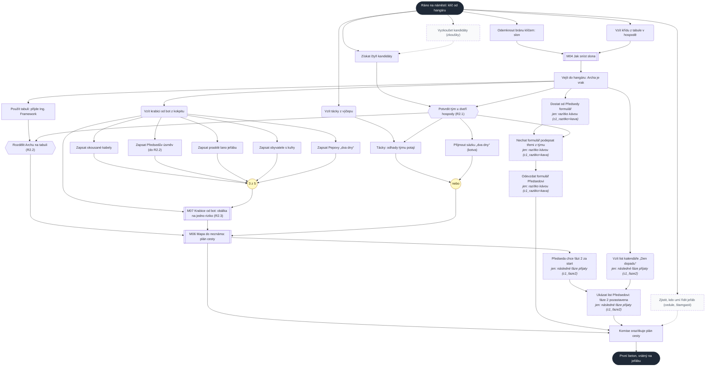
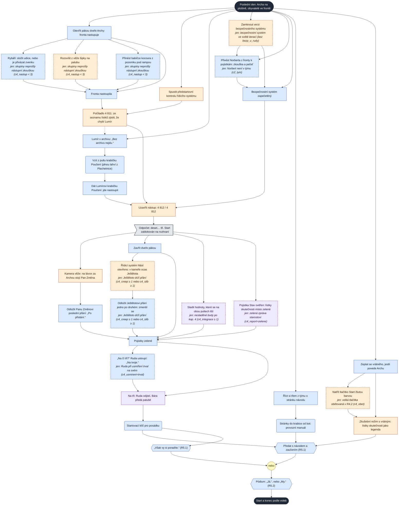
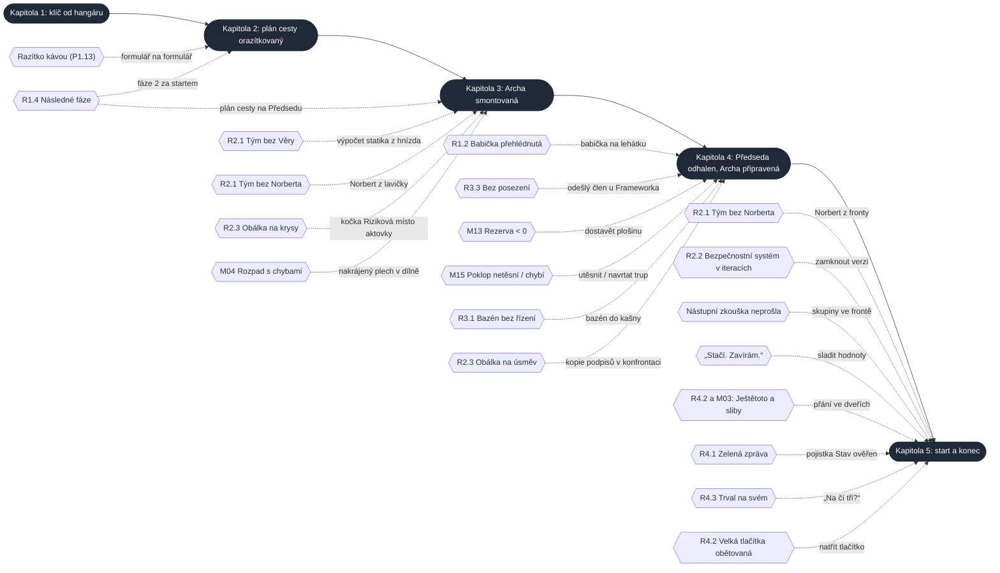

# Graf závislostí puzzlů: kapitoly 1–5

> Úplný graf závislostí podle Rona Gilberta pro kapitoly, které jsou v šedém prototypu (1–3),
> a pro návrhy kapitol 4 a 5, a co z něj plyne pro návrh. Grafy kapitol v návrzích ([1](kapitoly/01-iniciace.md#graf-závislostí-puzzlů),
> [2](kapitoly/02-planovani.md#graf-závislostí-puzzlů), [3](kapitoly/03-realizace.md#graf-závislostí-puzzlů))
> jsou kostry s hlavní linkou. Tady je každý krok, který hra opravdu vyžaduje, podle dat prototypu.
> Stav: **rozbor**, verze 0.5 (2026-11-05: přidána kapitola 5 z návrhu N3, D79; kapitola 4 v D77, D78)

## Jak graf číst

Ron Gilbert graf popisuje v článku
[Puzzle Dependency Charts](https://grumpygamer.com/puzzle_dependency_charts/) (Grumpy Gamer, 2014):

- **Uzel je krok k řešení:** úkol, získaný předmět, minihra. Šipka vede od předpokladu ke kroku,
  který na něm závisí. Graf neukazuje pořadí, ve kterém hráč hraje, ale co musí mít hotové.
  Gilbert to shrnuje větou „it's not flow, it's dependency“.
- **Staví se od cíle pozpátku:** co je potřeba, aby šel splnit cíl, a co je potřeba pro to.
- **Dobrý graf má tvar kosočtverců.** Jeden krok otevře dva nebo tři další a ty se zase
  sbíhají. Na konci aktu je **úzké hrdlo**: hráč uzavře celek, utřídí si, co ví, a vyprázdní
  kapsy. Lineární řetěz je nejhorší (hráč nemá na výběr) a příliš mnoho souběžných věcí taky
  (hráč se ztratí).
- **Gilbert kreslí zleva doprava.** Tady grafy běží shora dolů, aby se vešly na šířku stránky:
  cíl je dole, začátek nahoře.
- **Místa a postavy v grafu nejsou.** Příběh jen tehdy, když hru zamyká. Proto v kapitole 3
  zůstávají střihy fází: bez nich hra dál nepustí.

Úpravy pro tuhle hru:

| Značka | Význam |
|---|---|
| obdélník | úkol, který hráč udělá |
| zaoblený obdélník | získaný předmět |
| dvojitý obdélník | minihra |
| šestiúhelník | volba s následkem (RX.Y) |
| kroužek **nebo** | stačí jedna z cest; „3 z 5“ = stačí tři |
| praporek | střih, který hru posune (fáze v kapitole 3) |
| plná šipka | nutný předpoklad |
| čárkovaná šipka | pomáhá (lepší výsledek, znalost), ale nezamyká |
| čárkovaný rámeček | krok je volitelný, k cíli nevede |
| tečkovaný rámeček s *jen:* | krok existuje jen při určitém stavu z dřívější kapitoly |
| barva | v kapitole 3 kdo krok dělá: modrá Ruda, oranžová Bára, fialová obě postavy spolu (jako barvy postav v grafech Thimbleweed Parku); v kapitole 1 je oranžově úsek za Báru |

**Rozbor pod každým grafem** počítá skript. Kolo jsou kroky, které jdou udělat současně, když
hráč vždy udělá všechno, co už jde. Počet kol je nejkratší možný sled tahů, počet kroků v kole
ukazuje šířku grafu. Kroky, které se stanou samy (předmět z minihry, střih), tah nestojí.
**Úzké hrdlo** je povinný krok, před kterým nutně je, nebo za kterým nutně je každý jiný povinný
krok. „Nutně před“ znamená, že bez něj druhý krok nejde splnit vůbec, ani jinou cestou.

**Zdroj a kontrola:** grafy jsou data v `tools/graf/k1.mjs` až `k5.mjs`. Kapitoly 4 a 5 zatím
nemají prototyp, jejich grafy jsou z návrhu a příznaky se u nich nekontrolují. Příkaz
`node tools/graf_zavislosti.mjs` ověří, že každý příznak a předmět uzlu v prototypu existuje,
že cíl jde splnit v každém stavu a že žádný volitelný krok není ve skutečnosti povinný. Potom
přepíše grafy a rozbory v tomhle dokumentu. Co je mezi značkami `graf:kN`, se ručně neupravuje.

## Kapitola 1: Iniciace

<!-- graf:k1 -->

**Výchozí stav:** 33 kroků, z toho 18 povinných; nejkratší možný sled 18 kol; v jednom kole nejvýš 2 kroky k cíli (5 i s volitelnými).

| Kolo | Kroky k cíli, které jdou udělat | Navíc volitelné |
|---|---|---|
| 1 | Vzít kávu ze stolu · Vzít knihu z police: Prof. Pembok | – |
| 2 | Podepsat věřitelům stížnost, ukápne káva: dekret a propiska · Polít podušku kávou *(větev)* | – |
| 3 | Slézt dírou ve zdi na náměstí **⧗** | – |
| 4 | Nechat Báru domluvit (1.) *(větev)* · Propiska + káva: kávové pero *(větev)* | Prohlédnout stánek: plakát pod okurkou · Zeptat se vrátného: starosta ve 2. patře · Prohlédnout kocourův obojek |
| 5 | Nechat Báru domluvit (2.): kritéria úspěchu *(větev)* · Zapsat přání Pana Změny kávovým perem: plakát s číslem *(větev)* | Vyslechnout babičku o pozemku (R1.2) |
| 6 | Nechat Báru domluvit (3.): číslo 94/017 *(větev)* · Dostat se k Lumírovi do archivu s číslem **⧗** | Babiččina razítková poduška |
| 7 | Probrat kartotéku: lístky výtahu a mostu **⧗** | Přečíst Lumírovu knihu skutečných dat · Podepsat výpůjčku kávovým perem: karta poučení · Vzít katastrální mapu |
| 8 | Seřadit lístky podle skutečného data · Krabice 87/3 od Lumíra: tlačítko „2“ | – |
| 9 | Zapojit tlačítko do výtahu | Zeptat se Báry, co na Archu nepatří |
| 10 | Vyjet do 2. patra ke starostovi | – |
| 11 | M03 Souboj argumenty (R1.1) | – |
| 12 | M02 Kdo tu vlastně velí **⧗** | – |
| 13 | M01 Charter z trosek **⧗** | – |
| 14 | Postavit se do fronty na frontu **⧗** | – |
| 15 | Bára: změřit hluboký regál metrem: seznam pasažérů **⧗** | – |
| 16 | Požádat Předsedu o razítko: poduška je vyschlá **⧗** | – |
| 17 | Razítko Komise **⧗** | – |
| 18 | „A následné fáze?“ (R1.4) **⧗** | – |

**⧗** úzké hrdlo (10): všechny ostatní povinné kroky jsou nutně před ním, nebo nutně za ním. *(větev)*: jedna z cest rozcestí „nebo“, sama povinná není. *(teď nepotřebný)*: v tomhle stavu k cíli nevede, v jiném ano.
<!-- /graf:k1 -->

### Co z grafu plyne

1. **Začátek je správně keřovitý.** Útěk z bytu je malý kosočtverec (káva a kniha, z kávy
   dekret, všechno se sejde u díry). Číslo projektu má dvě nezávislé cesty (Bára, Pan Změna)
   a archiv se rozdělí na dvě větve, které se sejdou až v M02: zadání (kartotéka → řazení)
   a starosta (krabice → tlačítko → výtah → M03).
2. **Konec je dlouhý řetěz.** Od M02 je 7 povinných kroků za sebou a každý je úzké hrdlo:
   M02 → M01 → fronta → Bára u regálu → Předseda → razítko → R1.4. Je to 7 z 18 povinných
   tahů kapitoly. Návrh chce „lineární závěr, záměrně krátký“; krátký je dějově (všechno
   v kanceláři Komise), ale v tazích tvoří skoro polovinu kapitoly.
   M01 a M02 na sobě nezávisejí (obě potřebují podpis a zadání), ale stůl pustí M01 až po
   M02. **Rozhodnuto (D76): zůstává.** Všechno je v jedné kanceláři a hraje se rychle, pořadí
   „nejdřív kdo tu velí, potom charter“ drží Pembokova rada.
3. **Šířka je hlavně z volitelných věcí.** K cíli vedou v jednom kole nejvýš 2 kroky.
   „Rozdělané úkoly“ v [průchodu](kapitoly/01-pruchod.md#šířka-grafu) (v archivu tlačítko,
   zadání, karta, mapa) počítají i kartu poučení a mapu, které jsou volitelné. Hráč to ale
   nepozná, pro něj jsou otevřené. Šířka pro hráče je tedy 3–5, šířka k cíli 1–2.
4. **Vrátný nic nezamyká.** V návrhu je P1.1 povinný (`vratny --> vytah`), v prototypu tlačítko
   „2“ funguje i bez rozhovoru s vrátným. Rozhovor je jen znalost. V grafu je proto čárkovaně.
   **Rozhodnuto (D76):** zůstává znalostí; karta P1.1 a graf v návrhu kapitoly 1 jsou opravené.
5. **Měkké vstupy fungují.** M03 jde vyhrát i bez zadání, karty a kritérií (rychlými sliby
   s následkem R1.1). M02 a M01 jdou dohrát s horšími útržky. Řazení lístků jde i bez Lumírovy
   knihy (zkoušením). Žádný z těchto podkladů hráče nezastaví, jen zhorší výsledek.

## Kapitola 2: Plánování

<!-- graf:k2 -->

**Výchozí stav:** 22 kroků, z toho 12 povinných; nejkratší možný sled 8 kol; v jednom kole nejvýš 8 kroků k cíli (8 i s volitelnými).

| Kolo | Kroky k cíli, které jdou udělat | Navíc volitelné |
|---|---|---|
| 1 | Vzít křídu z tabule v hospodě · Vzít tácky z výčepu *(větev)* · Odemknout bránu klíčem: slon · Získat čtyři kandidáty | Vyzkoušet kandidáty (zkoušky) · Zjistit, kdo umí řídit jeřáb (cedule, štamgasti) |
| 2 | M04 Jak sníst slona | – |
| 3 | Vejít do hangáru: Archa je vrak | – |
| 4 | Potvrdit tým u dveří hospody (R2.1) · Vzít krabici od bot z kokpitu · Použít tabuli: přijde Ing. Framework | – |
| 5 | Tácky: odhady týmu potají *(větev)* · Přijmout sázku „dva dny“ (kotva) *(větev)* · Zapsat okousané kabely *(větev)* · Zapsat Předsedův úsměv (do R2.2) *(větev)* · Zapsat prasklé lano jeřábu *(větev)* · Zapsat obyvatele s kufry *(větev)* · Zapsat Pepovy „dva dny“ *(větev)* · Rozdělit Archu na tabuli (R2.2) | – |
| 6 | M07 Krabice od bot: obálka na jedno riziko (R2.3) | – |
| 7 | M06 Mapa do neznáma: plán cesty **⧗** | – |
| 8 | Komise orazítkuje plán cesty **⧗** | – |

**⧗** úzké hrdlo (2): všechny ostatní povinné kroky jsou nutně před ním, nebo nutně za ním. *(větev)*: jedna z cest rozcestí „nebo“, sama povinná není. *(teď nepotřebný)*: v tomhle stavu k cíli nevede, v jiném ano.

**Špatná kapitola 1 (razítko kávou, fáze 2):** 28 kroků, z toho 18 povinných; nejkratší možný sled 10 kol; v jednom kole nejvýš 9 kroků k cíli (9 i s volitelnými).

| Kolo | Kroky k cíli, které jdou udělat | Navíc volitelné |
|---|---|---|
| 1 | Vzít křídu z tabule v hospodě · Vzít tácky z výčepu *(větev)* · Odemknout bránu klíčem: slon · Získat čtyři kandidáty | Vyzkoušet kandidáty (zkoušky) · Zjistit, kdo umí řídit jeřáb (cedule, štamgasti) |
| 2 | M04 Jak sníst slona | – |
| 3 | Vejít do hangáru: Archa je vrak | – |
| 4 | Potvrdit tým u dveří hospody (R2.1) · Vzít krabici od bot z kokpitu · Použít tabuli: přijde Ing. Framework · Dostat od Předsedy formulář · Vzít list kalendáře „Den dopadu“ | – |
| 5 | Tácky: odhady týmu potají *(větev)* · Přijmout sázku „dva dny“ (kotva) *(větev)* · Zapsat okousané kabely *(větev)* · Zapsat Předsedův úsměv (do R2.2) *(větev)* · Zapsat prasklé lano jeřábu *(větev)* · Zapsat obyvatele s kufry *(větev)* · Zapsat Pepovy „dva dny“ *(větev)* · Rozdělit Archu na tabuli (R2.2) · Nechat formulář podepsat třemi z týmu | – |
| 6 | M07 Krabice od bot: obálka na jedno riziko (R2.3) · Odevzdat formulář Předsedovi | – |
| 7 | M06 Mapa do neznáma: plán cesty | – |
| 8 | Předseda chce fázi 2 za start | – |
| 9 | Ukázat list Předsedovi: fáze 2 pozastavena | – |
| 10 | Komise orazítkuje plán cesty **⧗** | – |

**⧗** úzké hrdlo (1): všechny ostatní povinné kroky jsou nutně před ním, nebo nutně za ním. *(větev)*: jedna z cest rozcestí „nebo“, sama povinná není. *(teď nepotřebný)*: v tomhle stavu k cíli nevede, v jiném ano.
<!-- /graf:k2 -->

### Co z grafu plyne

1. **Nejkeřovitější kapitola.** Po otevření hangáru běží souběžně tým, krabice s pěti lístky,
   tabule a odhad a všechno se sejde v M06. Je to učebnicový Gilbertův kosočtverec. Úzká hrdla
   jsou jen dvě, M06 a razítko Komise, tedy krátký konec.
2. **Slon na začátku je řetěz se zpáteční cestou.** Křída z hospody → slon → hangár. Tým jde
   potvrdit až po hangáru (záměr K2), takže se hráč do hospody vrací. Tácky taky potřebují
   potvrzený tým. Hospoda je tedy dvakrát; v grafu je to vidět jako dvě šipky do kroku
   „Potvrdit tým“, jedna z hospody, druhá z hangáru.
3. **Odhad má dvě cesty**, tácky a kotvu. Obě potřebují tým, kotva jen zhorší M06.
4. **Špatná kapitola 1 přidá jednu souběžnou větev a jeden řetěz na konci.** Formulář na
   formulář běží souběžně se vším ostatním (dobře). Fáze 2 přidá za M06 dva kroky za sebou
   (Předseda chce fázi 2 → list kalendáře → razítko). List jde vzít dřív, ale hráč se dozví,
   že ho potřebuje, až když předloží plán. Konec se tak natáhne z 2 na 4 kroky.

## Kapitola 3: Realizace

<!-- graf:k3 -->

**Výchozí stav:** 23 kroků, z toho 20 povinných; nejkratší možný sled 11 kol; v jednom kole nejvýš 6 kroků k cíli (6 i s volitelnými).

| Kolo | Kroky k cíli, které jdou udělat | Navíc volitelné |
|---|---|---|
| 1 | M13 Jeřábový balet: rozpis rampy (Ruda) · Ranní porada s kuchyňskou minutkou (Bára) · Vzít kabel z makety kajuty (Bára) · Vzít lepicí lístky z krabičky (Bára) · Odložit půlku čidla na polici „Někdy“ (Bára) · Odložit Rudův model rampy (Bára) | – |
| 2 | Zapojit kabel do zkušebního sloupku (Bára) · Slepit maketu lepicími lístky (Bára) | Dát Báře rozpis rampy (bez mostu u nástupu) |
| 3 | Pepův nápad: počká, až něco dokončíme (Bára) | – |
| 4 | Plán kola: cíl a nejvýš tři karty (Bára) | – |
| 5 | Říct si vrátnému o klíč od skladu (Ruda) · M14 Ukázka na náměstí (Bára) | – |
| 6 | Odemknout sklad: krysy na hnízdě (Ruda) · M10 Ještětoto: rozcestník změn (R3.1) (spolu) | Přepočítat počítadlo: zápis vady 4 811 |
| 7 | Žádosti o změnu jako stopa do Předsedovy aktovky (Ruda) · Bára a pořadí práce (R3.2) (spolu) | Říct Rudovi o vadě (důvěra, nebo za Rudu nechat domluvit) |
| 8 | Vzít servisní poklop ve skladu (Ruda) | – |
| 9 | Nasadit schválený poklop do otvoru v trupu (Ruda) | – |
| 10 | M15 Než se zavře trup (spolu) **⧗** | – |
| 11 | Co příště jinak (R3.3) (spolu) **⧗** | – |

**⧗** úzké hrdlo (2): všechny ostatní povinné kroky jsou nutně před ním, nebo nutně za ním. *(větev)*: jedna z cest rozcestí „nebo“, sama povinná není. *(teď nepotřebný)*: v tomhle stavu k cíli nevede, v jiném ano.

**Špatné kapitoly 1 a 2 (bez Věry i Norberta, fáze 2, rozpad):** 28 kroků, z toho 24 povinných; nejkratší možný sled 11 kol; v jednom kole nejvýš 7 kroků k cíli (7 i s volitelnými).

| Kolo | Kroky k cíli, které jdou udělat | Navíc volitelné |
|---|---|---|
| 1 | Říct si vrátnému o klíč od skladu (Ruda) · Ranní porada s kuchyňskou minutkou (Bára) · Vzít kabel z makety kajuty (Bára) · Vzít lepicí lístky z krabičky (Bára) · Odložit půlku čidla na polici „Někdy“ (Bára) · Odložit Rudův model rampy (Bára) · Odložit dvakrát nakrájený plech (Bára) | – |
| 2 | Odemknout sklad: krysy na hnízdě (Ruda) · Zapojit kabel do zkušebního sloupku (Bára) · Slepit maketu lepicími lístky (Bára) | – |
| 3 | Žádosti o změnu jako stopa do Předsedovy aktovky (Ruda) · Pepův nápad: počká, až něco dokončíme (Bára) | – |
| 4 | Vzít servisní poklop ve skladu (Ruda) · Vzít výpočet statika z krysího hnízda (Ruda) · Plán kola: cíl a nejvýš tři karty (Bára) | – |
| 5 | Dát výpočet vrátnému (Ruda) | – |
| 6 | M13 Jeřábový balet: rozpis rampy (Ruda) | – |
| 7 | M14 Ukázka na náměstí (Bára) · Pembok mlčí: Norbert z lavičky podepíše (Ruda) | Dát Báře rozpis rampy (bez mostu u nástupu) |
| 8 | M10 Ještětoto: rozcestník změn (R3.1) (spolu) | Přepočítat počítadlo: zápis vady 4 811 · Plán cesty na Předsedu: fáze 2 pozastavena |
| 9 | Nasadit schválený poklop do otvoru v trupu (Ruda) · Bára a pořadí práce (R3.2) (spolu) | Říct Rudovi o vadě (důvěra, nebo za Rudu nechat domluvit) |
| 10 | M15 Než se zavře trup (spolu) **⧗** | – |
| 11 | Co příště jinak (R3.3) (spolu) **⧗** | – |

**⧗** úzké hrdlo (2): všechny ostatní povinné kroky jsou nutně před ním, nebo nutně za ním. *(větev)*: jedna z cest rozcestí „nebo“, sama povinná není. *(teď nepotřebný)*: v tomhle stavu k cíli nevede, v jiném ano.

**Poklop v M10 neschválen:** 22 kroků, z toho 18 povinných; nejkratší možný sled 9 kol; v jednom kole nejvýš 6 kroků k cíli (6 i s volitelnými).

| Kolo | Kroky k cíli, které jdou udělat | Navíc volitelné |
|---|---|---|
| 1 | M13 Jeřábový balet: rozpis rampy (Ruda) · Ranní porada s kuchyňskou minutkou (Bára) · Vzít kabel z makety kajuty (Bára) · Vzít lepicí lístky z krabičky (Bára) · Odložit půlku čidla na polici „Někdy“ (Bára) · Odložit Rudův model rampy (Bára) | – |
| 2 | Zapojit kabel do zkušebního sloupku (Bára) · Slepit maketu lepicími lístky (Bára) | Dát Báře rozpis rampy (bez mostu u nástupu) |
| 3 | Pepův nápad: počká, až něco dokončíme (Bára) | – |
| 4 | Plán kola: cíl a nejvýš tři karty (Bára) | – |
| 5 | Říct si vrátnému o klíč od skladu (Ruda) · M14 Ukázka na náměstí (Bára) | – |
| 6 | Odemknout sklad: krysy na hnízdě (Ruda) · M10 Ještětoto: rozcestník změn (R3.1) (spolu) | Přepočítat počítadlo: zápis vady 4 811 |
| 7 | Žádosti o změnu jako stopa do Předsedovy aktovky (Ruda) · Bára a pořadí práce (R3.2) (spolu) | Říct Rudovi o vadě (důvěra, nebo za Rudu nechat domluvit) |
| 8 | Vzít servisní poklop ve skladu (Ruda) *(teď nepotřebný)* · M15 Než se zavře trup (spolu) **⧗** | – |
| 9 | Co příště jinak (R3.3) (spolu) **⧗** | – |

**⧗** úzké hrdlo (2): všechny ostatní povinné kroky jsou nutně před ním, nebo nutně za ním. *(větev)*: jedna z cest rozcestí „nebo“, sama povinná není. *(teď nepotřebný)*: v tomhle stavu k cíli nevede, v jiném ano.
<!-- /graf:k3 -->

### Co z grafu plyne

1. **Fáze A je široká a sbíhá se správně.** Ruda má M13, Bára poradu a dílnu s pěti drobnými
   úkoly. Střih „zbývá 21“ čeká na M13 **i** plán kola. Je to zámek přes obě postavy jako
   v *Day of the Tentacle*: když jedna postava uvízne, druhá musí dodělat svou část.
2. **Fáze B měla jednu linku, teď má dvě (D75).** Před změnou byla povinná linka po střihu
   řetěz M14 → M10 → R3.2 → střih → M15 → R3.3. Sklad měl Ruda v nejkratší cestě hotový už ve
   fázi A, takže **od střihu „zbývá 21“ do M10 neměl nic povinného** a čekal na Bářinu M14.
   Průchod uváděl ve fázi B 3–4 rozdělané úkoly, k cíli z nich vedl jeden.
   **Zapracováno:** klíč od skladu dá vrátný až ve fázi B (ve fázi A betonuje pilíře a z kabiny
   neleze). Ve fázi B teď běží Rudova linka klíč → krysy → poklop → nasazení souběžně s Bářinou
   M14 → M10 → R3.2 a sejdou se v M15. Bez Věry dá vrátný klíč hned, protože bez výpočtu statika
   do kabiny nesedne. Varianta s výpočtem z krysího hnízda tak zůstala beze změny.
   Nejkratší sled se tím prodloužil z 9 na 11 kol, protože Rudova linka teď vede do M15. Běží
   ale souběžně s Bárou, takže hráč čeká méně, ne víc.
3. **Fáze C je záměrně krátký řetěz** (M15 → R3.3, dvě úzká hrdla). V pořádku.
4. **Volba v M10 vytvoří povinný krok.** Když M10 poklop schválí, musí ho Ruda před M15
   nasadit; když ne, krok odpadá (scénář „Poklop v M10 neschválen“). Hráč to nemusí čekat.
   Prototyp to už hlídá: Věra nebo Ruda u místa pro počítač řeknou, že poklop chybí.
5. **Špatné kapitoly 1 a 2 vrátí sklad do fáze A** (bez Věry: klíč → krysy → výpočet →
   vrátný → teprve M13) a přidají Norberta na lavičce do fáze B. Ve fázi B pak Ruda místo
   skladu řeší Norberta. Tvar kapitoly se nemění.
6. **Vada je celá volitelná.** Mění konec, M15 (počítadlo opravené) a kapitolu 4, ale cíl
   na ní nezávisí. To je v souladu s návrhem (vada je volba s následkem, ne zámek).

## Kapitola 4: Krize

Graf je z [návrhu kapitoly 4](kapitoly/04-krize.md) (N3 a N4 hotové, D77 a D78). Zadání autora bylo
**co nejširší graf**, proto má kapitola tři akty a v každém několik souběžných linek pro obě
postavy. Uzly s *jen:* jsou následky z kapitol 1–3.

```mermaid
flowchart TB
  start(["Kometa zrychlí: zbývá 7, věž hlásí, že je všechno zelené"])
  semafor["Zeptat se dispečera, co který ukazatel měří"]
  denik("Říct si vrátnému o deník jeřábu")
  l_rampa["Porovnat rozpis rampy s deníkem: lístek Rampa"]
  l_trup["Nechat člena týmu otevřít poklop: lístek Trup<br/><i>jen: po posezení v kap. 3 nikdo neodešel (c3_retro)</i>"]
  l_pocitadlo["Spustit zkoušku počítadla: lístek Počítadlo"]
  obyvatele["Zeptat se obyvatel s kufry, kudy nastoupí"]
  l_nastup["Zkusit nástup s babičkou a rybáři: lístek Nástup"]
  l_zmeny["Změřit Ještětoto metrem: lístek Změny"]
  l_tym["Zeptat se každého z týmu, jak se má: lístek Tým"]
  listky(("4 z 6"))
  poctive{{"Poslat starostovi skutečný stav s variantami (R4.1)"}}
  zelene{{"Poslat starostovi zelenou (R4.1)"}}
  r41(("nebo"))
  m03[["M03 Souboj se starostou ve věži"]]
  r42{{"Co obětovat z rozsahu (R4.2)"}}
  rozkol>"Rozkol: Ruda zamyká, Bára přepracovává; zbývá 5"]
  startklic("Startovací klíč od Norberta (bez něj od vrátného)")
  palivo["Nechat vrátného zvednout jeřábem sud paliva"]
  zkouska["Zkouška motorů: naskočí a zhasne, řídicí systém mlčí"]
  povoleni["Požádat Komisi o povolení ke startu: „analýza dopadu na fázi 3“"]
  clen["Přemluvit člena týmu, který odešel k Frameworkovi<br/><i>jen: bez posezení v kap. 3 odešel člen týmu (c3_odchazi)</i>"]
  klic_clen("Klíč od poklopu (nebo plán zapojení) a svědectví o smlouvě<br/><i>jen: bez posezení v kap. 3 odešel člen týmu (c3_odchazi)</i>")
  lehatko["Vyslechnout babičku na lehátku pod rampou<br/><i>jen: babička není spojenkyně (c1_babicka)</i>"]
  posel_listek["Převzít od posla palubní lístek pro babičku<br/><i>jen: babička není spojenkyně (c1_babicka)</i>"]
  babicka["Dát babičce palubní lístek: uvolní rampu<br/><i>jen: babička není spojenkyně (c1_babicka)</i>"]
  plosina["Objednat u vrátného odpalovací plošinu<br/><i>jen: rampa bez plošiny (c3_rezerva < 0)</i>"]
  droleni["Zpevnit drolivou rampu<br/><i>jen: rampa se drolí (c3_drolivy)</i>"]
  tesnit["Utěsnit netěsný poklop<br/><i>jen: poklop netěsní (c3_poklop=netesni)</i>"]
  bazen["Vyjednat s Panem Změnou bazén z trupu do kašny<br/><i>jen: bazén zůstal v trupu (c3_bazen_v_trupu) a v R4.2 neobětovaný</i>"]
  posel_rozpis["Poslat Báře rozpis rampy po poslovi<br/><i>jen: aplikace nezná den lávky (bod lavka v c3_nesladeno, D78)</i>"]
  minutka("Vzít kuchyňskou minutku z dílny")
  lumir["Probudit Lumíra v archivu minutkou"]
  kometa["Najít v kartotéce lístek „Pozorování komety (1994–dosud)“"]
  zaznam("Hvězdářský záznam z přílohy")
  plan_komise("Seznam pasažérů + záznam: Komise chtěla odletět sama")
  smlouva("Zeptat se Frameworka na referenci: kopie smlouvy na fázi 3")
  tisk("Vytisknout palubní lístky pro všechny")
  lavka["Doplnit do aplikace den lávky z rozpisu<br/><i>jen: aplikace nezná den lávky (bod lavka v c3_nesladeno, D78)</i>"]
  oprava("Napsat opravu počítadla<br/><i>jen: vada v počítadle neopravená (c3_vada_hlasena)</i>")
  rekne["Vzkázat Rudovi po poslovi, co ví o Předsedovi (jen při důvěře)"]
  usmireni{{"Usmíření v hangáru (R4.3)"}}
  m11[["M11 Plachetnice na palubě Archy"]]
  faze_c>"Střih: zbývá 2"]
  nahrat["Nahrát navigaci poklopem: Ruda drží, Bára nahrává<br/><i>jen: servisní poklop nasazený (c3_poklop)</i>"]
  vrtat["Bez poklopu: Věra navrtá trup podle plánu zapojení<br/><i>jen: bez servisního poklopu (c3_poklop=ne)</i>"]
  programy(("nebo"))
  nastup["Nástupní zkouška nanečisto: po lávce k obrysu dveří na plošině"]
  kopie("Kopie všeho, co Předseda podepsal<br/><i>jen: kopie Předsedových podpisů (c2_riziko_predem=usmev)</i>")
  dukazy(("3 důkazy"))
  konfrontace["Konfrontace v Komisi: tři výmluvy, tři důkazy"]
  podpis["Starosta podepíše povolení ke startu"]
  konec(["Předseda odhalen, Archa vyjede na plošinu"])
  start --> semafor
  start --> denik
  denik --> l_rampa
  start --> l_trup
  start --> l_pocitadlo
  start --> obyvatele
  obyvatele --> l_nastup
  start --> l_zmeny
  start --> l_tym
  l_rampa --> listky
  l_trup --> listky
  l_pocitadlo --> listky
  l_nastup --> listky
  l_zmeny --> listky
  l_tym --> listky
  listky --> poctive
  start --> zelene
  poctive --> r41
  zelene --> r41
  r41 --> m03
  listky -.-> m03
  m03 --> r42
  r42 --> rozkol
  rozkol --> startklic
  rozkol --> palivo
  startklic --> zkouska
  palivo --> zkouska
  rozkol --> povoleni
  rozkol --> clen
  clen --> klic_clen
  rozkol --> lehatko
  tisk --> posel_listek
  lehatko --> babicka
  posel_listek --> babicka
  rozkol --> plosina
  rozkol --> droleni
  rozkol --> tesnit
  r42 --> bazen
  rozkol --> posel_rozpis
  rozkol --> minutka
  minutka --> lumir
  lumir --> kometa
  kometa --> zaznam
  zaznam --> plan_komise
  rozkol --> smlouva
  plan_komise -.-> smlouva
  klic_clen -.-> smlouva
  rozkol --> tisk
  l_pocitadlo -.-> tisk
  posel_rozpis --> lavka
  rozkol --> oprava
  l_pocitadlo -.-> oprava
  plan_komise --> rekne
  zkouska --> usmireni
  povoleni --> usmireni
  plan_komise --> usmireni
  smlouva --> usmireni
  tisk --> usmireni
  plosina --> usmireni
  rekne -.-> usmireni
  usmireni --> m11
  m11 --> faze_c
  faze_c --> nahrat
  klic_clen --> nahrat
  tesnit --> nahrat
  oprava --> nahrat
  bazen --> nahrat
  faze_c --> vrtat
  klic_clen --> vrtat
  oprava --> vrtat
  bazen --> vrtat
  nahrat --> programy
  vrtat --> programy
  faze_c --> nastup
  tisk --> nastup
  babicka --> nastup
  plosina --> nastup
  droleni --> nastup
  lavka --> nastup
  start --> kopie
  zaznam --> dukazy
  plan_komise --> dukazy
  smlouva --> dukazy
  kopie --> dukazy
  klic_clen --> dukazy
  faze_c --> konfrontace
  povoleni --> konfrontace
  dukazy --> konfrontace
  konfrontace --> podpis
  programy --> konec
  nastup --> konec
  podpis --> konec
  classDef ruda fill:#dbeafe,stroke:#1d4ed8,color:#0b1b3a
  classDef bara fill:#ffedd5,stroke:#c2410c,color:#3a1a05
  classDef spolu fill:#ede9fe,stroke:#6d28d9,color:#24124a
  classDef kraj fill:#1f2937,stroke:#1f2937,color:#ffffff
  classDef nebo fill:#fef9c3,stroke:#a16207,color:#3a2a00
  classDef strih fill:#e5e7eb,stroke:#4b5563,color:#111827
  classDef volitelny stroke-dasharray:5 4,color:#4b5563,fill:#f9fafb
  classDef jen stroke-dasharray:2 3,stroke-width:2px
  class semafor,denik,l_rampa,l_trup,l_tym,poctive,zelene,startklic,palivo,zkouska,povoleni,clen,klic_clen,lehatko,posel_listek,babicka,plosina,droleni,tesnit,bazen,posel_rozpis,kopie,podpis ruda
  class l_pocitadlo,obyvatele,l_nastup,l_zmeny,minutka,lumir,kometa,zaznam,plan_komise,smlouva,tisk,lavka,oprava,rekne bara
  class m03,r42,usmireni,m11,nahrat,vrtat,nastup,konfrontace spolu
  class start,konec kraj
  class listky,r41,programy,dukazy nebo
  class rozkol,faze_c strih
  class semafor,rekne volitelny
  class l_trup,clen,klic_clen,lehatko,posel_listek,babicka,plosina,droleni,tesnit,bazen,posel_rozpis,lavka,oprava,nahrat,vrtat,kopie jen
```

<!-- graf:k4 -->

**Výchozí stav:** 30 kroků, z toho 18 povinných; nejkratší možný sled 11 kol; v jednom kole nejvýš 7 kroků k cíli (8 i s volitelnými).

| Kolo | Kroky k cíli, které jdou udělat | Navíc volitelné |
|---|---|---|
| 1 | Říct si vrátnému o deník jeřábu (Ruda) *(větev)* · Nechat člena týmu otevřít poklop: lístek Trup (Ruda) *(větev)* · Spustit zkoušku počítadla: lístek Počítadlo (Bára) *(větev)* · Zeptat se obyvatel s kufry, kudy nastoupí (Bára) *(větev)* · Změřit Ještětoto metrem: lístek Změny (Bára) *(větev)* · Zeptat se každého z týmu, jak se má: lístek Tým (Ruda) *(větev)* · Poslat starostovi zelenou (R4.1) (Ruda) *(větev)* | Zeptat se dispečera, co který ukazatel měří |
| 2 | Porovnat rozpis rampy s deníkem: lístek Rampa (Ruda) *(větev)* · Zkusit nástup s babičkou a rybáři: lístek Nástup (Bára) *(větev)* · Poslat starostovi skutečný stav s variantami (R4.1) (Ruda) *(větev)* · M03 Souboj se starostou ve věži (spolu) **⧗** | – |
| 3 | Co obětovat z rozsahu (R4.2) (spolu) **⧗** | – |
| 4 | Startovací klíč od Norberta (bez něj od vrátného) (Ruda) · Nechat vrátného zvednout jeřábem sud paliva (Ruda) · Požádat Komisi o povolení ke startu: „analýza dopadu na fázi 3“ (Ruda) · Vzít kuchyňskou minutku z dílny (Bára) · Zeptat se Frameworka na referenci: kopie smlouvy na fázi 3 (Bára) · Vytisknout palubní lístky pro všechny (Bára) | – |
| 5 | Zkouška motorů: naskočí a zhasne, řídicí systém mlčí (Ruda) · Probudit Lumíra v archivu minutkou (Bára) | – |
| 6 | Najít v kartotéce lístek „Pozorování komety (1994–dosud)“ (Bára) | – |
| 7 | Seznam pasažérů + záznam: Komise chtěla odletět sama (Bára) | – |
| 8 | Usmíření v hangáru (R4.3) (spolu) **⧗** | Vzkázat Rudovi po poslovi, co ví o Předsedovi (jen při důvěře) |
| 9 | M11 Plachetnice na palubě Archy (spolu) **⧗** | – |
| 10 | Nahrát navigaci poklopem: Ruda drží, Bára nahrává (spolu) · Nástupní zkouška nanečisto: po lávce k obrysu dveří na plošině (spolu) · Konfrontace v Komisi: tři výmluvy, tři důkazy (spolu) | – |
| 11 | Starosta podepíše povolení ke startu (Ruda) | – |

**⧗** úzké hrdlo (4): všechny ostatní povinné kroky jsou nutně před ním, nebo nutně za ním. *(větev)*: jedna z cest rozcestí „nebo“, sama povinná není. *(teď nepotřebný)*: v tomhle stavu k cíli nevede, v jiném ano.

**Špatné kapitoly 1–3 (babička, bez posezení, bez poklopu, vada, lávka, plošina, bazén):** 38 kroků, z toho 27 povinných; nejkratší možný sled 11 kol; v jednom kole nejvýš 12 kroků k cíli (12 i s volitelnými).

| Kolo | Kroky k cíli, které jdou udělat | Navíc volitelné |
|---|---|---|
| 1 | Říct si vrátnému o deník jeřábu (Ruda) *(větev)* · Spustit zkoušku počítadla: lístek Počítadlo (Bára) *(větev)* · Zeptat se obyvatel s kufry, kudy nastoupí (Bára) *(větev)* · Změřit Ještětoto metrem: lístek Změny (Bára) *(větev)* · Zeptat se každého z týmu, jak se má: lístek Tým (Ruda) *(větev)* · Poslat starostovi zelenou (R4.1) (Ruda) *(větev)* | Zeptat se dispečera, co který ukazatel měří |
| 2 | Porovnat rozpis rampy s deníkem: lístek Rampa (Ruda) *(větev)* · Zkusit nástup s babičkou a rybáři: lístek Nástup (Bára) *(větev)* · M03 Souboj se starostou ve věži (spolu) **⧗** | – |
| 3 | Poslat starostovi skutečný stav s variantami (R4.1) (Ruda) *(větev)* · Co obětovat z rozsahu (R4.2) (spolu) **⧗** | – |
| 4 | Startovací klíč od Norberta (bez něj od vrátného) (Ruda) · Nechat vrátného zvednout jeřábem sud paliva (Ruda) · Požádat Komisi o povolení ke startu: „analýza dopadu na fázi 3“ (Ruda) · Přemluvit člena týmu, který odešel k Frameworkovi (Ruda) · Vyslechnout babičku na lehátku pod rampou (Ruda) · Objednat u vrátného odpalovací plošinu (Ruda) · Vyjednat s Panem Změnou bazén z trupu do kašny (Ruda) · Poslat Báře rozpis rampy po poslovi (Ruda) · Vzít kuchyňskou minutku z dílny (Bára) · Zeptat se Frameworka na referenci: kopie smlouvy na fázi 3 (Bára) · Vytisknout palubní lístky pro všechny (Bára) · Napsat opravu počítadla (Bára) | – |
| 5 | Zkouška motorů: naskočí a zhasne, řídicí systém mlčí (Ruda) · Převzít od posla palubní lístek pro babičku (Ruda) · Probudit Lumíra v archivu minutkou (Bára) · Doplnit do aplikace den lávky z rozpisu (Bára) | – |
| 6 | Dát babičce palubní lístek: uvolní rampu (Ruda) · Najít v kartotéce lístek „Pozorování komety (1994–dosud)“ (Bára) | – |
| 7 | Seznam pasažérů + záznam: Komise chtěla odletět sama (Bára) | – |
| 8 | Usmíření v hangáru (R4.3) (spolu) | Vzkázat Rudovi po poslovi, co ví o Předsedovi (jen při důvěře) |
| 9 | M11 Plachetnice na palubě Archy (spolu) | – |
| 10 | Bez poklopu: Věra navrtá trup podle plánu zapojení (spolu) · Nástupní zkouška nanečisto: po lávce k obrysu dveří na plošině (spolu) · Konfrontace v Komisi: tři výmluvy, tři důkazy (spolu) | – |
| 11 | Starosta podepíše povolení ke startu (Ruda) | – |

**⧗** úzké hrdlo (2): všechny ostatní povinné kroky jsou nutně před ním, nebo nutně za ním. *(větev)*: jedna z cest rozcestí „nebo“, sama povinná není. *(teď nepotřebný)*: v tomhle stavu k cíli nevede, v jiném ano.

**Rampa v potížích (drolí se, bez plošiny, babička), poklop netěsní, kopie podpisů:** 37 kroků, z toho 24 povinných; nejkratší možný sled 11 kol; v jednom kole nejvýš 10 kroků k cíli (10 i s volitelnými).

| Kolo | Kroky k cíli, které jdou udělat | Navíc volitelné |
|---|---|---|
| 1 | Říct si vrátnému o deník jeřábu (Ruda) *(větev)* · Nechat člena týmu otevřít poklop: lístek Trup (Ruda) *(větev)* · Spustit zkoušku počítadla: lístek Počítadlo (Bára) *(větev)* · Zeptat se obyvatel s kufry, kudy nastoupí (Bára) *(větev)* · Změřit Ještětoto metrem: lístek Změny (Bára) *(větev)* · Zeptat se každého z týmu, jak se má: lístek Tým (Ruda) *(větev)* · Poslat starostovi zelenou (R4.1) (Ruda) *(větev)* · Kopie všeho, co Předseda podepsal (Ruda) *(větev)* | Zeptat se dispečera, co který ukazatel měří |
| 2 | Porovnat rozpis rampy s deníkem: lístek Rampa (Ruda) *(větev)* · Zkusit nástup s babičkou a rybáři: lístek Nástup (Bára) *(větev)* · Poslat starostovi skutečný stav s variantami (R4.1) (Ruda) *(větev)* · M03 Souboj se starostou ve věži (spolu) **⧗** | – |
| 3 | Co obětovat z rozsahu (R4.2) (spolu) **⧗** | – |
| 4 | Startovací klíč od Norberta (bez něj od vrátného) (Ruda) · Nechat vrátného zvednout jeřábem sud paliva (Ruda) · Požádat Komisi o povolení ke startu: „analýza dopadu na fázi 3“ (Ruda) · Vyslechnout babičku na lehátku pod rampou (Ruda) · Objednat u vrátného odpalovací plošinu (Ruda) · Zpevnit drolivou rampu (Ruda) · Utěsnit netěsný poklop (Ruda) · Vzít kuchyňskou minutku z dílny (Bára) · Zeptat se Frameworka na referenci: kopie smlouvy na fázi 3 (Bára) · Vytisknout palubní lístky pro všechny (Bára) | – |
| 5 | Zkouška motorů: naskočí a zhasne, řídicí systém mlčí (Ruda) · Převzít od posla palubní lístek pro babičku (Ruda) · Probudit Lumíra v archivu minutkou (Bára) | – |
| 6 | Dát babičce palubní lístek: uvolní rampu (Ruda) · Najít v kartotéce lístek „Pozorování komety (1994–dosud)“ (Bára) | – |
| 7 | Seznam pasažérů + záznam: Komise chtěla odletět sama (Bára) | – |
| 8 | Usmíření v hangáru (R4.3) (spolu) | Vzkázat Rudovi po poslovi, co ví o Předsedovi (jen při důvěře) |
| 9 | M11 Plachetnice na palubě Archy (spolu) | – |
| 10 | Nahrát navigaci poklopem: Ruda drží, Bára nahrává (spolu) · Nástupní zkouška nanečisto: po lávce k obrysu dveří na plošině (spolu) · Konfrontace v Komisi: tři výmluvy, tři důkazy (spolu) | – |
| 11 | Starosta podepíše povolení ke startu (Ruda) | – |

**⧗** úzké hrdlo (2): všechny ostatní povinné kroky jsou nutně před ním, nebo nutně za ním. *(větev)*: jedna z cest rozcestí „nebo“, sama povinná není. *(teď nepotřebný)*: v tomhle stavu k cíli nevede, v jiném ano.
<!-- /graf:k4 -->

### Co z grafu plyne

1. **Akt A je nejširší místo celé hry.** Šest lístků skutečnosti jde ověřovat souběžně, za Rudu
   i za Báru, a stačí kterékoli čtyři („4 z 6“). Zelená zpráva je zkratka, která je dostupná od
   začátku, proto jsou v tabulce lístky jen *větve*: hráč je může přeskočit, ale zaplatí za to
   v M03 a v kapitole 5.
2. **Úzká hrdla jsou čtyři a uzavírají akty:** M03 a R4.2 (konec aktu A), usmíření a M11 (konec
   aktu B). Akt C se sbíhá až v cíli: navigace, nástupní zkouška a podpis starosty běží souběžně.
3. **Akt B je kosočtverec přes obě postavy.** Ruda má tři linky (motory, povolení, následky),
   Bára tři (archiv, smlouva, lístky) a sejdou se v usmíření. Usmíření záměrně čeká na všech pět
   povinných linek (bez plošiny i na její objednání): obě postavy musí narazit na hranici toho, co zvládnou samy.
4. **Bářina archivní linka je nejdelší řetěz** (minutka → Lumír → kometa → záznam → plán Komise,
   4 tahy). Běží ale souběžně s Rudovými linkami i s jejími dalšími dvěma, takže hráč nečeká.
5. **Špatné kapitoly 1–3 přidávají šířku, ne délku.** Babička, plošina, drolení, poklop, bazén
   a odešlý člen týmu jsou samostatné větve aktu B s jedním až třemi kroky. Nejkratší sled
   zůstane 11 kol, jen v jednom kole je až 12 kroků k cíli. Usmíření a M11 pak nejsou úzká hrdla,
   protože tyhle následky jdou dodělat i v aktu C. Výjimka je plošina: beton zraje dva dny, proto
   se objednává v aktu B a usmíření na ni čeká (D78).
6. **Posel přidává závislosti přes postavy i v aktu B,** kde spolu postavy nemluví: palubní lístek
   pro babičku, těsnicí páska a rozpis rampy. Jsou to jediné šipky mezi Rudovou a Bářinou linkou
   v aktu B a všechny jsou jen ve špatných stavech.

## Kapitola 5: Uzavření

Graf je z [návrhu kapitoly 5](kapitoly/05-uzavreni.md) (N3 hotová a schválená v D79, čeká na N4). Část A
je široká pro obě postavy, finále je kosočtverec pojistek přes rozhraní a část C je úzký závěr
s rozhodnutími. Uzly s *jen:* jsou následky z kapitol 1–4.

<!-- graf:k5 -->

**Výchozí stav:** 18 kroků, z toho 12 povinných; nejkratší možný sled 9 kol; v jednom kole nejvýš 5 kroků k cíli (5 i s volitelnými).

| Kolo | Kroky k cíli, které jdou udělat | Navíc volitelné |
|---|---|---|
| 1 | Otevřít pákou dveře Archy: fronta nastupuje (Ruda) · Spustit předstartovní kontrolu řídicího systému (Bára) · Lumír v archivu: „Bez archivu nejdu.“ (Ruda) · Říct si třem z týmu o stránku návodu (Ruda) *(větev)* · Zeptat se vrátného, jestli povede Archu (Ruda) *(větev)* | – |
| 2 | Počítadlo 4 811: ze seznamu lístků zjistit, že chybí Lumír (Bára) · Vzít z pultu krabičku Poučení (plnou lahví z Plachetnice) (Ruda) · Stránky do krabice od bot: provozní manuál (Ruda) *(větev)* · Zkušební režim s vrátným: lístky skutečnosti jako legenda (Bára) *(větev)* | – |
| 3 | Dát Lumírovi krabičku Poučení: jde nastoupit (Ruda) | – |
| 4 | Uzavřít nástup: 4 812 / 4 812 (Bára) **⧗** | – |
| 5 | Kamera věže: na lávce za Archou stojí Pan Změna (Bára) · Zavřít dveře pákou (Ruda) | – |
| 6 | Odložit Panu Změnovi poslední přání: „Po přistání.“ (Ruda) | – |
| 7 | Na tři: Ruda odjistí, Bára předá palubě (spolu) **⧗** | – |
| 8 | Předat s návodem a zaučením (R5.1) (Ruda) *(větev)* · „Však vy si poradíte.“ (R5.1) (Ruda) *(větev)* | – |
| 9 | Pódium: „Já.“, nebo „My.“ (R5.2) (Ruda) **⧗** | – |

**⧗** úzké hrdlo (3): všechny ostatní povinné kroky jsou nutně před ním, nebo nutně za ním. *(větev)*: jedna z cest rozcestí „nebo“, sama povinná není. *(teď nepotřebný)*: v tomhle stavu k cíli nevede, v jiném ano.

**Špatné kapitoly 1–4 (skupiny, bez Norberta, nesladěné body, Ještětoto, zelená, trval, tlačítka):** 28 kroků, z toho 21 povinných; nejkratší možný sled 11 kol; v jednom kole nejvýš 6 kroků k cíli (6 i s volitelnými).

| Kolo | Kroky k cíli, které jdou udělat | Navíc volitelné |
|---|---|---|
| 1 | Otevřít pákou dveře Archy: fronta nastupuje (Ruda) · Spustit předstartovní kontrolu řídicího systému (Bára) · Lumír v archivu: „Bez archivu nejdu.“ (Ruda) · Přivést Norberta z fronty k pojistkám: zkouška a pečeť (Ruda) · Říct si třem z týmu o stránku návodu (Ruda) *(větev)* · Zeptat se vrátného, jestli povede Archu (Ruda) *(větev)* | – |
| 2 | Rybáři: složit udice, nebo je přivázat zvenku (Ruda) · Rozsvítit z věže šipky na palubu (Bára) · Přinést babičce kocoura z pozemku pod rampou (Ruda) · Vzít z pultu krabičku Poučení (plnou lahví z Plachetnice) (Ruda) · Stránky do krabice od bot: provozní manuál (Ruda) *(větev)* · Natřít tlačítko Start žlutou barvou (Bára) *(větev)* | – |
| 3 | Počítadlo 4 811: ze seznamu lístků zjistit, že chybí Lumír (Bára) · Dát Lumírovi krabičku Poučení: jde nastoupit (Ruda) · Zkušební režim s vrátným: lístky skutečnosti jako legenda (Bára) *(větev)* | – |
| 4 | Uzavřít nástup: 4 812 / 4 812 (Bára) **⧗** | – |
| 5 | Kamera věže: na lávce za Archou stojí Pan Změna (Bára) · Zavřít dveře pákou (Ruda) · Sladit hodnoty, které se na obou pultech liší (spolu) · Pojistka Stav ověřen: lístky skutečnosti místo zelené (spolu) | – |
| 6 | Odložit Panu Změnovi poslední přání: „Po přistání.“ (Ruda) · Řídicí systém hlásí otevřeno: v kameře ocas Ještětota (Bára) | – |
| 7 | Odložit Ještětotovi přání jedno po druhém: zmenší se (Ruda) | – |
| 8 | „Na čí tři?“ Ruda ustoupí: „Na tvoje.“ (Ruda) **⧗** | – |
| 9 | Na tři: Ruda odjistí, Bára předá palubě (spolu) **⧗** | – |
| 10 | Předat s návodem a zaučením (R5.1) (Ruda) *(větev)* · „Však vy si poradíte.“ (R5.1) (Ruda) *(větev)* | – |
| 11 | Pódium: „Já.“, nebo „My.“ (R5.2) (Ruda) **⧗** | – |

**⧗** úzké hrdlo (4): všechny ostatní povinné kroky jsou nutně před ním, nebo nutně za ním. *(větev)*: jedna z cest rozcestí „nebo“, sama povinná není. *(teď nepotřebný)*: v tomhle stavu k cíli nevede, v jiném ano.

**Bezpečnostní systém ve světě iterací a bez Norberta:** 20 kroků, z toho 14 povinných; nejkratší možný sled 9 kol; v jednom kole nejvýš 6 kroků k cíli (6 i s volitelnými).

| Kolo | Kroky k cíli, které jdou udělat | Navíc volitelné |
|---|---|---|
| 1 | Otevřít pákou dveře Archy: fronta nastupuje (Ruda) · Spustit předstartovní kontrolu řídicího systému (Bára) · Lumír v archivu: „Bez archivu nejdu.“ (Ruda) · Zamknout verzi bezpečnostního systému (Bára) · Říct si třem z týmu o stránku návodu (Ruda) *(větev)* · Zeptat se vrátného, jestli povede Archu (Ruda) *(větev)* | – |
| 2 | Počítadlo 4 811: ze seznamu lístků zjistit, že chybí Lumír (Bára) · Vzít z pultu krabičku Poučení (plnou lahví z Plachetnice) (Ruda) · Přivést Norberta z fronty k pojistkám: zkouška a pečeť (Ruda) · Stránky do krabice od bot: provozní manuál (Ruda) *(větev)* · Zkušební režim s vrátným: lístky skutečnosti jako legenda (Bára) *(větev)* | – |
| 3 | Dát Lumírovi krabičku Poučení: jde nastoupit (Ruda) | – |
| 4 | Uzavřít nástup: 4 812 / 4 812 (Bára) **⧗** | – |
| 5 | Kamera věže: na lávce za Archou stojí Pan Změna (Bára) · Zavřít dveře pákou (Ruda) | – |
| 6 | Odložit Panu Změnovi poslední přání: „Po přistání.“ (Ruda) | – |
| 7 | Na tři: Ruda odjistí, Bára předá palubě (spolu) **⧗** | – |
| 8 | Předat s návodem a zaučením (R5.1) (Ruda) *(větev)* · „Však vy si poradíte.“ (R5.1) (Ruda) *(větev)* | – |
| 9 | Pódium: „Já.“, nebo „My.“ (R5.2) (Ruda) **⧗** | – |

**⧗** úzké hrdlo (3): všechny ostatní povinné kroky jsou nutně před ním, nebo nutně za ním. *(větev)*: jedna z cest rozcestí „nebo“, sama povinná není. *(teď nepotřebný)*: v tomhle stavu k cíli nevede, v jiném ano.
<!-- /graf:k5 -->

### Co z grafu plyne

1. **Část A je široká, ale krátká.** Na začátku jde udělat pět kroků k cíli za obě postavy
   (dveře, kontrola, Lumír, kapitán, stránky návodu). Hráč má rozdělané tři úkoly: nástup,
   Lumíra a předání.
2. **Úzká hrdla jsou tři a všechna jsou společná:** uzavření nástupu (Bára, ale čeká na Rudu
   s Lumírem), „Na tři“ (obě postavy najednou) a R5.2. R5.1 je rozcestí: s návodem a zaučením,
   nebo bez nich.
3. **Příprava předání nic nezamyká.** Stránky návodu, kapitán a zaučení jsou větev R5.1. Kdo
   je přeskočí, kapitolu dohraje, ale epilog ukáže posádku, která hledá vypínač, a scéna po
   titulcích nebude.
4. **Finále je kosočtverec přes rozhraní.** Každá pojistka potřebuje krok obou postav: Bára vidí
   (kamera, hodnoty), Ruda dělá (páka, Pan Změna, přání). Ve výchozím stavu jsou to dvě pojistky,
   ve špatném čtyři souběžné a ocas ve dveřích.
5. **Špatné kapitoly 1–4 přidávají hlavně šířku.** Skupiny ve frontě, Norbert z fronty, nesladěné
   hodnoty a stav ze zelené zprávy jsou souběžné větve. Delší řetěz je jen u Ještětota (kamera,
   přání) a u „Na čí tři?“. Proto je sled o dvě kola delší (11 místo 9).

## Mezi kapitolami

Kapitoly na sebe navazují jen jedním tvrdým předpokladem: klíč od hangáru z kapitoly 1 otevře
bránu v kapitole 2. Konec kapitoly 2 (vrátný na jeřábu) je začátek kapitoly 3 a Archa na plošině
z konce kapitoly 4 je začátek kapitoly 5. Ostatní
návaznosti jsou stavy: nepřidávají předpoklad k cíli, ale **přidávají nebo mění kroky**.

Všechny ostatní příznaky (R1.1–R1.3, R2.2, kvalita charteru, mosty, odhad) mění jen texty,
obtížnost miniher a výsledky. Kroky grafu nemění.

## Shrnutí pro návrh

| # | Zjištění | Návrh | Kdo rozhodne |
|---|---|---|---|
| 1 | Kap. 1: konec je řetěz 7 povinných kroků (od M02 po R1.4) | ponecháno, záměrně lineární závěr (D76) | – |
| 2 | Kap. 1: vrátný (P1.1) nic nezamyká, návrh ho měl jako povinný | ✅ znalost, návrh opraven (D76) | – |
| 3 | Kap. 3: od střihu „zbývá 21“ do M10 neměl Ruda nic povinného, fáze B byla řetěz | ✅ zapracováno (D75): klíč od skladu až ve fázi B, bez Věry hned | – |
| 4 | Kap. 3: schválení poklopu v M10 vytvoří povinný krok | ponechat, prototyp na chybějící poklop upozorní | – |
| 5 | Kap. 2: tvar odpovídá Gilbertovu ideálu | beze změny | – |
| 6 | Kap. 5: konec je řetěz tří úzkých hrdel („Na tři“ → R5.1 → R5.2) | ponechat, slavnostní závěr hry jako konec kap. 1 (D79) | ✅ schváleno (D79) |

Šířka, kterou uvádějí průchody, se počítá z pohledu hráče (co má rozdělané, včetně volitelného).
Tady je i šířka k cíli. Obě čísla dávají smysl, ale u fáze B kapitoly 3 se před D75 lišila nejvíc.
