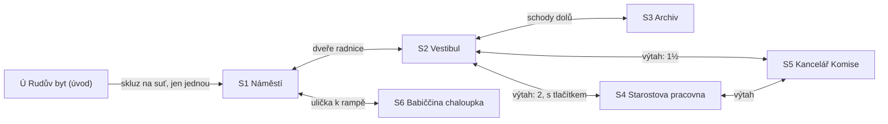

# Kapitola 1: obsah místností a matice předmětů

> Krok N3a a N3d [postupu návrhu](../12-postup-navrhu.md). Co je v každé scéně kapitoly 1,
> jaké předměty kapitola má a jak hra reaguje na jejich použití. Návrh kapitoly je
> v [01-iniciace.md](01-iniciace.md), puzzly v [01-puzzly.md](01-puzzly.md).
> Stav: **návrh**, verze 0.1

Sloupec *Prohlédnout* uvádí podstatu repliky, ne finální text. Finální texty vzniknou v kroku N6.

## Mapa scén

Výtah ve vestibulu jezdí do 1½. patra (Komise). Do 2. patra (starosta) až s tlačítkem „2“
z archivu. Ze S4 a S5 se jezdí výtahem zpátky do vestibulu nebo mezi sebou.

## Ú Rudův byt (úvod, nové pozadí)

Rozestavěný panelák: chybí jedna stěna, výtah vede do 3½. patra. Úvod učí ovládání:
prohlédnout, sebrat, použít, rozhovor.

| Prvek | Druh | Prohlédnout (podstata) | Použít / mluvit | Podmínka | Poznámka |
|---|---|---|---|---|---|
| Stůl s hrnkem kávy | aktivní místo | jediná věc v bytě, která funguje | sebrat → **hrnek kávy** | – | učí sebrat |
| Propiska | aktivní místo | propiska bez inkoustu, „vydrží všechno“ | sebrat → **propiska** | – | |
| Police s knihou | aktivní místo | dárek k narozeninám, nikdy neotevřený | sebrat → **Prof. Pembok** | – | Pembok zatím mlčí |
| Zeď slávy | aktivní místo | 14 diplomů za 14 projektů; č. 9 „týdenní výměna žárovek, 6 let, probíhá“ | Ruda: „To nebyl projekt, to byl provoz.“ | – | V01, volitelné |
| Dveře | aktivní místo | buší na ně věřitelé | rozhovor přes dveře (2–3 volby) | – | učí rozhovor |
| Škvíra pode dveřmi | aktivní místo | – | věřitel prostrčí „stížnost“ k podpisu; Ruda podepíše cizí propiskou a polije papír kávou → **dekret** | hrnek kávy v ruce | cutscéna, vznik dekretu |
| Díra ve zdi | východ | chybějící stěna, výhled na město, skluz na suť | → S1 | dekret, káva, propiska a Pembok v inventáři | jen jednou |

## S1 Náměstí (den, večer)

| Prvek | Druh | Prohlédnout (podstata) | Použít / mluvit | Podmínka | Poznámka |
|---|---|---|---|---|---|
| Kašna | aktivní místo | „Voda v kašně“ ve fázi 2 od 1994 | mince: přání zamítnuto | – | popředí (D50); hotovo v I1 |
| Telefonní budka | aktivní místo | jediná věc s jasným rozsahem | linka pomoci: „jste 4 812. v pořadí“ | – | běžecký vtip 4 812; hotovo v I1 |
| Kometa | aktivní místo | malá tečka, každý den větší | – | – | v I1 přepíná den a večer (jen prototyp) |
| Amplion na lampě | aktivní místo | městský rozhlas, hlásí jen špatné zprávy | – | – | v úvodu ohlásí kometu a jmenování |
| Stánek Pana Změny | aktivní místo | prodává všechno, nikdy dvakrát to samé; zboží balí do plakátu Archy | kávové pero → požadavek | – | P1.3; hotovo v I1 |
| Pan Změna | postava | dvě tužky za každým uchem, žádnou nepoužil | dialog `zmena` | – | |
| Bára | postava | jediná, kdo měří | první rozhovor (R1.3), pak dialog `bara` | – | P1.2; hotovo v I1 |
| Kocour | postava | zrzavý, natržené ucho, soudí | prohlédnout obojek: „Pozemková, pozemek pod rampou“ | – | odhalí babičku (P1.10); toulá se u kašny |
| Dveře radnice | východ | lešení je tu tak dlouho, že je nosné | → S2 | – | v I1 je hlídá vrátný (dočasně) |
| Ulička k rampě | východ | rovná rampa trčí nad křivými střechami | → S6 | – | |

## S2 Vestibul radnice

| Prvek | Druh | Prohlédnout (podstata) | Použít / mluvit | Podmínka | Poznámka |
|---|---|---|---|---|---|
| Vrátný | postava | hlídá dveře, termosku a křížovku | dialog `vratny` | – | P1.1; v I1 zatím na náměstí |
| Výtah | aktivní místo | tlačítka 1 a 1½, místo „2“ díra | → S5; s tlačítkem „2“ → S4 | – | P1.6 |
| Schody nahoru | aktivní místo | „ve fázi 2“, zatarasené páskou | Ruda: nejdou | – | gag, ne puzzle |
| Úřední deska | aktivní místo | „Komise: úřední hodiny příští fáze“ | – | – | náznak Předsedy |
| Schody do sklepa | východ | – | → S3 | – | |
| Dveře ven | východ | – | → S1 | – | |

## S3 Archiv zkrachovalých projektů

| Prvek | Druh | Prohlédnout (podstata) | Použít / mluvit | Podmínka | Poznámka |
|---|---|---|---|---|---|
| Archivář Lumír | postava | hrdý na každý dokončený lístek | dialog `lumir` | – | P1.4 |
| Kartotéka | aktivní místo | seřazená podle plánovaného dokončení, všude „příští rok“ | číst lístky (výtah, most, Archa chybí) | číslo projektu | P1.5, P1.7; část hotova v I1 |
| Lumírova kniha | aktivní místo | kniha skutečných dat zahájení | číst | – | klíč k P1.5 |
| Regál s krabicemi | aktivní místo | krabice podle čísel lístků | Lumír vydá krabici podle čísla z lístku | číslo krabice z kartotéky | P1.6 |
| Mapník | aktivní místo | katastrální mapy, „mapy nejsou projekty“ | sebrat → **katastrální mapa** | – | P1.9 |
| Hluboký regál | aktivní místo | zvenku hlubší než zevnitř (jen Bára si všimne) | Bára: metr → přihrádka | úsek za Báru | P1.12 |
| Schody | východ | zábradlí končí v půlce | → S2 | – | hotovo v I1 |

## S4 Starostova pracovna (2. patro)

| Prvek | Druh | Prohlédnout (podstata) | Použít / mluvit | Podmínka | Poznámka |
|---|---|---|---|---|---|
| Starosta Bohumil | postava | stuha a nůžky vždy po ruce | dialog `starosta`, M03 | – | P1.8 |
| Noviny na stole | aktivní místo | starosta na titulní straně, vždy u nedokončené stavby | – | – | nápověda: chce být v novinách |
| Fotky na zdi | aktivní místo | starosta stříhá pásky u 40 nedokončených staveb | – | – | gag |
| Okno | aktivní místo | výhled na kometu | – | – | |
| Výtah | východ | – | → S2, S5 | – | |

## S5 Kancelář Komise (1½. patro)

| Prvek | Druh | Prohlédnout (podstata) | Použít / mluvit | Podmínka | Poznámka |
|---|---|---|---|---|---|
| Předseda Věčný | postava | vlídný, vše „důkladně odloží“ | dialog `predseda` | – | P1.13, R1.4 |
| Fronta na frontu | aktivní místo | fronta, do které se stojí ve frontě | postavit se → úsek za Báru | charter hotový | P1.11 |
| Ing. Framework | postava | kufr krabic s metodikami | dialog `framework` | – | jen ve frontě |
| Cedule | aktivní místo | „Úřední hodiny: příští fáze“ | – | – | |
| Razítko a poduška | aktivní místo | poduška vyschlá „ve fázi 2“ | babiččina poduška / káva → razítko | charter, Předseda souhlasí | P1.13 |
| Stůl pro žadatele | aktivní místo | sem se skládá charter | M02, pak M01 | podpis sponzora, původní zadání | P1.9, P1.11 |
| Telefon | aktivní místo | – | – | – | konec kapitoly |
| Výtah | východ | – | → S2, S4 | – | |

## S6 Babiččina chaloupka (pod rampou)

| Prvek | Druh | Prohlédnout (podstata) | Použít / mluvit | Podmínka | Poznámka |
|---|---|---|---|---|---|
| Babička Pozemková | postava | jediná dokončená stavba ve městě je její | dialog `babicka` | o pozemku jen se znalostí (mapa / obojek) | P1.10, R1.2 |
| Kocour | postava | sedí na plotě, když není na náměstí | – | – | |
| Plot | aktivní místo | suť končí přesně u plotu | – | – | gag: jediná hranice rozsahu ve městě |
| Rampa | aktivní místo | jediná rovná stavba ve městě (D34) | – | – | zárodek kap. 2 |
| Lavička u dveří | aktivní místo | – | sednout: babička nabídne buchtu | spojenec | gag |
| Ulička | východ | – | → S1 | – | |

## Předměty

Ruda má 15 předmětů, Bára 2 (ikony 1–17, D52).

| # | Předmět | Kde vznikne | Kdy | Spotřebuje se | Ikona |
|---|---|---|---|---|---|
| 1 | Jmenovací dekret | Ú, škvíra pode dveřmi | úvod | ne (důkaz, kdo je Ruda) | ikony-1 #1 |
| 2 | Hrnek kávy | Ú, stůl | úvod | nikdy (nekonečný) | ikony-1 #2 |
| 3 | Propiska bez inkoustu | Ú, stůl | úvod | kombinací s kávou | ikony-1 #3 |
| 4 | Kávové pero | propiska + káva | kdykoli | ne | ikony-1 #4 |
| 5 | Prof. Pembok | Ú, police | úvod | ne (nápověda) | ikony-1 #5 |
| 6 | Plakát Archy | S1, Pan Změna | cesta B k číslu | ne | ikony-1 #6 |
| 7 | Požadavek Pana Změny | S1, kávové pero na stánek | cesta B | ne (vrací se v kap. 3) | ikony-1 #7 |
| 8 | Tlačítko „2“ | S3, krabice výtahu | po vstupu do archivu | ve výtahu | ikony-1 #8 |
| 9 | Původní zadání Archy | S3, kartotéka | po seřazení | v M01 (útržek cíle) | ikony-1 #9 |
| 10 | Karta poučení (Most 1974) | S3, Lumír | po výpůjčce kávovým perem | ne (replika do M03) | ikony-2 #1 |
| 11 | Katastrální mapa | S3, mapník | po vstupu do archivu | ne (M02, babička) | ikony-2 #2 |
| 12 | Razítková poduška | S6, babička | jen spojenec (R1.2) | při razítku | ikony-2 #3 |
| 13 | Podpis sponzora | S4, starosta | po M03 | v M01 | ikony-2 #4 |
| 14 | Charter | S5, M01 | po M02 | při razítku | ikony-2 #5 |
| 15 | Klíč od hangáru | S5, Předseda | konec | ne (kap. 2) | ikony-2 #6 |
| 16 | Metr (Bára) | Bářin inventář | úsek za Báru | ne | ikony-2 #7 |
| 17 | Seznam pasažérů (Bára) | S3, skrytá přihrádka | úsek za Báru | ne (kap. 4, D59) | ikony-2 #8 |

**Kontrola slepých uliček:** žádný předmět nejde ztratit, prodat ani dát pryč dřív, než je
potřeba. Pan Změna o předměty žádá, ale nikdy si žádný nevezme. Káva je nekonečná, propiska
zanikne jen v kávovém peru. Tlačítko „2“ zůstane ve výtahu natrvalo. Podpis sponzora a zadání
zůstávají v charteru.

## Matice předmětů

✔ = řešení, ★ = vlastní reakce (vtip), – = výchozí reakce (`obecne_pouzit_s`). Přepínat
předměty mezi sebou: propiska + káva ✔ (kávové pero), dekret + káva ★, plakát + dekret ★,
požadavek + Pembok ★, karta poučení + Pembok ★.

| Předmět ↓ / cíl → | Bára | Pan Změna / stánek | Vrátný | Lumír | Kartotéka / regál | Výtah | Starosta | Předseda | Razítko | Babička | Kocour | Framework |
|---|---|---|---|---|---|---|---|---|---|---|---|---|
| Dekret | ★ (změří skvrnu) | ★ | ★ (luští dál) | ★ (založí ho) | – | – | ★ (nepozná vlastní podpis) | ★ | – | ★ | – | ★ |
| Hrnek kávy | ★ | ★ (nedám) | ★ (má termosku) | ★ (ne v archivu!) | – | – | ★ | ★ | ✔ (hnědé razítko) | ★ | ★ (kocour pohrdá) | ★ |
| Propiska | ★ | ★ (prázdná) | – | ★ | – | – | – | ★ | – | – | – | – |
| Kávové pero | ★ | ✔ (požadavek) | ★ (křížovka) | ✔ (výpůjčka karty) | – | – | ★ | ★ | ★ (pero není razítko) | – | – | ★ |
| Plakát | ★ (číslo sedí) | ★ | ★ | ✔ (číslo projektu) | – | – | ★ | – | – | – | – | – |
| Požadavek | ★ | ★ (hrdě ho pozná) | – | ★ | – | – | – | ★ | – | – | – | ★ |
| Tlačítko „2“ | – | – | ★ | – | – | ✔ | – | – | – | – | – | – |
| Původní zadání | ★ (pozná ho) | – | – | ★ | – | – | ✔ (replika M03) | ★ (zbledne) | – | – | – | – |
| Karta poučení | ★ | – | – | ★ | – | – | ✔ (replika M03) | – | – | ★ (rybáři) | – | – |
| Katastrální mapa | – | – | – | – | – | – | – | – | – | ✔ (téma pozemek) | – | – |
| Podpis sponzora | – | – | – | – | – | – | ★ | ★ | – | – | – | – |
| Charter | ★ | ★ | – | – | – | – | – | ✔ (razítko) | ✔ | – | – | ★ |
| Razítková poduška | – | – | – | – | – | – | – | ★ | ✔ (modré razítko) | – | – | – |

Cíl matice: každá kombinace, kterou hráči při playtestu prototypu (N8) zkusí víckrát,
dostane ★. Odhad: 45 vlastních reakcí.
