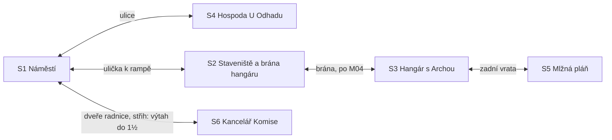

# Kapitola 2: obsah místností a matice předmětů

> Krok N3a a N3d [postupu návrhu](../12-postup-navrhu.md). Co je v každé scéně kapitoly 2,
> jaké předměty kapitola má a jak hra reaguje na jejich použití. Návrh kapitoly je
> v [02-planovani.md](02-planovani.md), puzzly v [02-puzzly.md](02-puzzly.md).
> Stav: **schváleno** (D69), verze 0.2 (zapracována autorská kontrola, D68)

Sloupec *Prohlédnout* uvádí podstatu repliky, ne finální text. Finální texty vzniknou v kroku N6.
**K** v poznámce = podezřelá věc pro Krabici od bot: s krabicí v inventáři se prohlédnutím zapíše.

## Mapa scén

Zadní vrata hangáru jsou otevřená od začátku (tudy chodí Bára, K1), ale Mlžná pláň nabídne minihru až po R2.2, M07
a odhadu (Pembok řekne, co chybí). Do Komise jde kdykoli; bez plánu cesty Předseda jen „vítá“.

## S1 Náměstí (ráno, převzaté)

Pozadí z kapitoly 1 v ranní verzi (D51 má den a večer; ráno = denní verze s jiným světlem,
nebo denní beze změny, rozhodne se v grafice). Změny proti kapitole 1: Bára u kašny není
(je v hangáru), přibyli obyvatelé s kufry.

| Prvek | Druh | Prohlédnout (podstata) | Použít / mluvit | Podmínka | Poznámka |
|---|---|---|---|---|---|
| Telefonní budka | aktivní místo | tady Ruda přespal; „nejlepší ubytování ve městě, má dveře“ | linka pomoci: „jste 4 812. v pořadí“ (návrat) | – | úvod; 4 812 (D64) |
| Amplion | aktivní místo | hlásí dny do dopadu a starostovy vzkazy | – | – | úvod; vzkaz podle `c1_slib_vseho` |
| Kometa | aktivní místo | větší než včera | – | – | s krabicí: „To není riziko. To je termín.“ |
| Kašna | aktivní místo | pořád „ve fázi 2“ | – | – | |
| Obyvatelé s kufry | aktivní místo (skupina) | čekají „na nástup“; nikdo neví kam, kudy ani kdy | mluvit: „Kudy se nastupuje?“ „To nám řekněte vy.“ | – | **K** nástup |
| Stánek Pana Změny | aktivní místo | dnes prodává věci, které nemá | – | – | |
| Pan Změna | postava | dvě tužky za ušima | dialog `zmena` | podle `c1_zmena_dohoda` | |
| Ulice k hospodě | východ | vývěsní štít „U Odhadu“ | → S4 | – | první východ, který hráč uvidí |
| Ulička k rampě | východ | rampa trčí nad střechami a končí ve vzduchu | → S2 | – | |
| Dveře radnice | východ | lešení, nosné | → S6 | – | střih: „výtah do 1½. patra“ |

## S2 Staveniště rampy a brána hangáru (nové pozadí)

Pod rampou z roku 1994, která končí ve vzduchu. Vlevo brána hangáru, uprostřed jeřáb, vpravo
babiččin plot (chaloupka mimo obraz). Hlavní scéna kapitoly 3.

| Prvek | Druh | Prohlédnout (podstata) | Použít / mluvit | Podmínka | Poznámka |
|---|---|---|---|---|---|
| Brána hangáru | aktivní místo | plechová, na ní cedule „Archa. Nevstupovat. Komise 1994.“ | klíč → brána se pootevře, slon | – | P2.1 |
| Slon | aktivní místo | třicet let rozdělané práce svázané do tvaru slona; jedna stará čára křídou pod uchem | křída → M04 | před M04 | P2.1; po M04 zmizí |
| Rampa | aktivní místo | rovná, do půlky hotová, končí ve vzduchu | – | – | D34; konec kapitoly |
| Jeřáb | aktivní místo | jediný ve městě; kabina zamčená; cedule „Obsluha jen s průkazem“ | – | – | stopa ke konci; po stopě k vrátnému Ruda: „Vrátný? Zeptám se ho, až bude jeřáb potřeba.“ (K15) |
| Lano jeřábu | aktivní místo | prasklé lanko trčí z navijáku; cedule „Lano měněno: 1994“ | – | – | **K** lano; po R2.3 = `lano` nové |
| Domíchávač betonu | aktivní místo | míchá od rána, nikdo neví co | – | – | gag; na konci první beton |
| Babiččin plot | aktivní místo | podle `c1_babicka`: `spojenec` mává a nechá na plotě buchtu / `odmitnuta` zatažená záclona („Babička si pamatuje, že jsem spěchal.“) / `prehlizena` a `neodhalena` jen prádlo, nikdo nemává | buchta: „Tohle je jediná věc tady, co je dopečená.“ | spojenec | jen zmínka, následek v kap. 4 (K10) |
| Kocour | postava | babiččin zrzavý kocour z kap. 1 sedí na plotě a soudí | krabice nebo obálka: „Tenhle krysy nehoní. Ten soudí lidi.“ | – | převzatý sprite (K11) |
| Dveře skladu | aktivní místo | „Zamčeno. Uvnitř něco šustí.“ | – | – | připraveno pro kap. 3 (sklad, krysy; N4 kap. 3, K8) |
| Ulička | východ | – | → S1 | – | |
| Brána (otevřená) | východ | – | → S3 | po M04 | |

## S3 Hangár s Archou (nové pozadí)

Archa je rezavá loď s přidělanými motory. Na stěně Rudův Gantt (nakreslí ho zbytkem křídy při
prvním příchodu: „Kousek zbyl. Na Gantt vždycky zbyde.“, K19), vedle tabule s magnety a kalendář.
Při `c1_charter_kvalita` = 3 visí nad tabulí cíl z papíru o Arše (K13). Po M04 se u Archy usadí zbytek mlžné půlky slona.

| Prvek | Druh | Prohlédnout (podstata) | Použít / mluvit | Podmínka | Poznámka |
|---|---|---|---|---|---|
| Archa | aktivní místo | vrak; „kdyby rez byla palivo, už jsme na Měsíci“ | – | – | |
| Kokpit Archy | aktivní místo | sedadlo, volant od autobusu, krabice od bot | vzít → **krabice od bot** (s obálkou) | – | P2.5 |
| Kabely pod Archou | aktivní místo | okousané, malé zuby, hodně zubů | – | – | **K** krysy |
| Výkresy z roku 1994 | aktivní místo | rampa, trup, pohon a bezpečnostní systém mají výkres; řídicí systém a kajuty: „dopracuje se podle potřeb obyvatel“ | – | – | stopa R2.2 |
| Rudův Gantt na stěně | aktivní místo | 214 řádků, i „naprogramovat řízení: úterý“ | – | – | gag; po R2.2 = `povaha` Ruda polovinu přeškrtne |
| Tabule s magnety | aktivní místo | osm magnetů, všechny v Rudově sloupci; sloupce „Rudův způsob: výkres a termín“ a „Bářin způsob: zkusit a ukázat“ | rozdělení (R2.2): nechat / krabice / rozdělit část po části | potvrdit jen s týmem | P2.4 (K4, K16) |
| Cíl nad tabulí | aktivní místo | „Odvézt všechny obyvatele.“ „Všechny. Ne jen ty, co umějí číst výkresy.“ | – | `c1_charter_kvalita` = 3 | stopa R2.2 (K13) |
| Kalendář | aktivní místo | odtrhávací odpočet; dnes „zbývá 27“, poslední list „Den dopadu“ | vzít → **list „Den dopadu“** | – | P2.8; Ruda: „Ať to aspoň vypadá, že máme čas.“ |
| Stůl | aktivní místo | sem se vysype krabice | krabice → M07 | aspoň 3 lístky | P2.5 |
| Bára | postava | měří trup, nikoho si nevšímá; přišla zadními vraty („Zadem. Přes mlhu. Tudy nikdo jiný nechodí.“) | dialog `bara` | – | rady podle `c1_bara_vyslechnuta` (K1); krabici pozná (K14) |
| Předseda | postava | stojí u vrat a usmívá se; „kontrolní návštěva“ | dialog `predseda_hangar` | do potvrzení R2.2 | **K** úsměv; předá formulář při `c1_razitko` = `kava` |
| Ing. Framework | postava | kufr plný krabic | dialog `framework` | od prvního použití tabule do potvrzení R2.2 | nabídka krabice (R2.2) |
| Tým | postavy | 4 vybraní kandidáti | krátké repliky, podpisy formuláře | po R2.1 | |
| Boční dveře | aktivní místo | „Bářin kout. Zatím jen bedny.“ | – | – | připraveno pro kap. 3 (dílna; N4 kap. 3, K8) |
| Žebřík k Arše | aktivní místo | „Dovnitř zatím ne. Je tam hlavně rez.“ | – | – | připraveno pro kap. 3 (trup; N4 kap. 3, K8) |
| Zadní vrata | východ | za nimi mlha | → S5 | – | |
| Brána | východ | – | → S2 | – | |

## S4 Hospoda U Odhadu (nové pozadí)

Hospoda bez obsluhy (cedule „Obsluha: fáze 2“), štamgasti u kulatého stolu, kandidáti po celé
místnosti. Pije se „limonáda z fáze 2“ (PEGI 12).

| Prvek | Druh | Prohlédnout (podstata) | Použít / mluvit | Podmínka | Poznámka |
|---|---|---|---|---|---|
| Tabule „Odhad dne“ | aktivní místo | „Odhad dne: dva dny“; u ní křída | vzít → **křída** | – | P2.1 |
| Sázková tabule | aktivní místo | sázky „za kolik dní bude…“, všechny „dva dny“, všechny prohrané | odhad rampy (P2.3): štamgasti kotví, tácky dostane tým | po R2.1 | P2.3 (K3) |
| Výčep s tácky | aktivní místo | tácky, na které se dá psát | vzít → **tácky** | – | P2.3 |
| Štamgasti | aktivní místo (skupina) | odhadují všechno, hlavně cizí práci | mluvit: kotva „dva dny“; stopa k jeřábu | – | P2.3; tácky na štamgasty ★ „Oni rampu stavět nebudou.“ |
| Hrací automat | aktivní místo | hraje jednu písničku od roku 1994 | zkouška Pepy | – | |
| Viklavý stůl | aktivní místo | viklá se tak dlouho, že je to tradice | zkouška Věry a Zdendy | – | |
| Hasicí přístroj | aktivní místo | červený, prošlý, nikdo to neví | zkouška Norberta | – | |
| Lavice u okna | aktivní místo | nikdo na ní nesedí a nikdo neví proč | zkouška Kláry | – | stopa P2.3 (Klára se ptá každého zvlášť) |
| Inzerát | aktivní místo | „Daruji kočku. Na všechno připravená. Krmení na rok si platí nový majitel.“ | – | – | stopa R2.3 = `krysy` |
| Pepa „Dva dny“ | postava | sedí u automatu, sleduje ho | dialog `pepa` | – | **K** odhad (prohlédnout, nebo jeho „dva dny“ u sázkové tabule) |
| Věra Výztužná | postava | měří hospodu svinovacím metrem | dialog `vera` | – | |
| Norbert Norma | postava | sedí rovně, čte normu o sezení | dialog `norbert` | – | |
| Klára Maketová | postava | lepí kajutu z tácků | dialog `klara` | – | |
| Zdenda Známý | postava | zdraví všechny jménem, i automat | dialog `zdenda` | – | stopa ke konci (jeřáb) |
| Kryštof Krabička | postava | rozdává lepicí lístky | dialog `krystof` | – | |
| Dveře | východ | – | → S1; s vybranými čtyřmi potvrzení týmu | potvrzení až po prvním příchodu do hangáru; předtím „Nejdřív se podívám, co ta Archa vůbec potřebuje.“ | R2.1 (K2) |

## S5 Mlžná pláň (nové pozadí, levné)

Okraj pláně za hangárem: kus trávy, rozcestník bez šipek, dál jen mlha. M06 je překryvná
obrazovka mapy.

| Prvek | Druh | Prohlédnout (podstata) | Použít / mluvit | Podmínka | Poznámka |
|---|---|---|---|---|---|
| Mlha | aktivní místo | „Mapa je hotová. Je bílá.“ | – | – | |
| Rozcestník | aktivní místo | bez šipek; cedule „Sem“ | – | – | gag |
| Bára | postava | čeká s tužkou | M06 (spolu) | vstupy M06 | rady podle důvěry |
| Místo na mapu (velký kámen) | aktivní místo | – | použít → M06 | R2.2, M07, odhad | P2.7 |
| Zadní vrata | východ | – | → S3 | – | |

## S6 Kancelář Komise (převzatá)

Pozadí z kapitoly 1. Změny: fronta na frontu je kratší („jen fronta“), na stole razítková
poduška z kapitoly 1 (podle `c1_razitko` babiččina modrá, nebo hnědě zaschlá od kávy).

| Prvek | Druh | Prohlédnout (podstata) | Použít / mluvit | Podmínka | Poznámka |
|---|---|---|---|---|---|
| Předseda | postava | vlídný jako vždy | dialog `predseda` | – | P2.8 |
| Fronta | aktivní místo | dnes jen fronta, bez fronty na frontu; „pokrok“ | – | – | gag |
| Razítko | aktivní místo | podle `c1_razitko` | – | – | |
| Telefon | aktivní místo | mlčí | – | – | zvoní jen v kap. 1 a 4 |
| Výtah | východ | – | → S1 (střih) | – | |

## Předměty

Ruda má 13 předmětů, z toho 4 přenesené z kapitoly 1. Ikony nových předmětů vzniknou podle
stylové bible (D52 platí pro kap. 1).

| # | Předmět | Kde vznikne | Kdy | Spotřebuje se | Poznámka |
|---|---|---|---|---|---|
| 1 | Prof. Pembok | z kap. 1 | – | ne | nápověda |
| 2 | Hrnek kávy | z kap. 1 | – | nikdy | |
| 3 | Kávové pero (nebo propiska) | z kap. 1 | – | ne | propisku jde s kávou spojit i tady |
| 4 | Klíč od hangáru | z kap. 1 | – | na bráně (zůstane v zámku) | |
| 5 | Křída | S4, tabule „Odhad dne“ | kdykoli | v M04 (zbytek na Gantt v hangáru) | |
| 6 | Tácky | S4, výčep | kdykoli | v P2.3 | |
| 7 | Odhad na tácku | P2.3 | po R2.1 | v M06 | „15“, nebo „2“ při kotvě |
| 8 | Krabice od bot | S3, kokpit | po M04 | ne (vrací se v kap. 3–4) | lístky přibývají |
| 9 | Obálka „Na nepředvídané“ | v krabici | s krabicí | v M07 | |
| 10 | Formulář | Předseda v S3 | jen `c1_razitko` = `kava` | v S6 | P2.6 |
| 11 | List „Den dopadu“ | S3, kalendář | jen `c1_faze2` | v S6 | P2.8 |
| 12 | Plán cesty ke startu | M06 | po M06 | v S6 (orazítkovaný zůstane) | |
| 13 | Buchta | S2, babiččin plot | jen spojenec | sní se (★ kdekoli) | gag |

**Kontrola slepých uliček:** křída a tácky leží v hospodě od začátku a neubývají (vezme se jen
jeden kus, další zůstane na tabuli a výčepu). Obálka se nedá utratit jinde než v M07. Formulář
nejde ztratit ani odevzdat bez podpisů. List kalendáře jde utrhnout i bez `c1_faze2`, jen
se nepoužije (★ u Předsedy).

## Matice předmětů

✔ = řešení, ★ = vlastní reakce (vtip), – = výchozí reakce. Předměty mezi sebou: propiska + káva ✔
(kávové pero, pokud chybí), křída + tácky ★ („Odhad se píše tužkou. Nebo křídou. Hlavně
potajmu.“), obálka + Pembok ★, odhad na tácku + plán ★. Krabice nebo obálka na kocoura ★ je
v tabulce scény S2 (K11).

| Předmět ↓ / cíl → | Slon | Brána | Jeřáb / lano | Tabule | Kalendář | Sázková tabule / štamgasti | Bára | Pepa | Věra | Norbert | Klára | Zdenda | Kryštof | Framework | Předseda | Pan Změna |
|---|---|---|---|---|---|---|---|---|---|---|---|---|---|---|---|---|
| Hrnek kávy | ★ | – | – | – | – | ★ | ★ | ★ | – | ★ (norma o tekutinách) | – | ★ | – | ★ | ★ | ★ |
| Kávové pero | ★ | – | – | ★ | – | – | ★ | – | – | ★ | – | – | ★ | ★ | ★ | ★ |
| Klíč od hangáru | ★ | ✔ | ★ | – | – | – | – | – | – | – | – | – | – | – | ★ | – |
| Křída | ✔ (M04) | – | – | ★ | – | ★ | – | – | – | – | – | – | – | – | – | – |
| Tácky | – | – | – | – | – | ★ (nebudou stavět) | ★ | ✔ (P2.3) | ✔ | ✔ | ✔ | ✔ | ✔ | – | – | – |
| Odhad na tácku | – | – | – | ★ | – | ★ | ★ | ★ (dva dny?) | – | – | – | – | – | ★ | ★ | – |
| Krabice od bot | ★ | – | ✔ (zapsat lano) | – | – | ✔ (zapsat dva dny) | ★ | – | – | – | – | – | – | ★ | ✔ (zapsat úsměv) | – |
| Obálka | – | – | ★ | – | – | – | ★ | – | – | – | – | ★ | – | ★ (chce ji) | ★ | ★ |
| Formulář | – | – | – | – | – | – | ★ | ✔ | ✔ | ✔ | ✔ | ✔ | ✔ | ★ | ✔ (odevzdat) | – |
| List „Den dopadu“ | – | – | – | – | – | – | – | – | – | – | – | – | – | – | ✔ (fáze 2) | – |
| Plán cesty | – | – | – | – | – | – | ★ | – | – | – | – | – | – | ★ | ✔ | ★ |
| Buchta | ★ | – | – | – | – | – | ★ | ★ | – | – | – | ★ | – | – | – | – |

Zapsání podezřelé věci krabicí jde i prohlédnutím (sloupce ✔ u krabice jsou totéž jako
prohlédnutí s krabicí v inventáři). Krysy a nástup se zapíšou prohlédnutím kabelů a obyvatel. Tácky (P2.3) se dávají členům týmu
po R2.1, ✔ platí jen pro ně (K3); u sázkové tabule pak Ruda otočí všechny najednou.
Formulář podepíšou jen ti z kandidátů, kteří jsou v týmu (✔ u všech šesti platí jen pro členy
týmu); ostatní ★ („Nejsem v týmu, nemám co podepsat.“).

Cíl matice: každá kombinace, kterou hráči při playtestu (N8) zkusí víckrát, dostane ★. V matici je
52 vlastních reakcí včetně kombinací předmětů a „Nejsem v týmu“ (N4: původní odhad 40 byl nízký).
