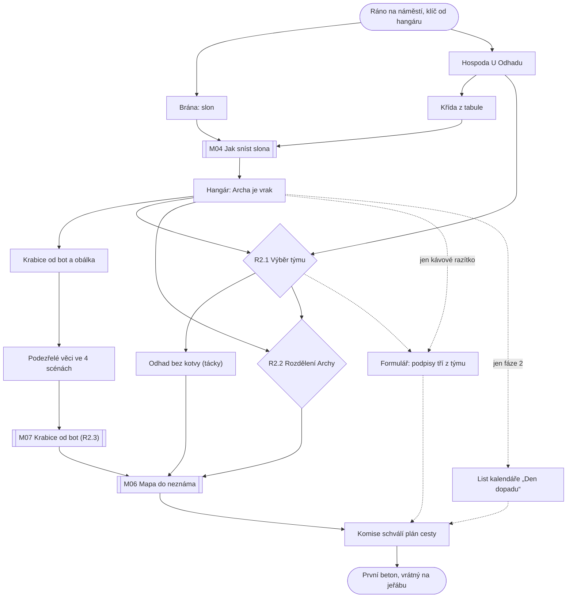

# Kapitola 2: Plánování – rozdělení Archy

> Podrobný návrh kapitoly 2. Vznikl z kostry (N2, D62) v kroku N3
> [postupu návrhu](../12-postup-navrhu.md).
> Stav: **návrh do detailu (N3) schválen** (D69), **texty první verze** (N6, D83), verze 0.4
> Podrobnosti: [obsah místností a matice předmětů](02-mistnosti.md), [karty puzzlů](02-puzzly.md),
> [průchod hrou](02-pruchod.md), [osnovy dialogů](02-dialogy.md), [scénář](02-scenar.md),
> [autorská kontrola](02-kontrola.md)

## Přehled

| | |
|---|---|
| **Titulek kapitoly** | *Plán na všechno* / *A Plan for Everything* |
| **Cíl hráče** | sestavit tým, rozdělit Archu podle povahy práce a nechat schválit plán cesty ke startu, aby se mohlo začít stavět |
| **Délka** | 55–75 minut |
| **Patro v popředí** | rozdělení Archy ([koncepce](../07-dva-svety.md)) |
| **Výuková témata** | V06 rozpad práce, V07 odhady, V08 roadmapa, V09 rizika, V10 tým, V11 volba přístupu ([matice](../02-vyukova-matice.md)) |
| **Minihry** | M04 Jak sníst slona, M07 Krabice od bot, M06 Mapa do neznáma |
| **Rozhodnutí** | R2.1 tým, R2.2 rozdělení Archy, R2.3 riziko předem |
| **Rudova vada** | plánuje do mlhy: chce Gantt na všechno, i na software |
| **Hraní za Báru** | ne (D59) |
| **Kometa** | o kousek větší; dny do dopadu ubývají na kalendáři v hangáru (27 → 25) |

## Místo v koncepci Dva světy, jedna Archa

Kapitola 2 je **rozdělení Archy**. Hráč poprvé vidí, že Archa má dvě povahy, a to dřív, než
o tom kdokoli promluví:
- **Slon v bráně** má kamennou a mlžnou půlku (M04). Kamenná se dá naporcovat celá, mlžná jen
  kousek dopředu. Bezpečnostní systém je v kamenné půlce, interiér v mlžné: první stopa k výjimkám.
- **Tabule v hangáru** (R2.2) je místo, kde hráč pravidlo vysloví rukama: každou část přiřadí
  Rudovu, nebo Bářinu způsobu.
- **Mapa do neznáma** (M06) hned ukáže, jestli rozdělení dává smysl: části se na mapu dostanou
  podle tabule. Kdo dal všechno Rudovi, kreslí software jako silnici do mlhy a mapa se mu rozpadá.

Ruda chce Gantt na všechno, Ing. Framework krabici na všechno. Bára by nejraději neplánovala nic,
ale do mapy kreslí řeku: v kapitole 2 je poprvé vidět, že bez jejího způsobu to nejde a bez
Rudova termínu taky ne.

## Výchozí stav

Z kapitoly 1 má Ruda v inventáři **Prof. Pemboka**, **hrnek kávy**, **kávové pero** (nebo
propisku, pokud pero nevyrobil) a **klíč od hangáru**. Ostatní předměty kapitoly 1 hra uloží
(Ruda: „Papíry nechám doma. Teda… v budce.“) a jejich následky nesou příznaky.

| Příznak z kap. 1 | Jak se projeví v kapitole 2 |
|---|---|
| `c1_bara_vyslechnuta` ≥ 2 | Bára u tabule sama naznačí, podle čeho dělit, a na Mlžné pláni radí; jinak jen měří a mlčí |
| `c1_slib_vseho` ≥ 3 | amplion ohlásí starostův vzkaz „všechno, hned, a ještě fontánu“; na tabuli přibudou magnety Fontána, Bazén a Terasa, které je třeba sundat |
| `c1_mimo_rozsah` (nový, viz níže) | kdo měl v papíru o Arše dobrou kolonku „Co na Archu nepatří“ (bazén, terasa, fontána), tomu se žádný z těch tří magnetů na tabuli neobjeví ani po slibu; Pembok: „Fontánu máš v papíru mezi věcmi, které na Archu nepatří. Aspoň něco.“ (K12) |
| `c1_charter_kvalita` = 3 | nad tabulí visí cíl z papíru o Arše „Odvézt všechny obyvatele“: další stopa, proč nástup a interiér patří Báře (K13) |
| `c1_faze2` | Předseda chce do plánu připsat „fázi 2“ za start; hráč ji musí vyjednat pryč (P2.8) |
| `c1_razitko` = `kava` | Předseda při návštěvě hangáru předá formulář navíc „k uznání hnědé barvy“ (P2.6) |
| `c1_babicka` | babiččin plot u staveniště (jen zmínka, následek v kap. 4): `spojenec` mává a nechá na plotě buchtu; `odmitnuta` zatažená záclona; `prehlizena` a `neodhalena` jen prádlo, nikdo nemává (K10) |
| `c1_zmena_dohoda` | Pan Změna stojí za modrou; bez dohody chce Archu pokaždé jinou |

**Nový příznak `c1_mimo_rozsah`** se nastaví v M01 kapitoly 1, když hráč do kolonky „Co na Archu
nepatří“ dá dobrý útržek. Kostra kapitoly 2 s ním počítala, v kapitole 1 chyběl. Doplněn
do [návrhu kapitoly 1](01-iniciace.md#m01-charter-z-trosek-útržky) a do mapy následků v bibli.

## Scény

| # | Scéna | Nová / převzatá | Postavy | Co se tu děje |
|---|---|---|---|---|
| S1 | **Náměstí** (ráno) | převzatá (kap. 1) | Pan Změna, obyvatelé s kufry (pozadí) | úvod, starostův vzkaz, riziko nástupu |
| S2 | **Staveniště rampy a brána hangáru** | nová | slon, babiččin kocour na plotě, vrátný (na konci) | M04, jeřáb s prasklým lanem, babiččin plot, první beton |
| S3 | **Hangár s Archou** | nová | Bára, Předseda (návštěva), Ing. Framework, tým | Archa je vrak, tabule (R2.2), krabice od bot (M07) |
| S4 | **Hospoda U Odhadu** | nová | 6 kandidátů, štamgasti (pozadí) | nábor (R2.1), odhad bez kotvy, křída a tácky |
| S5 | **Mlžná pláň** | nová | Bára | M06; pozadí je z velké části mlha, proto levné |
| S6 | **Kancelář Komise** | převzatá (kap. 1) | Předseda | schválení plánu cesty |

Kostra měla bránu hangáru a staveniště rampy jako dvě místa. Jsou na jednom pozadí: brána
hangáru stojí na kraji staveniště pod rampou. Vestibul radnice se nepoužívá: dveře radnice
na náměstí vedou střihem rovnou do kanceláře Komise („výtah do 1½. patra“). Rozpočet 6 scén,
4 nová pozadí, zůstává.

**Rampa z roku 1994 je rovná, ale končí ve vzduchu**: chybí horní polovina a odpalovací plošina.
Dostavba je práce kapitol 2 a 3. Popisek rampy v kapitole 1 („rovná, hotová“) se upravuje na
„rovná, do půlky hotová“.

## Postavy

**Vracející se:** Ruda, Bára, Prof. Pembok, Předseda Věčný, Ing. Framework, Pan Změna, vrátný
(na konci jako jeřábník), babička jen zmínkou.

**Nové: kandidáti do týmu** (jména schválena v D69, D47 platí i pro ně: vtip v každém jazyce zvlášť)

| Kandidát | EN | Svět | Síla | Vada | Zkouška v hospodě |
|---|---|---|---|---|---|
| **Pepa „Dva dny“**, programátor | **Two-Day Joe** | iterace | řídicí systém; opravuje po malých kouscích | na všechno „dva dny“ | hrací automat hraje jednu písničku: Pepa řekne „dva dny“ a za minutu hraje |
| **Věra Výztužná**, statička | **Vera Rebar** | plán | počítá, kreslí výkresy | všechno chce mít na razítku | viklavý stůl: spočítá podložku na milimetr a chce na ni razítko |
| **Norbert Norma**, certifikátor | **Norman Standards** | plán | jediný, kdo smí podepsat start | mluví jen v normách | hasicí přístroj: odrecituje, že má prošlou revizi, a víc neřekne |
| **Klára Maketová**, designérka interiérů | **Mona Mockup** | iterace | staví makety, ptá se lidí | nerozhodne se bez dalšího průzkumu | prázdná lavice u okna: zeptá se štamgastů, postaví maketu z tácků a neví |
| **Zdenda Známý**, Rudův kamarád | **Benny Buddy** | – | sympatický, zná všechny | neumí nic, co Archa potřebuje | viklavý stůl: „Znám chlapa, co zná truhláře.“ |
| **Kryštof Krabička**, Frameworkův asistent | **Chip Checkbox** | zvrhlé iterace | nadšený, má krabice | rituály bez práce | svolá u výčepu poradu o tom, kdy bude porada |

Dobrý tým (4 ze 6) pokrývá stavbu (Věra), zkoušení (Pepa nebo Klára) a podpis startu
(Norbert). Užiteční kandidáti jsou otravní, pasti jsou sympatické: to je celé téma V10. Zdenda
má jednu skutečnou hodnotu: ví, kdo ve městě má průkaz na jeřáb (stopa ke konci kapitoly).

**Štamgasti** jsou skupina v pozadí hospody jako fronta úředníků v kapitole 1: mluví, ale nemají
vlastní list postavy. Bez obsluhy: cedule „Obsluha: fáze 2“.

## Průběh a puzzly

1. **Ráno na náměstí.** Ruda přespal v telefonní budce. Amplion hlásí 27 dní do dopadu a vzkaz
   od starosty (podle R1.1). Ruda: „Dvacet sedm? Vždyť bylo třicet!“ Pembok: „Fronta na frontu
   trvala dva dny. Stál jsi v ní.“ (K8) Pembok: „Klíč máš. Teď potřebuješ plán, lidi a někoho, kdo ten plán
   orazítkuje.“ Ruda: „Plán mám.“ (kreslí Gantt do vzduchu).
2. **Brána hangáru a slon (M04, P2.1).** Klíč pasuje, brána se pootevře a za ní stojí slon:
   třicet let rozdělané práce, svázané do tvaru slona. Strčit do něj nejde. Pembok: „Jak se jí
   slon?“ Slon praskne tam, kde se nakreslí čára, takže je potřeba **křída** z tabule v hospodě.
   **M04 Jak sníst slona:** kamenná půlka se naporcuje celá, mlžná jen v nejbližší části.
3. **Archa je vrak.** Rezavá loď s přidělanými motory. Ruda okamžitě nakreslí zbytkem křídy Gantt
   na stěnu hangáru, i na software. Bára už uvnitř měří trup: přišla zadními vraty přes Mlžnou
   pláň („Zadem. Přes mlhu. Tudy nikdo jiný nechodí.“, K1). Podle důvěry z kapitoly 1 promluví,
   nebo mlčí.
   U vrat stojí **Předseda** na „kontrolní návštěvě“ a usmívá se (podezřelá věc pro M07).
   Na kalendáři je 27.
4. **Nábor v hospodě U Odhadu (R2.1, P2.2).** Šest kandidátů, každý s jednou zkouškou.
   Hráč vybere čtyři. Zkoušet jde hned, potvrdit tým až po prvním příchodu do hangáru: hráč
   nejdřív musí vidět, co Archa potřebuje (K2).
5. **Odhad bez kotvy (P2.3).** Štamgasti sázejí, za kolik dní bude rampa. Pepa vyhrkne „dva dny“
   a všichni se přidají. Kdo dá **tácek** každému z týmu a sobě, ať napíše odhad potají, a otočí
   je najednou, dostane realistický odhad (15 dní). Odhadují ti, kdo budou rampu stavět,
   štamgasti jen kotví (K3). Kdo kotvu přijme, odnese si „dva dny“.
6. **Krabice od bot (M07, P2.5).** V kokpitu Archy leží krabice od bot z roku 1994 s nápisem
   „Co se může pokazit“. Je prázdná, jen s obálkou „Na nepředvídané“. S krabicí v ruce si Ruda
   podezřelé věci zapisuje: okousané kabely (hangár), prasklé lano jeřábu (staveniště),
   Předsedův úsměv (hangár), obyvatele s kufry, kteří nevědí, kudy nastoupit (náměstí),
   a Pepovy „dva dny“ (hospoda). Obálka stačí jen na jednu věc: **R2.3**.
7. **Rozdělení Archy (R2.2, P2.4)** na tabuli v hangáru, až je tým pohromadě. Osm magnetů:
   rampa, trup, pohon, bezpečnostní systém, řídicí systém, aplikace, nástup, interiér.
   Ruda je dal všechny do svého sloupce. Přijde **Ing. Framework** s kufrem a nabídne jednu
   krabici na všechno. Hráč může nechat Gantt, vzít krabici, nebo rozdělit část po části:
   pak se všech osm magnetů sundá doprostřed a hráč umístí každý sám (K4).
8. **Formulář na formulář (P2.6, jen při kávovém razítku).** Předseda chce podpisy tří členů týmu.
9. **Mapa do neznáma (M06, P2.7)** na Mlžné pláni za zadními vraty hangáru. Ruda kreslí cestu,
   Bára řeku. Části jsou na mapě podle tabule. Výsledek je **plán cesty ke startu** s mosty.
10. **Schválení v kanceláři Komise (P2.8).** Předseda plán „vítá“. S `c1_faze2` chce za start
    připsat fázi 2 a hráč mu ukáže, že by začala den po dopadu komety. Pak razítko.
11. **Konec kapitoly.** Na staveništi má být první beton, ale jeřáb nemá kdo řídit. Přijde vrátný
    z radnice: „Nikdo se nikdy nezeptal. Tak jsem přišel sám.“ Má průkaz od roku 1994. Kdo
    stopu k vrátnému slyšel, uslyší: „Prý jste se chtěl zeptat. To je víc, než kolik jsem
    slyšel za třicet let.“ (K15)
    Kometa je větší. Podrobně v části [Úvod a konec](#úvod-a-konec-n3g).

## Rozhodnutí kapitoly

| ID | Kde | Volby | Příznak | Kde se vrátí |
|---|---|---|---|---|
| R2.1 | hospoda U Odhadu | 4 ze 6 kandidátů | `c2_tym` (seznam), `c2_tym_pokryti` (0–3: stavba, zkoušení, podpis startu) | kap. 3: chybí-li dovednost, puzzle oklikou; kap. 5: bez Norberta náhradní puzzle při startu |
| R2.2 | tabule v hangáru | část po části / nechat Gantt na všechno / krabice na všechno | `c2_rozdeleni` = `povaha` / `gantt` / `krabice`; `c2_vyjimky` (0–2) | hned v M06; kap. 3: M13 a M14 se hrají jinak; kap. 4: krize; kap. 5: bezpečnostní systém a interiér |
| R2.3 | Krabice od bot | obálka na krysy / lano / Předsedův úsměv | `c2_riziko_predem` = `krysy` / `lano` / `usmev` | kap. 3: kočka Riziková (krysy), jeřáb bez výpadku (lano); kap. 4: kopie všeho, co Předseda podepsal, zkrátí konfrontaci (úsměv) |

**R2.2 a stavové proměnné:** `povaha` zvedne sladění světů, Bářinu důvěru a Rudův vývoj o 1
(vada „plánuje do mlhy“); `gantt` Bářinu důvěru sníží; `krabice` sníží sladění a dá
Ing. Frameworkovi v kapitole 3 páku na sprinty betonování.

**Další příznaky:** `c2_rozpad` (M04, počet mezer a překryvů, 0–3, 0 je nejlepší),
`c2_odhad` = `realny` / `kotva` (P2.3), `c2_rizika_zapsana` (M07, seznam zapsaných lístků),
`c2_mosty` (M06, seznam funkčních mostů `trup` / `nastup` / `start`, počet 0–3; seznam
zavedla kapitola 3, která potřebuje vědět, který most drží).

## Graf závislostí puzzlů

Plné šipky jsou nutné kroky, tečkované jen pro některé stavy z kapitoly 1. Po otevření hangáru
má hráč rozdělané tři až čtyři věci (nábor, odhad, rizika, rozdělení). Tým jde potvrdit až
po prvním příchodu do hangáru (K2). Úzká místa jsou slon
na začátku a Mlžná pláň na konci.

## Minihry v kapitole 2

Všechny tři se testují až ve hře (D53, D66). Rozhraní nepoužívá odborné pojmy (D26).

### M04 Jak sníst slona

- **Patro:** svět plánu (kamenná půlka) a ukázka světa iterací (mlžná půlka).
- **Příběh:** slon z rozdělané práce blokuje bránu hangáru. Praskne tam, kde Ruda nakreslí
  křídou čáru. Kusy se odvezou v kolečku.
- **Mechanika, kamenná půlka:** čtyři části (rampa, trup, pohon, bezpečnostní systém), v každé
  2–3 místa, která se musí odvézt. Hráč pokládá na obrys slona karty kusů:

| Část | Správné kusy | Pasti |
|---|---|---|
| Rampa | horní dráha, pilíře, odpalovací plošina | *Celá rampa naráz* (nevejde se do kolečka) |
| Trup | kostra, plášť, poklopy | *Celý trup* (nevejde se do kolečka) |
| Pohon | motory, nádrže | *Pilíře a motory* (pilíře jsou už v rampě: překryv) |
| Bezpečnostní systém | pojistky startu, nouzové vypnutí | *Poklopy a pojistky* (poklopy jsou už v trupu: překryv) |

  Kus, který se nevejde do kolečka, slon odmítne hned. Překryv se pozná až při odvozu: kus
  se drolí, protože ho někdo krájel dvakrát. Tlačítko *Stačí, odvezte to!* je dostupné vždy.
  Co zůstane nepokryté, je mezera.
- **Mechanika, mlžná půlka:** čtyři části (řídicí systém, aplikace, nástup, interiér). Ostře
  je vidět jen nejbližší kousek každé části: *první obrazovka*, *přihlášení*, *zkouška
  s deseti lidmi*, *jedna vzorová kajuta*. Karty jako *Celý řídicí systém do posledního
  tlačítka* jde položit dál do mlhy, ale mlha se po chvíli přeskupí a kus se rozplyne. Nic
  se tím nezkazí, jen to stojí čas a Ruda pokaždé řekne, že tohle už kreslil.
- **Konec:** kamenná půlka odjede v kolečkách, mlžná ustoupí o naporcovaný kousek a brána
  je volná. Zbytek mlžné půlky se usadí v hangáru u Archy a čeká (vizuální stopa pro R2.2).
- **Výsledek:** `c2_rozpad` = mezery + překryvy, nejvýš 3. Přeskočení: Pembok naporcuje slona
  „tak nějak“, `c2_rozpad` = 3.
- **Témata:** V06; mlžná půlka připravuje V08 a V11.
- **Riziko návrhu:** skládačka bez výzvy. Výzvou jsou pasti s věrohodnými názvy, ne obtížné
  ovládání.

### M07 Krabice od bot

- **Patro:** společný základ.
- **Příběh:** původní tým Archy si v roce 1994 založil krabici na věci, které se můžou pokazit.
  Nikdy do ní nic nenapsal. Uvnitř je jen obálka „Na nepředvídané“.
- **Sbírání (ve scénách):** s krabicí v inventáři se prohlédnutí podezřelé věci zapíše na lístek.

| Lístek | Kde | Povaha | Rozumná reakce |
|---|---|---|---|
| Okousané kabely (krysy) | S3 hangár, pod Archou | plán | předejít: kočka z inzerátu v hospodě (obálka) |
| Prasklé lano jeřábu | S2 staveniště | plán | předejít: nové lano (obálka) |
| Předsedův úsměv | S3 hangár, u vrat | společný základ | předejít: kopie všeho, co Předseda podepíše (obálka) |
| Nikdo neví, kudy nastoupit | S1 náměstí, obyvatelé s kufry | iterace | zkusit: deset lidí na zkoušku (zdarma) |
| Pepovy „dva dny“ | S4 hospoda | iterace | zkusit: malý kousek a změřit (zdarma) |

  Kometa se zapsat nedá: „To není riziko. To je termín.“
- **Obrazovka minihry** (stůl v hangáru, od tří lístků): hráč položí obálku na jeden lístek.
  U lístků z mlžné povahy obálka nejde: „Na tohle peníze nepotřebuješ. Stačí to zkusit.“
  a lístek dostane zdarma razítko *Zkusíme*. Ostatní lístky zůstanou zapsané a hlídané.
- **Výsledek:** `c2_riziko_predem` (R2.3), `c2_rizika_zapsana` (seznam). Přeskočení není
  potřeba: kdo nechce hledat, otevře minihru se třemi lístky a vybere.
- **Témata:** V09; rozdíl mezi předcházením a levným pokusem.
- **Riziko návrhu:** hledání může být pixel-hunting. Každá podezřelá věc je i bez krabice
  výrazné aktivní místo s vlastním popiskem.

### M06 Mapa do neznáma

- **Patro:** spojka.
- **Příběh:** za zadními vraty hangáru začíná Mlžná pláň, kterou nikdo nezmapoval. Mezi hangárem
  a dnem startu se musí potkat cesta (Rudova) a řeka (Bářina).
- **Mechanika:** mapa má 8 sloupců po třech dnech (zbývá 25 → zbývá 1, start). Hra mluví jen
  o tom, kolik dní zbývá (K8). Nahoře cesta, dole řeka.
  Části Archy jsou na nich podle tabule z R2.2.
  - **Cesta** je vidět 3 sloupce dopředu. Pokládají se přesné dlaždice (úseky rampy, uzavření
    trupu, zkouška pohonu, podpis bezpečnostního systému). Délku rampy určuje odhad z P2.3:
    s realistickým odhadem 5 sloupců, s „dvěma dny“ 1 sloupec. **Kotva (K5):** když mlha odkryje
    druhý sloupec, Ruda řekne „Dva dny… a ještě třináct.“ a rampa se natáhne na 5 sloupců, ale
    o sloupec později. Most *zkouška nástupu na rampě* pak nemá pevný bod: s kotvou nejvýš 2 mosty.
  - **Řeka** je vidět 1 sloupec dopředu. Hrubé dlaždice („něco s nástupem“) jdou položit
    kamkoli, podrobné jen do viditelného sloupce. Po tlačítku *Mlha ustoupí* se odkryje další
    sloupec a řeka může změnit koryto: podrobné dlaždice v mlze se rozplynou, hrubé se přizpůsobí.
  - **Mosty:** tři místa, kde se cesta a řeka musí potkat: *trup se zavírá* (řídicí systém musí
    být uvnitř), *zkouška nástupu na rampě*, *start*. Most drží, když má cesta v jeho sloupci
    pevný bod a řeka tam dorazila aspoň hrubou dlaždicí.
- **Varianty podle R2.2:** `gantt`: všechno je na cestě, software se kreslí jako silnice
  do mlhy a rozplývá se, mosty nemají řeku. `krabice`: všechno je řeka, rampa nemá pevné body
  a mosty nemají kde stát. V obou případech jde mapu dokončit, ale nejvýš s 1 mostem (start).
  Špatně zařazená výjimka udělá díru: bezpečnostní systém v řece nestihne podpis, interiér
  na cestě se po odkrytí mlhy překresluje.
- **Bára** kreslí řeku s hráčem. Při `c1_bara_vyslechnuta` ≥ 2 radí („Řeku dál než kousek
  nekresli.“), jinak kreslí mlčky.
- **Výsledek:** `c2_mosty` (seznam funkčních mostů, 0–3), předmět **plán cesty ke startu**. Přeskočení: Pembok nakreslí
  „rovnou čáru“, `c2_mosty` = [start].
- **Témata:** V08, V11.
- **Riziko návrhu:** nejsložitější pravidla kapitoly. Papírový model pro autora: dva pruhy
  papíru, dlaždice na kartičkách, mlha jako list papíru, který se odsouvá.

## Úvod a konec (N3g)

### Úvod: ráno na náměstí

| Záběr | Kde | Co se stane |
|---|---|---|
| 1 | S1 | titulek *Kapitola 2: Plán na všechno*; Ruda vyleze z telefonní budky, kde přespal |
| 2 | S1 | amplion: „Dnů do dopadu komety: 27.“ a vzkaz od starosty (s `c1_slib_vseho` ≥ 3: „všechno, hned, a ještě fontánu“, jinak: „hlavně ať je to v novinách“); Ruda: „Dvacet sedm? Vždyť bylo třicet!“ Pembok: „Fronta na frontu trvala dva dny. Stál jsi v ní.“ |
| 3 | S1 | Pembok: „Klíč máš. Teď potřebuješ plán, lidi a někoho, kdo ten plán orazítkuje.“ Ruda: „Plán mám.“ (kreslí prstem do vzduchu Gantt) Pembok: „Na co?“ Ruda: „Na všechno.“ |
| 4 | S1 | volná hra; náměstí má nové východy: ulice k hospodě a ulička ke staveništi |

### Konec kapitoly

1. Předseda orazítkuje plán cesty: „Vítám. Vítám.“ (s úsměvem, který si hráč možná zapsal).
   Při `c2_riziko_predem` = `usmev` si Ruda vyžádá **kopie všeho, co Předseda podepsal**:
   „Obálka byla na úsměv. Kopie jsou zdarma.“ (předmět do kap. 4, D81).
2. Staveniště: domíchaný beton čeká, jeřáb stojí. „Kdo umí s jeřábem?“ Ticho.
3. Přijde vrátný z radnice v čepici jeřábníka: „Nikdo se nikdy nezeptal. Tak jsem přišel sám.“
   (návrat k jeho replice z kapitoly 1; se stopou „Prý jste se chtěl zeptat…“). Lano je nové,
   nebo prasklé podle R2.3; prasklé: „Lano? Drží. Zatím.“ (K18, předzvěst M13).
4. První beton na rampě. Kometa je větší. Ruda: „Fáze 1 začala.“ Bára: „Zbývá dvacet pět.“
5. Obrazovka **„Co si Nedostavěnice zapamatovala“**: tým, rozdělení (při Ganttu nebo krabici na
   všechno: „Jedna metodika na všechno. Uvidíme.“), riziko předem a jedna věta o mapě.
   Pokračování příště.

## Kontrola proti zásadám (N3h)

- [x] Pilíře vize: učí mechanika (slon, tabule a mapa nesou rozdíl světů), rozhodnutí mají
  váhu (R2.1–R2.3 se čtou v kap. 3–5), absurdní, ale fér (stopy u každého puzzlu, [karty](02-puzzly.md))
- [x] **Slovník D26:** ve hře „Rudův způsob“ a „Bářin způsob“, „plán cesty ke startu“, „věci,
  které se můžou pokazit“; žádné WBS, roadmapa ani registr rizik v rozhraní ani v replikách
- [x] Žádný puzzle na jazykové hříčce (D03): „Jak sníst slona“ má anglický protějšek
  (*one bite at a time*), mechanika na něm nestojí
- [x] Nic nezávisí na najetí myší (D04)
- [x] Žádná slepá ulička ([kontrola v průchodu](02-pruchod.md#kontrola-slepých-uliček)),
  M04 a M06 přeskočitelné, M07 jde otevřít se třemi lístky (D12)
- [x] Šířka grafu: po otevření hangáru 3–4 rozdělané úkoly ([průchod](02-pruchod.md#šířka-grafu))
- [x] Každý puzzle má aspoň dvě stopy ve světě a tři stupně nápovědy (D10)
- [x] PEGI 12 (D11): hospoda bez alkoholu v popředí (štamgasti mají „limonádu z fáze 2“)
- [x] Rozpočet (D56): 6 scén (4 nové), 6 nových postav, 13 předmětů, odhad 454 replik, 3 minihry
  ([osnovy dialogů](02-dialogy.md#součet))
- [x] Otevřené otázky níže

## Rozsah výroby (odhad)

| Položka | Počet |
|---|---|
| Pozadí scén | 4 nová (staveniště s branou, hangár, hospoda, Mlžná pláň) + 2 převzatá |
| Nové postavy s referenčním listem | 6 kandidátů; slon jako objekt minihry |
| Předměty v inventáři | 13 (z toho 4 přenesené z kap. 1) |
| Minihry | 3 |
| Repliky | odhad 454 na jazyk |

## Otevřené otázky

- [x] Jména a vtipy kandidátů v obou jazycích → tabulka výše (D69)
- [x] Mlžná pláň jako samostatná scéna, nebo jen obrazovka minihry? → samostatná scéna, ale levná
  (mlha); brána hangáru a staveniště sdílejí jedno pozadí, takže rozpočet 6 (4) platí
- [x] Jak se hráč dozví, že vrátný má průkaz na jeřáb? → v kap. 1 to vrátný řekne mimochodem
  (`ch1_vratny_jerab_1`), v kap. 2 to ví Zdenda a cedule na jeřábu; na konci přijde sám
- [x] Titulek kapitoly → *Plán na všechno* / *A Plan for Everything* (D69)
- [x] Hospoda bez obsluhy, nebo hostinský jako sedmá postava? → bez obsluhy, cedule „Obsluha: fáze 2“ (D69)
