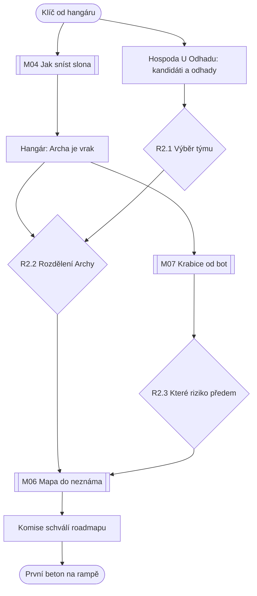

# Kapitola 2: Plánování – rozdělení Archy (kostra)

> Kostra kapitoly z kroku N2 [postupu návrhu](../12-postup-navrhu.md). V kroku N3 se rozroste
> v úplný návrh jako [kapitola 1](01-iniciace.md).
> Stav: **kostra ke schválení**, verze 0.1

## Přehled

| | |
|---|---|
| **Cíl hráče** | sestavit tým, rozdělit Archu podle povahy práce a nechat schválit roadmapu, aby se mohlo začít stavět |
| **Délka** | 55–75 minut |
| **Patro v popředí** | rozdělení Archy ([koncepce](../07-dva-svety.md)) |
| **Výuková témata** | V06 rozpad práce, V07 odhady, V08 roadmapa, V09 rizika, V10 tým, V11 volba přístupu ([matice](../02-vyukova-matice.md)) |
| **Minihry** | M04 Jak sníst slona, M07 Krabice od bot, M06 Mapa do neznáma |
| **Rozhodnutí** | R2.1 tým, R2.2 rozdělení Archy, R2.3 riziko předem |
| **Rudova vada** | plánuje do mlhy: chce Gantt na všechno, i na software |
| **Hraní za Báru** | ne (D59: kapitoly 1, 3, 4 a 5) |
| **Kometa** | o kousek větší; dny do dopadu ubývají na kalendáři v hangáru |

## Průběh v kostce

1. **Brána hangáru.** Klíč od hangáru pasuje, ale bránu zevnitř blokuje obří slon (ztělesnění
   Archy). Kdo ho chce „sníst“ najednou, neuspěje. **M04 Jak sníst slona:** kamenná půlka se
   naporcuje celá, mlžná jen v nejbližší části.
2. **Archa je vrak.** Rezavá loď s přidělanými motory. Ruda okamžitě kreslí Gantt na stěnu
   hangáru. Bára (podle důvěry z kap. 1) mlčí, nebo upozorní, že na půlku věcí nikdo neví,
   co mají dělat.
3. **Nábor v hospodě U Odhadu.** Šest kandidátů do týmu, každý s dovedností a vadou. Hráč je
   poznává rozhovory a malými zkouškami. Pepa „Dva dny“ a štamgasti se předhánějí v odhadech
   a kotví („to jsou dva dny, ne?“). Kdo kotvě odolá, dostane realistický odhad (V07). Výběr
   čtyř je **R2.1**.
4. **Ing. Framework** přijede s kufrem krabic: „Agilní beton“, „Scrum pro rampy“. Nabízí jednu
   krabici na všechno.
5. **Rozdělení Archy (R2.2)** na tabuli v hangáru: každou část (rampa, trup, pohon, bezpečnostní
   systém, řídicí systém, aplikace, nástup, interiér) přiřadit k Rudovu, nebo Bářinu způsobu.
   Dvě schválné výjimky (bezpečnostní systém, interiér, D24) prověří, jestli hráč pochopil
   kritérium. Kdo poslechne Rudu nebo Frameworka, dá vše jednomu způsobu.
6. **M07 Krabice od bot:** Ruda dostane krabici jako registr rizik. Po hangáru, staveništi
   a hospodě se hledají podezřelé věci (stopy krys, prasklé lano jeřábu, Předsedův úsměv).
   Rozpočet stačí jen na jednu reakci předem: **R2.3**.
7. **M06 Mapa do neznáma** na Mlžné pláni: cesta (rampa, trup) a řeka (software, interiér)
   se musí potkat u mostů. Výsledkem je roadmapa s integračními body.
8. **Schválení v kanceláři Komise.** Předseda roadmapu „vítá“, ale chce do ní připsat fáze
   (podle R1.4 má, nebo nemá páku). Jakmile ji orazítkuje, může se začít.
9. **Konec:** první beton na staveništi rampy. Vrátný z radnice se ukáže jako jediný člověk
   ve městě s průkazem na jeřáb. Kometa je větší.

## Místa (rozpočet 6 scén, z toho 4 nové)

| Scéna | Nová / převzatá | Co se tu děje |
|---|---|---|
| Hangár s Archou (brána a interiér hangáru) | nová | slon, tabule s rozdělením, Framework, rizika |
| Hospoda U Odhadu | nová | nábor týmu, odhady, Pepa |
| Mlžná pláň | nová | M06, průzkum nejistoty |
| Staveniště rampy s jeřábem | nová | rizika (lano), konec kapitoly; hlavní scéna kap. 3 |
| Náměstí | převzatá (kap. 1) | Pan Změna, Bára, zprávy o kometě |
| Kancelář Komise | převzatá (kap. 1) | schválení roadmapy |

## Postavy (rozpočet: 6 nových, kandidáti do týmu)

- **Vracející se:** Ruda, Bára, Prof. Pembok, Ing. Framework, Předseda, Pan Změna, vrátný
  (nově jeřábník), babička jen zmínkou (pozemek pod rampou).
- **Nové, kandidáti do týmu (pracovní role, jména v N3):**

| Role | Svět | Síla | Vada |
|---|---|---|---|
| Pepa „Dva dny“, programátor | iterace | umí řídicí systém | na všechno „dva dny“ |
| Betonářka a statička | plán | počítá, kreslí výkresy | všechno chce mít na razítku |
| Certifikátor bezpečnostních systémů | plán | jediný, kdo smí podepsat start | mluví jen v normách |
| Designérka interiérů | iterace | staví makety, ptá se lidí | nerozhodne se bez dalšího průzkumu |
| Rudův kamarád z hospody | – | sympatický, zná všechny | neumí nic, co Archa potřebuje |
| Frameworkův asistent | zvrhlé iterace | nadšený, má krabice | rituály bez práce |

Dobrý tým pokrývá oba světy i certifikaci. Kamarád a asistent jsou pasti (bible: tým z kamarádů).

## Hlavní graf

Hráč má po otevření hangáru rozdělané tři věci: nábor, rozdělení a rizika. Úzké místo je
roadmapa na Mlžné pláni.

## Rozhodnutí

| ID | Kde | Volby | Příznak | Kde se vrátí |
|---|---|---|---|---|
| R2.1 | hospoda U Odhadu | 4 ze 6 kandidátů | `c2_tym` (seznam), `c2_tym_pokryti` (0–3: plán, iterace, certifikace) | kap. 3: chybí-li dovednost, puzzle se řeší oklikou; kap. 5: bez certifikátora nejde start |
| R2.2 | tabule v hangáru | podle povahy práce / Gantt na všechno / krabice na všechno | `c2_rozdeleni` = `povaha` / `gantt` / `krabice`; `c2_vyjimky` (0–2) | kap. 3: M13 a M14 se hrají jinak; kap. 4: krize; kap. 5: bezpečnostní systém a interiér |
| R2.3 | Krabice od bot | krysy / lano jeřábu / Předsedův úsměv | `c2_riziko_predem` | kap. 3: kočka Riziková (krysy), jeřáb bez výpadku (lano); kap. 4: dřívější podezření na Předsedu (úsměv) |

Výsledky miniher: `c2_rozpad` (M04, 0–3: mezery a překryvy) ovlivní počet překvapení v kap. 3;
`c2_mosty` (M06, počet a umístění integračních bodů) je vstupem M15 v kap. 3;
`c2_rizika_zapsana` (M07) určí, co v kap. 3 a 4 hráče nezaskočí.

## Čte příznaky z kapitoly 1

| Příznak | Následek v kapitole 2 |
|---|---|
| `c1_bara_vyslechnuta` / Bářina důvěra | Bára sama poradí s rozdělením Archy, nebo mlčí a hráč musí přijít sám |
| `c1_charter_kvalita` | s dobrým „mimo rozsah“ jde rozdělení i roadmapa rychleji; bazén se v tabuli neobjeví |
| `c1_slib_vseho` | starosta pošle vzkaz „všechno, hned, a ještě fontánu“; na tabuli přibudou nesmysly |
| `c1_faze2` | Předseda má páku a do roadmapy připíše „fázi 2“; hráč ji musí vyjednat pryč |
| `c1_razitko` | kávové razítko: Předseda si vyžádá ještě jeden formulář |

## Rozpočet

| | Rozpočet (D56) | Kostra |
|---|---|---|
| Délka | 55–75 min | odhad 60–70 min |
| Scény (nové) | 6 (4) | 6 (4) |
| Nové postavy | 6 | 6 kandidátů |
| Předměty | 15 | odhad 10–12 (klíč, krabice, metr, výkresy…) |
| Repliky na jazyk | 400–500 | odhad 420–480 (nábor je drahý: 6 postav) |
| Minihry | M04, M06, M07 | M04, M06, M07 |

## Otevřené otázky

- [ ] Jména a vtipy kandidátů do týmu v obou jazycích
- [ ] Mlžná pláň jako samostatná scéna, nebo jen obrazovka minihry M06? (Ušetří pozadí.)
- [ ] Jak se hráč dozví, že vrátný má průkaz na jeřáb (zárodek pro kap. 3)
