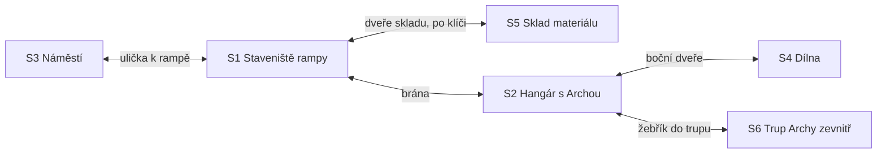

# Kapitola 3: obsah místností a matice předmětů

> Krok N3a a N3d [postupu návrhu](../12-postup-navrhu.md). Co je v každé scéně kapitoly 3,
> jaké předměty kapitola má a jak hra reaguje na jejich použití. Návrh kapitoly je
> v [03-realizace.md](03-realizace.md), puzzly v [03-puzzly.md](03-puzzly.md).
> Stav: **schváleno** (D72), verze 0.1

Sloupec *Prohlédnout* uvádí podstatu repliky, ne finální text. Finální texty vzniknou v kroku N6.
Za Báru se prohlíží jinak než za Rudu: Ruda soudí, Bára měří. Sloupec uvádí Rudovu verzi,
Bářina je v poznámce, když nese stopu. **Fáze** A, B, C podle [návrhu](03-realizace.md#jak-se-hraje-za-dva).

## Mapa scén

Všechny východy jsou otevřené od začátku, kromě skladu (klíč od vrátného). Do trupu jde
kdykoli, M15 se nabídne až ve fázi C po R3.2. Zadní vrata hangáru jsou zavřená („Mlha počká.“).

## S1 Staveniště rampy (převzaté z kap. 2)

Pozadí kapitoly 2 bez slona a bez prasklého lana, pokud ho R2.3 vyměnilo. Rampa roste po fázích:
A jen spodní půlka z roku 1994, B pilíře, C dráha, konec plošina (kulisy přes pozadí). Vpravo
dveře skladu (nové aktivní místo na stávajícím pozadí).

| Prvek | Druh | Prohlédnout (podstata) | Použít / mluvit | Podmínka | Poznámka |
|---|---|---|---|---|---|
| Rampa | aktivní místo | podle fáze: „do půlky z roku 1994“ / „pilíře stojí“ / „dráha vede do nebe“ | – | – | |
| Jeřáb | aktivní místo | jediný ve městě; v kabině vrátný v čepici jeřábníka | použít → M13 | fáze A; bez Věry až s výpočtem | P3.1 |
| Vrátný (jeřábník) | postava | „Za třicet let poprvé vidím, kam jedu.“ | dialog `vratny` → klíč od skladu | – | P3.2; lano podle R2.3 |
| Lano jeřábu | aktivní místo | `lano`: nové, ještě voní; jinak prasklé lanko a cedule „Lano měněno: 1994“ | – | – | M13 výpadek |
| Domíchávač | aktivní místo | „Míchá od kapitoly dvě.“ | – | – | gag |
| Předseda Věčný | postava | stojí u jeřábu, kontroluje beton pohledem; „Výborně. Pomalu.“ | dialog `predseda` | fáze A–B, dokud krysy nejsou pryč | P3.2; formuláře |
| Předsedova aktovka | aktivní místo | otevřená, plná papíru; „Krysám by se tam líbilo.“ | formuláře → stopa (P3.2) | Předseda tu je | P3.2 |
| Dveře skladu | východ / aktivní místo | zamčené; zevnitř je slyšet šustění papíru | klíč od skladu → otevřít; formuláře → stopa krysám | – | P3.2 |
| Kočka Riziková | postava | sedí v koši u dveří skladu; „Na všechno připravená.“ | mluvit / použít na dveře skladu → krysy pryč | jen `krysy` | P3.2 |
| Rozpis rampy na plotě | aktivní místo | po M13 Rudův rozpis přibitý na plot; „Tohle mi jde.“ | – | po M13 | Pembok chválí |
| Babiččin plot | aktivní místo | `spojenec`: babička čte noviny s lupou a mává; `odmitnuta`: zatažená záclona; jinak prádlo | buchta (spojenec) | – | stopa M14 (lupa) |
| Kocour | postava | sedí na plotě a soudí | ★ s kočkou Rizikovou: „Dva soudci. Jedno město.“ | – | převzatý |
| Kometa | aktivní místo | „Je vidět i ve dne. To není dobré znamení. To je kalendář.“ | – | – | |
| Brána hangáru | východ | – | → S2 | – | |
| Ulička | východ | – | → S3 | – | |

## S2 Hangár s Archou (převzatý z kap. 2)

Archa je ve fázi A rezavý vrak s otevřeným bokem, ve fázi C má trup obložený plechy, na konci
je zavřená. Tabule z R2.2 visí dál ve stavu, jak ji hráč nechal. Od M10 vedle ní rozcestník
změn a na tabuli Ještětoto.

| Prvek | Druh | Prohlédnout (podstata) | Použít / mluvit | Podmínka | Poznámka |
|---|---|---|---|---|---|
| Archa | aktivní místo | podle fáze: vrak / trup v plechu / smontovaná | – | – | |
| Žebřík do trupu | východ | „Dovnitř. Dokud to jde.“ | → S6 | – | |
| Tabule z kap. 2 | aktivní místo | podle `c2_rozdeleni`: dva sloupce / Gantt / krabice | – | – | připomínka R2.2 |
| Rozcestník změn | aktivní místo | čtyři přihrádky: *Rovnou udělat*, *Posoudit a vyjednat*, *Do Bářina seznamu*, *Ne* | použít → M10 | fáze B, po M13 a M14 | P3.9 |
| Ještětoto | postava | podle `c3_creep`: „Malý. Zatím.“ / „Už se nevejde na tabuli.“ | ★ s předměty | od M14 | nová postava |
| Rudův Gantt na stěně | aktivní místo | 214 řádků; po R2.2 = `povaha` polovina přeškrtnutá | – | – | |
| Kalendář | aktivní místo | zbývá 24 / 18 / 12 / 9 | – | – | |
| Pan Změna | postava | s podepsanými (`c1_zmena_dohoda`), nebo nepodepsanými přáními | dialog `zmena` | při M10 | |
| Věra, Norbert | postavy | kdo je v týmu; Věra počítá dopad, Norbert hlídá bezpečnostní systém | krátké repliky | fáze B–C | |
| Zadní vrata | aktivní místo | „Mlha počká. Teď se staví.“ | – | – | zavřená |
| Boční dveře | východ | cedule „Dílna. Nerušit. (Rudo.)“ | → S4 | – | gag |
| Brána | východ | – | → S1 | – | |

## S3 Náměstí (převzaté z kap. 1, denní)

Bez Báry u kašny. Obyvatelé s kufry z kap. 2 jsou tu dál, u kašny sedí rybáři s udicemi. Ve fázi
B je tu stánek s ukázkou (nástupní sloupek a maketa kajuty).

| Prvek | Druh | Prohlédnout (podstata) | Použít / mluvit | Podmínka | Poznámka |
|---|---|---|---|---|---|
| Amplion | aktivní místo | „Dnů do dopadu komety: 24.“ a dál podle fáze | – | – | |
| Kometa | aktivní místo | větší, ve dne | – | – | |
| Kašna | aktivní místo | teče z ní kafe; rybáři v ní chytají | – | – | |
| Rybáři | aktivní místo (skupina) | „Chytáme, co teče.“ udice delší než oni | mluvit: „Na Archu? S udicemi, nebo vůbec.“ | – | stopa M14 (udice) |
| Obyvatelé s kufry | aktivní místo (skupina) | pořád nevědí, kudy nastoupit | mluvit: „Kudy se bude nastupovat?“ | – | stopa M14 (šipky) |
| Babička | postava | ve fázi B přišla na ukázku; noviny čte s lupou | dialog `babicka` | fáze B | stopa M14; podle `c1_babicka` |
| Stánek s ukázkou | aktivní místo | sloupek s obrazovkou a maketa kajuty | použít → M14 (za Báru) | fáze B | P3.7 |
| Pan Změna | postava | u stánku; „Dneska prodávám přání.“ | dialog `zmena` | – | svačiny → Ještětoto |
| Norbert Norma | postava | sedí na lavičce a čte normu o lavičkách | dialog `norbert_mesto` → podpis (P3.3) | jen bez Norberta v týmu, od fáze B | P3.3 |
| Telefonní budka | aktivní místo | linka pomoci: „Jste 4 812. v pořadí.“ „Aspoň něco je tu stálé.“ | – | – | D64 |
| Ulička k rampě | východ | – | → S1 | – | |

## S4 Dílna (nové pozadí)

Bářin kout přistavěný k hangáru: pracovní stůl zavalený rozdělanými věcmi, tabule
„Dělám / Hotovo“ s třemi háčky, Bářina tabule se seznamem práce, police „Někdy“, zkušební
počítač, kuchyňská minutka ve tvaru komety. V rohu leží šedá mlha: zbytek mlžné půlky slona
z kap. 2.

| Prvek | Druh | Prohlédnout (podstata) | Použít / mluvit | Podmínka | Poznámka |
|---|---|---|---|---|---|
| Tabule „Dělám / Hotovo“ | aktivní místo | tři háčky, šest lístků (sedm při `c2_rozpad` ≥ 2); Bára: „Tři háčky. Ne šest.“ | – | fáze A | P3.5 |
| Pracovní stůl | aktivní místo | sloupek, maketa, půlka čidla, Rudův model rampy | – | – | P3.5 |
| Zkušební sloupek | aktivní místo | nástupní sloupek bez zapojeného kabelu | kabel → hotovo | fáze A | P3.5 |
| Maketa kajuty | aktivní místo | z tácků, rozlepená; pod ní kabel | lepicí lístky → hotovo; Bára vezme kabel | fáze A | P3.5 |
| Půlka čidla | aktivní místo | „Na tohle teď nikdo nečeká.“ | odložit na polici „Někdy“ | fáze A | P3.5 |
| Rudův model rampy | aktivní místo | „Ruda si tu rozdělal rampu. U mě.“ | odložit na polici, nebo dát Rudovi | fáze A | P3.5, gag |
| Police „Někdy“ | aktivní místo | „Sem patří všechno, co nedělám.“ | odložit rozdělanou věc | – | P3.5 |
| Krabička lepicích lístků | aktivní místo | Kryštofovy (nebo „zbylé z hospody“) | vzít → lepicí lístky | – | P3.5 |
| Bářina tabule seznamu práce | aktivní místo | karty seřazené podle odhadu; nahoře Rudův odpočet | použít → plán kola (P3.6); fáze C → R3.2 | – | P3.6, P3.11 |
| Kuchyňská minutka | aktivní místo | ve tvaru komety; „Patnáct minut. Ani o minutu víc.“ | použít → ranní porada | fáze A, na začátku | P3.4 |
| Zkušební počítač | aktivní místo | běží na něm počítadlo lidí | po M14: spočítat všechny → vada | fáze B | P3.8 |
| Mlha v rohu | aktivní místo | „Kus slona. Nejde dokončit, jde jen ukousnout.“ | – | – | z kap. 2 |
| Pepa, Klára, Kryštof | postavy | kdo je v týmu | porada, krátké repliky | – | P3.4 |
| Zdenda | postava | „Znám chlapa, co má kafe.“ přichází na poradu kvůli kafi | – | Zdenda v týmu | gag |
| Ruda (návštěva) | postava | vtrhne na poradu; ve fázi C sahá po kartách | zápis vady (P3.8) | při poradě a ve fázi C; jinak tam, kde ho hráč nechal | P3.4, P3.11; mikromanagement |
| Dveře do hangáru | východ | – | → S2 | – | |

## S5 Sklad materiálu (nové pozadí)

Dlouhá plechová hala s regály z roku 1994. Uprostřed hnízdo z papírů, na něm krysy. Vzadu plechy
pláště a servisní poklop opřený o zeď. Dokud jsou tu krysy, Ruda dál než ke dveřím nejde
(„Mají většinu.“).

| Prvek | Druh | Prohlédnout (podstata) | Použít / mluvit | Podmínka | Poznámka |
|---|---|---|---|---|---|
| Krysy | aktivní místo (skupina) | sedí na hnízdě z papírů, jedí výkresy; s lístkem „krysy“ v krabici: „Zapsal jsem si: žerou papír.“ | ★ na všechno kromě řešení | do P3.2 | P3.2 |
| Hnízdo z papírů | aktivní místo | výkresy, faktury, výpočty z roku 1994; „Krysy tu jedí papír. Ve městě, kde je papíru víc než sýra.“ | po krysách: vzít → výpočet statika (jen bez Věry; jinak ★ „Výpočet. Věra ho má v hlavě.“) | po P3.2 | P3.2, P3.3 |
| Plechy pláště | aktivní místo | materiál na trup | po krysách: tým je odveze | po P3.2 | konec fáze B |
| Servisní poklop | aktivní místo | „Na výkresu není. Kdo ho sem dal?“; Bára: „Já. V devadesátém čtvrtém. Pro jistotu.“ | vzít → servisní poklop | po P3.2 | P3.10 |
| Regály | aktivní místo | „Všechno, co se v roce 1994 nedostavělo. Tedy všechno.“ | – | – | gag |
| Okousané kabely | aktivní místo | „Tohle jsem si zapsal v kapitole dvě.“ | – | – | připomínka M07 |
| Dveře | východ | – | → S1 | – | |

## S6 Trup Archy zevnitř (nové pozadí)

Řez trupem: tři přípojky (motory, čidla počítadla, navigace), místo pro řídicí počítač, otvor
v boku na poklop, panel bezpečnostního systému, okénko s kometou. M15 je překryvná obrazovka
nad tímto pozadím.

| Prvek | Druh | Prohlédnout (podstata) | Použít / mluvit | Podmínka | Poznámka |
|---|---|---|---|---|---|
| Otvor v boku | aktivní místo | „Díra. Bude z ní poklop, nebo nýty.“ | servisní poklop → nasadit | poklop schválen v M10 | P3.10 |
| Přípojky | aktivní místo | tři konce kabelů; Bára: „Tudy povedou programy. Pokud tu budou kabely.“ | – | – | stopa M15 |
| Místo pro počítač | aktivní místo | „Sem přijde mozek Archy. Zatím tu je prach.“ | použít → M15 | fáze C, po R3.2 | P3.12 |
| Panel bezpečnostního systému | aktivní místo | podle `c2_vyjimky`: zapečetěný Norbertem / „předělává se každý týden“ | – | – | varování (kap. 5) |
| Věra | postava | s nýtovačkou; „Zítra zavírám. Kdo tu bude, zůstane.“ | dialog `vera` | Věra v týmu | |
| Norbert | postava | „Podle normy se zavírá jen podepsaný trup.“ | dialog `norbert` | Norbert v týmu | P3.3 |
| Okénko | aktivní místo | kometa | – | – | |
| Žebřík | východ | – | → S2 | – | |

## Předměty

Dohromady 15 předmětů, z toho 7 přenesených z kap. 1–2 a 2 jen ve variantách. V jednom
průchodu jich hráč uvidí 11–13. Ikony nových předmětů podle stylové bible (D52).

| # | Předmět | Kdo | Kde vznikne | Kdy | Spotřebuje se | Poznámka |
|---|---|---|---|---|---|---|
| 1 | Prof. Pembok | Ruda | z kap. 1 | – | ne | nápověda; P3.3 (Norbert) |
| 2 | Hrnek kávy | Ruda | z kap. 1 | – | nikdy | |
| 3 | Kávové pero (nebo propiska) | Ruda | z kap. 1 | – | ne | |
| 4 | Krabice od bot s lístky | Ruda | z kap. 2 | – | ne (vrací se v kap. 4) | lístky napovídají (krysy, lano) |
| 5 | Plán cesty ke startu | Ruda | z kap. 2 | – | ne | při `c1_faze2` zarazí Předsedu (M10) |
| 6 | Svinovací metr | Bára | z kap. 1 | – | ne | nápověda za Báru |
| 7 | Seznam pasažérů | Bára | z kap. 1 | – | ne (kap. 4) | ★ „Ještě ne.“ (D59) |
| 8 | Žádosti o změnu (tři kopie) | Ruda | Předseda v úvodu | fáze A | v P3.2 jako stopa krysám | Předseda je dá znovu |
| 9 | Klíč od skladu | Ruda | vrátný | kdykoli | ne (zůstane v zámku) | P3.2 |
| 10 | Výpočet statika z roku 1994 | Ruda | hnízdo ve skladu | po P3.2, jen bez Věry | u jeřábníka | P3.3 |
| 11 | Rozpis rampy | Ruda | M13 | po M13 | ne (dá se Báře a ona ho vrátí) | M15 |
| 12 | Servisní poklop | Ruda | sklad | po P3.2 | v trupu | P3.10 |
| 13 | Kabel | Bára | pod maketou v dílně | fáze A | na sloupku | P3.5 |
| 14 | Lepicí lístky | Bára | krabička v dílně | kdykoli | na maketě | P3.5 |
| 15 | Zápis vady | Bára | zkušební počítač | po M14 | u Rudy (když ho vyslechne) | P3.8 |

Kočka Riziková není předmět, ale postava: když s ní Ruda promluví, jde s ním ke dveřím skladu.
Plechy pláště se přesunou samy (tým je odveze), lepicí lístky a kabel jsou v dílně jen
jednou, ale nejde je spotřebovat jinde.

**Kontrola slepých uliček:** formuláře jdou utratit jen v P3.2. Když je hráč použije špatně
(★ odmítnutí), zůstanou mu. Předseda je dá znovu, kdykoli s ním Ruda mluví. Klíč od skladu dá
vrátný vždy. Výpočet statika a servisní poklop se objeví až po krysách. Rozpis rampy zůstane
Rudovi i po předání Báře (Bára si ho opíše).

## Matice předmětů

✔ = řešení, ★ = vlastní reakce (vtip), – = výchozí reakce. Bářiny předměty mají sloupce, které
dávají smysl za Báru. Předměty mezi sebou: žádosti o změnu + krabice od bot ★ („Tři kopie
rizika.“), rozpis rampy + plán cesty ★ („Plán, který sedí na plán. Poprvé.“), lepicí lístky
+ metr ★ („Měří se, nelepí.“).

### Rudovy předměty

| Předmět ↓ / cíl → | Jeřáb / vrátný | Předseda | Aktovka | Dveře skladu | Krysy | Kočka | Kocour | Pan Změna | Ještětoto | Bára | Věra | Norbert | Pepa | Otvor v trupu | Rozcestník |
|---|---|---|---|---|---|---|---|---|---|---|---|---|---|---|---|
| Pembok | ★ | ★ | – | – | ★ | ★ | – | ★ | ★ | ★ | – | ✔ (jen Norbert z náměstí, P3.3) / ★ | – | – | – |
| Hrnek kávy | ★ („Za jízdy nepiju.“) | ★ | – | – | ★ | ★ | – | ★ | ★ (vypije ho a vyroste) | ★ | – | ★ | ★ | – | – |
| Kávové pero | – | ★ | – | – | – | – | – | ★ | – | ★ | – | ★ | – | – | – |
| Krabice od bot | ★ (lano) | ★ (úsměv, `usmev`) | – | – | ✔ nápověda (lístek krysy) | ★ | ★ | – | ★ („Na tebe lístek nemám. Zatím.“) | ★ | – | – | – | – | – |
| Plán cesty | – | ✔ (jen `c1_faze2`, M10) / ★ | – | – | – | – | – | ★ | – | ★ | – | – | – | – | – |
| Žádosti o změnu | ★ | ★ („Další kopie? Jistě.“) | ✔ (stopa, P3.2) | ✔ (stopa, P3.2) | ✔ (P3.2) | – | – | ★ | ★ („Nekrmit.“) | ★ | – | – | – | – | ★ |
| Klíč od skladu | – | – | – | ✔ | – | – | – | – | – | – | – | – | – | – | – |
| Výpočet statika | ✔ (bez Věry) | ★ | – | – | – | – | – | – | – | – | ★ („Ten je dobrý. Skoro jako můj.“) | – | – | – | – |
| Rozpis rampy | ★ | ★ | – | – | – | – | – | ★ | – | ✔ (M15, den lávky) | – | – | ★ („Dva dny?“) | – | – |
| Servisní poklop | – | ★ | – | – | – | – | – | – | – | ★ | ★ | ★ | – | ✔ (po schválení v M10) / ★ před ním | – |

### Bářiny předměty

| Předmět ↓ / cíl → | Sloupek | Maketa | Půlka čidla / Rudův model | Police „Někdy“ | Pepa | Klára | Kryštof | Ruda | Zkušební počítač | Babička | Rybáři | Pan Změna | Ještětoto |
|---|---|---|---|---|---|---|---|---|---|---|---|---|---|
| Metr | ★ | ★ („Kajuta je o dlaň kratší než palanda.“) | ★ | – | ★ | ★ | – | ★ | – | ★ | ★ (udice) | – | ★ („Roste. Měřitelně.“) |
| Seznam pasažérů | – | – | – | – | – | – | – | ★ („Ještě ne.“) | ★ | – | – | – | – |
| Kabel | ✔ | – | ★ | – | ★ | – | – | – | – | – | – | – | – |
| Lepicí lístky | – | ✔ | ★ | – | ★ | ★ | ★ („Moje!“) | ★ (lístek „Nerušit“) | – | – | – | – | ★ |
| Zápis vady | – | – | – | – | ★ („Dva dny.“) | ★ | ★ | ✔ (důvěra vysoká) / odbyde ji (nízká) | – | – | – | – | – |

Odložení rozdělané věci na polici „Někdy“ je **použití věci na polici** (u půlky čidla
a Rudova modelu ✔), ne předmět v inventáři. Dát Rudův model Rudovi jde, jen když je Ruda
v dílně (★ „Můj model! Kdo ho tu rozdělal?“).

Cíl matice: každá kombinace, kterou hráči při playtestu (N8) zkusí víckrát, dostane ★. V matici
je **asi 72 vlastních reakcí** (47 u Rudy, 22 u Báry, 3 kombinace předmětů). Je to víc než
v kap. 2 (53), protože hrají dvě postavy. V N6 se škrtá nejdřív tady. Za Báru a za Rudu se výchozí reakce liší
(sada `obecne_*` a `bara_*` z kapitoly 1).
