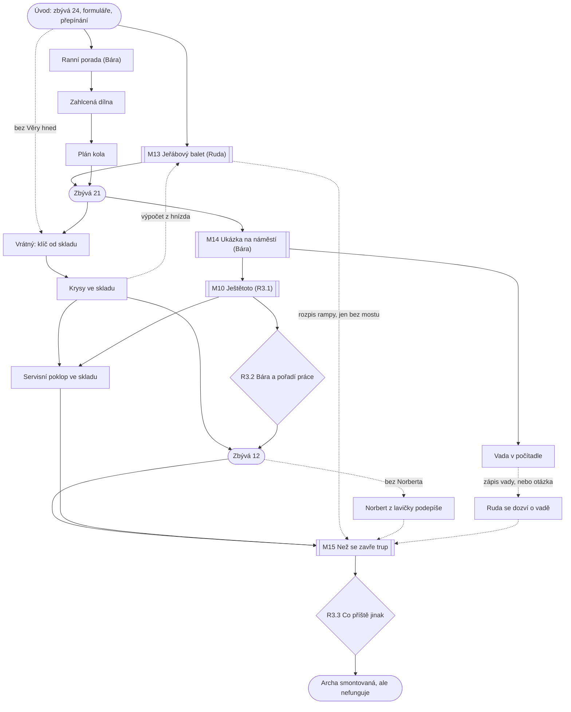

# Kapitola 3: Realizace – dva světy paralelně

> Podrobný návrh kapitoly 3. Vznikl z kostry (N2, D62) v kroku N3
> [postupu návrhu](../12-postup-navrhu.md).
> Stav: **návrh do detailu (N3) schválen** (D72), verze 0.4 (zapracována autorská kontrola K1–K16, D73)
> Podrobnosti: [obsah místností a matice předmětů](03-mistnosti.md), [karty puzzlů](03-puzzly.md),
> [průchod hrou](03-pruchod.md), [osnovy dialogů](03-dialogy.md),
> [autorská kontrola](03-kontrola.md)

## Přehled

| | |
|---|---|
| **Titulek kapitoly** | *Každý po svém* / *Each to Their Own* (D72) |
| **Cíl hráče** | postavit rampu, vyzkoušet s lidmi řídicí systém a kajuty, zavřít trup se vším, co v něm musí být, a smontovat Archu |
| **Délka** | 70–90 minut (nejdelší kapitola) |
| **Patro v popředí** | oba světy paralelně ([koncepce](../07-dva-svety.md)) |
| **Výuková témata** | V23 harmonogram, V16 rozpracovaná práce, V13 ranní porada, V12 plán kola, V24 ukázka, V14 hodnota, V15 změny, V25 integrace, V19 poučení, V20 vedení ([matice](../02-vyukova-matice.md)) |
| **Minihry** | M13 Jeřábový balet, M14 Ukázka na náměstí, M10 Ještětoto (Scope Creep), M15 Než se zavře trup (Integrační okno) |
| **Rozhodnutí** | R3.1 bazén a svačiny, R3.2 Bára a pořadí práce, R3.3 co příště jinak |
| **Rudova vada** | mikromanažuje: chce rozhodovat i o věcech, kterým nerozumí |
| **Hraní za Báru** | ano, zhruba polovina kapitoly: dílna, ranní porada, plán kola, ukázka, vada |
| **Kometa** | zřetelně větší, ve dne je vidět i na obloze; zbývá 24 → 9 dní |

## Místo v koncepci Dva světy, jedna Archa

Kapitola 3 jsou **oba světy paralelně**. Hráč je poprvé zažije zevnitř, každý jinou postavou:
- **Ruda na rampě** hraje deterministickou minihru. Plán dopředu se vyplatí a zapomenutá
  závislost se vymstí (M13). Tady jeho způsob opravdu funguje a Pembok ho poprvé pochválí za to, co opravdu umí.
- **Bára v dílně** pracuje se skrytou informací. Co mají lidé rádi, se ukáže až na ukázce (M14).
  Plán dopředu je promarněná práce. Mezi Bářiny potíže patří i vlastní rozdělaná práce (dílna).
- **Spojka** jsou změny a zavření trupu. Ještětoto (M10) učí poslat každou změnu správnou cestou:
  drahou změnu trupu posoudit, levnou změnu aplikace zařadit do seznamu práce. Trup se zavírá
  v pevný den (M15) a do té doby musí být uvnitř kabely a nejmenší verze programu. Zbytek
  přijde později servisním poklopem.

Rudova vada je mikromanagement. Ruda chodí do Bářiny dílny přerovnávat karty, skáče jí do
porady a v R3.2 se rozhoduje, jestli jí pořadí práce nechá. Mechanicky z toho plyne, že
**každý svět má svého pána**, a spolupráce se odehrává na rozhraní (mosty z M06, rozpis rampy
pro Báru, servisní poklop).

## Výchozí stav

**Ruda** má z kapitoly 2 **Prof. Pemboka**, **hrnek kávy**, **kávové pero** (nebo propisku),
**krabici od bot** s lístky a **orazítkovaný plán cesty ke startu**. **Bára** má z kapitoly 1
**svinovací metr** a **seznam pasažérů**, který ukáže až v kapitole 4 (D59).

| Příznak z dřívějška | Jak se projeví v kapitole 3 |
|---|---|
| `c1_bara_vyslechnuta` ≥ 2 a `c2_rozdeleni` ≠ `gantt` (**Bářina důvěra vysoká**) | Ruda Báru vyslechne, když mu přinese zápis vady; Bára jako postava radí; jinak ji Ruda odbude a hráč za Rudu se musí zeptat sám (P3.8) |
| `c1_faze2` | Předseda u každé změny posílané k posouzení chce „analýzu dopadu na fázi 2“; zarazí ho plán cesty s poznámkou „fáze 2: pozastavena“ z kap. 2 (P3.9) |
| `c1_zmena_dohoda` | Pan Změna nosí požadavky sepsané a podepsané; v M10 odpadá třetí kolo (bazén s vlnami), když hráč bazén vyjedná |
| `c1_mimo_rozsah` | při posuzování bazénu Bára připomene, že bazén je v papíru o Arše mezi věcmi, které na Archu nepatří; Pan Změna výměnu přijme hned |
| `c1_babicka` | `spojenec`: babička na ukázce prozradí víc hned v 1. kole (kocour) a na plotě nechá buchtu; `odmitnuta`: na ukázce mluví až ve 2. kole; ostatní: běžné reakce |
| `c2_tym`, `c2_tym_pokryti` | chybí stavba (Věra): výpočet statika z roku 1994 (P3.3); chybí podpis startu (Norbert): Norbert z lavičky na náměstí (P3.3); chybí zkoušení (Pepa i Klára): Bára má v kolech kapacitu 2 místo 3 |
| `c2_rozdeleni` | `gantt`: Ruda nadiktuje Báře 1. kolo a zakáže ukázku po 2. kole (M14); `krabice`: Ing. Framework v M13 přidá „ukázky betonu“ a seznam práce v M14 zamkne do krabice; `povaha`: bez zásahu |
| `c2_vyjimky` | interiér u Rudy: kajuta je „podle výkresu“ a místo na udice nejde přidat (M14); bezpečnostní systém u Báry: Norbert varuje, že „tohle nikdo nepodepíše“ (následek v kap. 5) |
| `c2_riziko_predem` | `krysy`: kočka Riziková vyřeší sklad za minutu; `lano`: jeřáb v M13 bez výpadku; `usmev`: v kap. 3 jen vtip, následek v kap. 4 |
| `c2_rizika_zapsana` | zapsaná rizika nezaskočí: lístek „krysy“ napoví, že krysy jedí papír; lístek „lano“ ukáže výpadek jeřábu v M13 dopředu |
| `c2_odhad` = `kotva` | první den M13 zabere oslava „rampy za dva dny“; rezerva nejvýš 1 |
| `c2_rozpad` | ≥ 1: v M13 se při přehrávání objeví zapomenuté zábradlí (−1 den); ≥ 2: v dílně je jedna rozdělaná věc navíc |
| `c2_mosty` (seznam, viz [zpětné úpravy](#zpětné-úpravy-dřívějších-kapitol)) | most *trup se zavírá*: Bára v M15 zná přesně, co bude hotové; most *zkouška nástupu*: Bára zná den lávky z rozpisu rampy sama, jinak jí ho Ruda musí dát |

## Scény

| # | Scéna | Nová / převzatá | Postavy | Co se tu děje |
|---|---|---|---|---|
| S1 | **Staveniště rampy** | převzatá (kap. 2 S2) | vrátný v jeřábu, Předseda s aktovkou (fáze A–B), kočka Riziková (jen `krysy`), kocour na plotě | úvod, M13, klíč od skladu, krysy a aktovka |
| S2 | **Hangár s Archou** | převzatá (kap. 2 S3) | tým, Pan Změna a Předseda (při M10), Ještětoto | M10, R3.3, konec kapitoly |
| S3 | **Náměstí** | převzatá (kap. 1, denní) | obyvatelé, rybáři, babička, Pan Změna, Norbert (jen bez něj v týmu) | M14 |
| S4 | **Dílna** (Bářin kout u hangáru) | **nová** | Bára, Pepa, Klára, Kryštof (kdo je v týmu), Ruda (návštěvy) | ranní porada, rozdělaná práce, plán kola, vada, R3.2 |
| S5 | **Sklad materiálu** | **nová** | krysy | krysy, plechy pláště, servisní poklop, výpočet z roku 1994 |
| S6 | **Trup Archy zevnitř** | **nová** | Věra, Norbert (kdo je v týmu) | servisní poklop, M15 |

Hospoda, Mlžná pláň a kancelář Komise se v kapitole 3 nepoužívají. Zadní vrata hangáru jsou
zavřená („Mlha počká. Teď se staví.“). Rozpočet 6 scén (3 nové) platí.

## Postavy

**Vracející se:** Ruda, Bára, Prof. Pembok, tým (4 z R2.1), vrátný jako jeřábník, Pan Změna,
Předseda Věčný, Ing. Framework (jen při `c2_rozdeleni` = `krabice`, jinak jen zmínka),
babička a obyvatelé, babiččin kocour.

**Nové:**

| Postava | EN | Kdy | Co dělá |
|---|---|---|---|
| **Ještětoto** (Scope Creep) | **Scopecreeper** | od ukázky na náměstí | malý chlupatý ještěr, který se narodí z prvního neřízeného přání („A ještě tohle…“) a roste s každou změnou přijatou bez řízení; sedí na tabuli v hangáru, na konci kapitoly je vidět jeho velikost |
| **Kočka Riziková** | Risky the Cat | jen při `c2_riziko_predem` = `krysy` | přijde v úvodu v koši s cedulkou „Na všechno připravená. Krmení zaplaceno.“; krysy ve skladu vyřeší jedním pohledem a zůstane hlídat |

**Rybáři** jsou skupina v pozadí náměstí (chytají v kašně, kde teče kafe) jako štamgasti
v kapitole 2: mluví, ale nemají vlastní list postavy.

**Tým v kapitole 3:** Věra a Norbert pracují s Rudou na rampě a v trupu, Pepa, Klára a Kryštof
s Bárou v dílně. Zdenda chodí, kam je zrovna kafe. Každý mluví jen tehdy, když je v týmu.

## Jak se hraje za dva

- **Přepínání kdykoli.** V rohu obrazovky je portrét druhé postavy. Klepnutím se hraje za ni
  a první postava zůstane, kde byla (jako v *Day of the Tentacle*). Nejde to v rozhovoru,
  v minihře ani ve střihové scéně. Úvod přepínání ukáže a Pembok ho připomene, když jedna linka
  uvízne.
- **Společné scény** (M10, R3.2, M15, R3.3) začnou krátkým střihem, který druhou postavu
  přivede („Bára přišla z dílny.“). Po scéně zůstanou obě tam, kde scéna proběhla (K6).
- **Předměty si postavy předají** jen tehdy, když stojí ve stejné scéně (použij předmět na
  druhou postavu).
- **Nápověda:** Rudovi radí Pembok. Báře radí její metr jako v kapitole 1: tři stupně jsou její
  vlastní poznámky při měření („Šest rozdělaných věcí, tři háčky. Něco nesedí.“).
- **Čas běží po fázích**, ne po krocích. Hra se dělí na tři fáze a mezi nimi je střih
  s odpočtem (amplion, kalendář v hangáru). Rampa na pozadí staveniště roste podle fáze.

| Fáze | Zbývá dní | Ruda | Bára | Spolu | Konec fáze |
|---|---|---|---|---|---|
| **A Začátek stavby** | 24 | M13 (bez Věry nejdřív klíč, krysy a výpočet) | ranní porada, rozdělaná práce, plán kola | – | M13 hotová a Bára má naplánované 1. kolo |
| **B Ukázka a změny** | 21 (ukázky na 21, 18 a 15) | klíč od skladu, krysy, servisní poklop (D75) | M14 na náměstí, vada v počítadle | M10 v hangáru, R3.2 v dílně | sklad volný, M14, M10 a R3.2 hotové |
| **C Zavírá se trup** | 12 | poklop do trupu | rozpis rampy (jen bez mostu) | M15, R3.3 | konec kapitoly (zbývá 9) |

**Kolo za Báru trvá tři dny** (N4, K1): 1. kolo zbývá 24 → 21, 2. kolo → 18, 3. kolo → 15, ve
4. kole (15 → 12) se dělá řídicí systém a trup se zavírá na zbývá 11. M14 zkrátí tři ukázky do
jedné scény na náměstí, stejně jako M13 zkrátí 16 dní stavby.

## Průběh a puzzly

1. **Úvod na staveništi.** Ráno, zbývá 24. Kometa je vidět i ve dne. Ruda rozvine rozpis
   rampy: „Patnáct dní. Jeřáb, beton, Gantt. Tohle umím.“ Pembok: „Tohle opravdu umíš.“
   Bára jde do dílny: „Řídicí systém se sám nenapíše.“ Ruda: „Napíšu ti, co máš dělat.“ Bára:
   „Nenapíšeš.“ Přijde **Předseda s aktovkou** a dá Rudovi **žádosti o změnu ve třech
   kopiích**: „Změny přijdou. Vždycky přijdou.“ (při `krysy` přijde i kočka Riziková v koši).
   Pembok ukáže přepínání na Báru. Podrobně v části [Úvod a konec](#úvod-a-konec-n3g).
2. **Jeřábový balet (M13, P3.1).** Ruda s vrátným v jeřábu rozvrhne stavbu horní poloviny
   rampy na 16 dní. Jeden jeřáb, dvě sady bednění, beton zraje dva dny („Jediná věc v tomhle
   městě, která opravdu trvá dva dny.“). Výsledek je **rozpis rampy** a `c3_rezerva`.
3. **Krysy ve skladu (P3.2).** Sklad s plechy na trup je zamčený a plný krys, které sedí na hnízdě
   z papírů z roku 1994. **Klíč od skladu** má vrátný („Mám klíče od všeho. Nikdo se nikdy
   nezeptal.“), ale ve fázi A betonuje pilíře a z kabiny neleze: „Až budou pilíře v bednění.“
   Klíč dá až ve fázi B, takže krysy jsou Rudova práce, zatímco Bára chystá ukázku (D75). Bez
   Věry ho dá hned: bez výpočtu statika do kabiny nesedne, a tak má čas. S kočkou Rizikovou je hotovo za minutu. Bez ní: krysy jedí papír a nejvíc
   papíru ve městě nosí Předseda. Ruda položí **žádosti o změnu** jako stopu od dveří skladu
   k Předsedově otevřené aktovce a krysy se do ní přestěhují. Předseda aktovku zavře a odejde:
   „Výborně, výborně.“ Aktovka se hýbe.
4. **Chybějící dovednost (P3.3, jen při `c2_tym_pokryti` < 3).** Bez Věry jeřábník nezačne
   horní dráhu bez výpočtu statika; výpočet z roku 1994 leží v krysím hnízdě. Bez Norberta
   trup nikdo nepodepíše; Norbert sedí na lavičce na náměstí a podepíše, jen když Pembok
   přestane mluvit. Každá oklika stojí den rezervy.
5. **Ranní porada (P3.4, za Báru).** Porada v dílně má trvat patnáct minut (kuchyňská
   minutka). Pepa odbočí k automatu, Klára ke kulatým kajutám, Kryštof navrhne poradu o
   poradách. Uprostřed vtrhne Ruda a chce všem rozdělit práci. Bára utíná odbočky a najde
   překážku: zkušební sloupek je zavalený rozdělanou prací.
6. **Zahlcená dílna (P3.5, za Báru).** Na tabuli „Dělám“ jsou tři háčky a visí na nich
   šest lístků. Bára musí dvě věci dokončit, jednu odložit na polici „Někdy“ a Pepovi říct,
   že nový nápad počká, „až něco dokončíme“.
7. **Plán kola (P3.6, za Báru).** Co stihnou do ukázky na náměstí: cíl kola a nejvýš tři
   karty ze seznamu práce. Kdo přidá čtvrtou a pátou, zvýší technický dluh (`c3_dluh`).
8. **Střih: zbývá 21.** Pilíře stojí v bednění, kometa je větší.
9. **Ukázka na náměstí (M14, P3.7).** Bára ukáže obyvatelům nástupní sloupek a maketu kajuty.
   Babička na malé písmo nevidí, rybáři nemají kam dát udice. Pan Změna se zeptá, jestli by
   v tom šlo objednat svačinu, a u stánku se z ničeho nic objeví malé chlupaté **Ještětoto**.
   Bára po každé ukázce přerovná seznam práce. Výsledek `c3_hodnota`.
10. **Vada v počítadle (P3.8, za Báru).** Babička se na ukázce ptala, jestli se vejdou všichni.
    Bára to v dílně přepočítá: počítadlo se zastaví na **4 811**. Jeden člověk se nevejde.
    Bára sepíše **zápis vady**. Když Rudovi věří a on jí věří (důvěra vysoká), Ruda ji vyslechne:
    „Kdo se nevejde?“ „Podle pořadí na lince pomoci ty.“ Jinak ji odbyde: „Teď ne, Báro, mám
    jeřáb.“ Hráč za Rudu se pak může zeptat sám, ale musí ji nechat domluvit
    (`c3_vada_hlasena`).
11. **Ještětoto (M10, R3.1, P3.9).** Pan Změna přijde do hangáru s bazénem v trupu a svačinami
    v aplikaci. U tabule je nový rozcestník změn se čtyřmi přihrádkami: *Rovnou udělat*,
    *Posoudit a vyjednat*, *Do Bářina seznamu*, *Ne*. Přicházejí i dobré změny: Bára chce do
    trupu **servisní poklop**, babička tlačítko *Zpět*. Ruda by rád měl v aplikaci svůj Gantt.
    Ještětoto roste s každou změnou přijatou bez řízení. Předseda chce u každého posouzení formulář
    a při `c1_faze2` i analýzu dopadu na fázi 2.
12. **Servisní poklop (P3.10).** Poklop leží ve skladu („Na výkresu není.“ Bára: „Dala jsem ho
    sem v roce devadesát čtyři. Pro jistotu.“). Zabudovat se dá jen schválený. Ruda ho v trupu
    nasadí do otvoru.
13. **Bára a pořadí práce (R3.2, P3.11).** Po M10 (zbývá 15) Ruda přijde do dílny, chce vědět,
    co bude v trupu, a sáhne po Bářiných kartách. Vedle visí jeho Gantt přepsaný na papír
    („Řádek 112: naprogramovat řízení: úterý“). Volba: „Pořadí je tvoje. Řekni mi jen, co bude
    hotové, až se zavře trup.“ nebo „Pořadí určuju já.“ Rozhodne 4. kolo, ve kterém se dělá
    řídicí systém.
14. **Střih: zbývá 12. Zítra se zavírá trup.**
15. **Než se zavře trup (M15, P3.12).** V trupu se rozhoduje, co musí být uvnitř před
    zavřením (kabely, start motorů, počítadlo) a co přijde později servisním poklopem (navigace).
    Ruda chce všechno dovnitř, Bára nic neslíbit. Hráč přepíná mezi nimi. Bára musí znát den,
    kdy bude hotová nástupní lávka, takže jí Ruda dá **rozpis rampy** (při mostu *zkouška
    nástupu* ho zná sama). Výsledek `c3_integrace`. Věra trup zanýtuje.
16. **Co příště jinak (R3.3, P3.13).** V hangáru: „Sedneme si a řekneme si, co příště jinak“,
    nebo „Nemáme čas. Stavíme.“ Při posezení každý z týmu řekne jednu věc z kapitoly a hráč
    vybere jedno zlepšení.
17. **Konec kapitoly.** Zbývá 9. Archa je smontovaná, trup zavřený, rampa (skoro) hotová. Ruda
    zmáčkne velké červené tlačítko a nic se nestane. Pepa: „Dva dny.“ Podrobně v části
    [Úvod a konec](#úvod-a-konec-n3g).

## Rozhodnutí kapitoly

| ID | Kde | Volby | Příznak | Kde se vrátí |
|---|---|---|---|---|
| R3.1 | M10, hangár | bazén: posoudit a vyjednat / přijmout bez řízení / odmítnout bez rozhovoru; svačiny: do Bářina seznamu / protlačit posouzením / rovnou udělat / odmítnout | `c3_bazen` = `vyjednan` / `bez_rizeni` / `odmitnut`; `c3_svaciny` = `seznam` / `schvalovani` / `rovnou` / `odmitnuty` | hned v M15 (bazén zabere místo v trupu); kap. 4: velikost Ještětoto, důvěra obyvatel |
| R3.2 | dílna, konec fáze B (zbývá 15) | pustit Báru k pořadí / rozhodovat sám | `c3_bara_priority` | hned v M15 (co je hotové); kap. 4: řídicí systém dělá, co chtějí lidé, nebo co chtěl Ruda; Bářina důvěra; Rudův vývoj (vada „mikromanažuje“) |
| R3.3 | hangár, po M15 | posedět: co příště jinak / „Nemáme čas. Stavíme.“ | `c3_retro`, `c3_zlepseni` | kap. 4: bez posezení se opakují chyby, morálka padá a odejde člen týmu (`c3_odchazi`) s klíčem od poklopu, bez poklopu s plánem zapojení trupu |

**Stavové proměnné:** R3.2 = pustit zvedne Bářinu důvěru a Rudův vývoj o 1, rozhodovat sám
důvěru sníží. R3.1 mění rozsah (Ještětoto), důvěru obyvatel (svačiny) a sladění světů (bazén
v trupu). R3.3 mění morálku.

**Další příznaky:**

| Příznak | Hodnoty | Nastaví | Čte |
|---|---|---|---|
| `c3_rezerva` | −3 až 2 (dny; záporná = zpoždění rampy) | M13 a okliky P3.3 | kap. 4 |
| `c3_drolivy` | ano / ne | M13 při `krabice`, když se odbednil nezralý beton | kap. 4 (rampa se drolí) |
| `c3_hodnota` | 0–3 | M14 | kap. 4, 5 |
| `c3_dluh` | 0–3 | plán kola a M14 (karty nad kapacitu) | kap. 4 |
| `c3_creep` | 0–4 | M10 (velikost Ještětoto) | kap. 4, 5 |
| `c3_poklop` | `ano` / `netesni` / `ne` | M10 a P3.10 | M15; kap. 4 (krize se řeší poklopem) |
| `c3_vada_hlasena` | ano / ne | P3.8 | kap. 4 |
| `c3_integrace` | 0–3 (nesladěné body) | M15 | kap. 4, 5 |
| `c3_krysy` | `kocka` / `aktovka` | P3.2 | kap. 4 (krysy v Komisi, vtip) |
| `c3_odchazi` | Pepa / Klára / Věra / Norbert | konec M15 | kap. 4 (kdo odejde bez posezení; s poklopem si odnese klíč od poklopu, bez něj plán zapojení trupu) |
| `c3_zlepseni` | jedno ze tří | R3.3 | kap. 4 (M11 navazuje) |

## Graf závislostí puzzlů

Plné šipky jsou nutné kroky, tečkované jen pro některé stavy nebo volitelné. Proti kostře se
R3.2 přesunulo **před M15**: volba se tak hned projeví v tom, co je hotové k zavření trupu.
Graf má dvě nezávislé linky, takže hráč má skoro vždy 3–4 rozdělané věci
([šířka grafu](03-pruchod.md#šířka-grafu)). Klíč od skladu je až ve fázi B (D75), aby i Ruda měl
ve fázi B vlastní linku, než se obě sejdou v M10 ([úplný graf](../13-graf-zavislosti.md#kapitola-3-realizace)).
Úzké místo je fáze C (poklop → M15 → R3.3), která je záměrně lineární.

## Minihry v kapitole 3

Všechny čtyři se testují až ve hře (D53, D66). M13 a M14 nesou rozdíl mezi světy, proto je
autor v N4 projde krok za krokem. Čísla v pravidlech jsou výchozí a doladí se v šedém
prototypu (D70). Rozhraní nepoužívá odborné pojmy (D26).

### M13 Jeřábový balet

- **Patro:** svět plánu.
- **Příběh:** horní polovina rampy z roku 1994 se musí dostavět. Ve městě je jediný jeřáb
  a obsluhuje ho vrátný. Beton musí zrát.
- **Mechanika:** časová osa má 16 dní (zbývá 24 → zbývá 9) a jeden řádek *Jeřáb*. Hráč pokládá
  karty prací do dnů, každý den jednu. Pod osou se ukazuje, co zraje a kde je bednění.

| Prvek | Karty na jeřáb | Podmínka |
|---|---|---|
| Levý pilíř | bednění, betonáž | – |
| Pravý pilíř | bednění, betonáž | – |
| Horní dráha | bednění, betonáž | oba pilíře dozrálé |
| Odpalovací plošina | bednění, betonáž | dráha dozrálá |
| Nástupní lávka | bednění, betonáž | – (most *zkouška nástupu* z M06) |

  - **Pravidla:** betonáž až den po bednění nebo později. Beton zraje dva dny a uspěchat ho
    nejde. **Dvě sady bednění:** sada se uvolní, až beton jejího prvku dozraje. Každý den
    jen jedna karta na jeřáb.
  - **Přehrání:** po potvrzení se plán přehraje den po dni. Porušené pravidlo je gag: zřícené
    bednění („Na nezralý beton se nestaví.“), fronta u jeřábu, „Nemáme bednění“. Karta se
    posune na nejbližší možný den a další karty se posunou s ní.
  - **Nejlepší plán** skončí 14. den, takže rezerva je 2 dny. Jsou dva: lávka hned po
    pilířích (bednění 5., betonáž 6. den), nebo souběžně s dráhou (betonáž 9. den). Kritická
    cesta pilíře → dráha → plošina nesmí čekat, lávka se vejde do dnů, kdy jeřáb jinak stojí.
    Ověřeno ručním rozpisem v [průchodu](03-pruchod.md#rozpis-m13).
- **Varianty:**
  - **Lano (R2.3):** `lano` = žádný výpadek. Jinak lano 9. a 10. den praskne a jeřáb stojí
    (při kotvě až 10. a 11. den, aby se oslava a lano nesčítaly, D72). Kdo měl lano v krabici
    od bot, vidí výpadek na ose dopředu a dá lávku hned po pilířích (ten plán dál končí 14. den,
    s kotvou 15.). Kdo ne, dozví se to až při přehrání.
  - **Kotva:** první den je oslava „rampy za dva dny“ a jeřáb nese prapory. Nejvýš rezerva 1.
    Pepa (je-li v týmu): „Dva dny. Říkal jsem to.“
  - **Krabice:** Ing. Framework vloží do 3., 6., 9. a 12. dne karty *Ukázka betonu*: rozbednit
    a ukázat lidem. Na nezralém betonu se ukázka rozdrolí a betonáž se opakuje
    (`c3_drolivy`). Karty jde odnést zpátky do Frameworkova kufru („Bez ukázek? To je tak minulé
    čtvrtletí.“).
  - **`c2_rozpad` ≥ 1:** při přehrání se objeví zapomenuté **zábradlí** na plošinu (den jeřábu
    po dozrání plošiny, −1 den).
  - **Bez Věry:** M13 jde potvrdit, až jeřábník dostane výpočet statika (P3.3); den hledání
    se odečte z osy.
- **Výsledek:** `c3_rezerva` = 16 − den dokončení (záporná = zpoždění), `c3_drolivy`, předmět
  **rozpis rampy**. Přeskočení: Pembok rozvrhne „podle Gantta“, `c3_rezerva` = 0.
- **Témata:** V23 (kritická cesta, sdílený zdroj, závislosti).
- **Riziko návrhu:** suché. Proto vrátný v kabině komentuje každý den, zřícené bednění je
  gag a Pembok tu Rudu chválí bez ironie. Na telefonu 16 sloupců na šířku (asi 120 px na den).

### M14 Ukázka na náměstí

- **Patro:** svět iterací.
- **Příběh:** Bára ukáže obyvatelům nástupní sloupek s aplikací a maketu kajuty z tácků.
- **Mechanika:** seznam práce je sloupec karet, nahoře se dělá první. Každá karta má na líci
  odhad hodnoty (hvězdičky) a na rubu skutečnou hodnotu, která se ukáže až po ukázce. Kola
  jsou tři. V každém kole se udělají tři karty shora (kapacita), na konci kola Bára karty
  ukáže a obyvatelé reagují. Reakce otočí ukázané karty a často prozradí i jiné: babička
  na malé písmo nevidí, takže karta *Velká tlačítka* se otočí, i když ji nikdo neukázal.
  Mezi koly Bára přerovná seznam a karty bez hodnoty vyhodí.

| Karta | Odkud | Odhad | Skutečnost | Jak se ukáže |
|---|---|---|---|---|
| Odpočet na celé obrazovce | Ruda | ★★★ | 0 | „To víme. Máme amplion.“ |
| Heslo k nástupu | Ruda | ★★ | −1 | babička: „Heslo? Já nevím, kde mám brýle.“ |
| Šipky „Kudy nastoupit“ | Bára | ★★ | 3 | obyvatelé s kufry (riziko z kap. 2) |
| Mapa kajut | Bára | ★★ | 2 | – |
| Maketa kajuty s palandou | Klára / Bára | ★★ | 1 | rybáři: „A kam dáme udice?“ |
| Velká tlačítka | objeví se po 1. ukázce aplikace (odmítnutá babička až po 2.) | – | 3 | babička |
| Místo na udice | objeví se po ukázce makety | – | 3 | rybáři |
| Smí kocour? | objeví se po 2. ukázce (spojenkyně babička už po 1.) | – | 2 | babička |

  - **Kolo trvá tři dny,** ukázky jsou na zbývá 21, 18 a 15. Po M14 pokračuje seznam práce
    kartami řídicího systému (start motorů, počítadlo, navigace), které se na náměstí neukazují.
    O jejich pořadí rozhoduje R3.2 (K1).
  - **1. kolo** je to, co Bára naplánovala v plánu kola (P3.6). Ukázka po něm je vždy.
  - **2. a 3. kolo** se plánují přímo v minihře. Nad kapacitu jde přidat jednu kartu
    (`c3_dluh` +1). Po 2. kole jde ukázku vynechat („Ukážeme to, až to bude hotové.“). Po 3.
    kole je ukázka vždy, ale pak už se nic nepřerovná.
  - **Nejlepší výsledek:** 1. kolo šipky, mapa kajut, maketa; 2. kolo velká tlačítka, udice,
    kocour; heslo a odpočet vyhodit. Součet 14.
- **Varianty:**
  - **`gantt`:** 1. kolo nadiktuje Ruda podle Gantta (odpočet, heslo, mapa kajut) a ukázka
    po 2. kole je zakázaná („Ukážeme to hotové.“).
  - **`krabice`:** Framework zavře seznam do krabice „Pořadí je posvátné“. Ukazovat se smí,
    přerovnat ne, dokud Bára seznam z krabice nevyndá (tlačítko v minihře, Bára to napoví).
  - **Interiér u Rudy (`c2_vyjimky`):** kajuta je „podle výkresu“, karta *Místo na udice*
    nepřibude („Na výkresu udice nejsou.“).
  - **Bez zkoušení (ani Pepa, ani Klára):** kapacita 2 karty na kolo; Bára dělá sama za dva.
  - **`c1_babicka`:** běžná babička prozradí velká tlačítka po 1. ukázce a kocoura po 2.;
    `spojenec` obojí po 1. („Konečně se někdo ptá.“); `odmitnuta` obojí až po 2. („Mně se nikdo
    neptá, tak já taky neodpovím.“). Nejlepší součet 14 jde se všemi, liší se počet potřebných
    ukázek (K5).
- **Výsledek:** `c3_hodnota` podle součtu skutečných hodnot hotových karet: 12 a víc → 3,
  8–11 → 2, 4–7 → 1, jinak 0. Hotové karty jdou do seznamu práce pro R3.2 a M15. Přeskočení:
  Bára ukáže „všechno najednou“, `c3_hodnota` = 1. Ještětoto se narodí ve střihu po M14,
  takže i po přeskočení (K14).
- **Témata:** V24, V14; s plánem kola i V12.
- **Riziko návrhu:** skrytá informace nesmí působit jako náhoda. Každá reakce jde odvodit
  dopředu: babička čte noviny s lupou (S1 plot nebo S3), rybáři sedí u kašny s udicemi,
  obyvatelé s kufry z kap. 2 nevědí, kudy nastoupit.

### M10 Ještětoto (Scope Creep)

- **Patro:** spojka.
- **Příběh:** Ještětoto se narodilo na náměstí z prvního neřízeného přání. V hangáru sedí na tabuli
  a roste s každou změnou, kterou někdo přijme bez řízení. S velikostí se natahuje i jméno:
  Ještětoto → Ještětototo → Ještětotototo… (EN Scopecreeper → Scopecreeeper…), takže velikost
  je vidět i slyšet. Kdo ho zná z kap. 3, pozná ho v kap. 4–5 podle délky jména.
- **Mechanika:** u tabule z kap. 2 visí rozcestník se čtyřmi přihrádkami. Změny přicházejí jako
  karty, hráč za Rudu je posílá. U *Posoudit a vyjednat* Věra (nebo Ruda sám) spočítá dopad
  a Ruda vyjedná se žadatelem výměnu. *Do Bářina seznamu* zařadí Bára podle hodnoty.

| Kolo | Karta | Žadatel | Správně | Co udělají jiné cesty |
|---|---|---|---|---|
| 1 | Bazén v trupu | Pan Změna | posoudit a vyjednat: „Čtyřicet tun vody. Trup to neunese.“ → výměna za nafukovací bazén do kajuty, ten jde do Bářina seznamu | rovnou: Ještětoto +2, bazén zabere místo v trupu (M15); ne: Ještětoto +1, Pan Změna se vrátí ve 3. kole |
| 1 | Svačiny v aplikaci | Pan Změna | do Bářina seznamu (Bára ji dá dolů) | posoudit: zdržení a naštvaní obyvatelé („Svačina za tři týdny?“); rovnou: Ještětoto +1 |
| 2 | Servisní poklop v trupu | Bára | posoudit a vyjednat: „Třicet kilo, otvor zesílit, dva dny.“ → schváleno | rovnou: poklop netěsní (`netesni`); ne: bez poklopu; do Bářina seznamu: Věra vrátí: „Plech se nezkouší po kouskách.“ |
| 2 | Tlačítko *Zpět* | babička (z M14) | do Bářina seznamu | posoudit: zdržení |
| 2 | Gantt v aplikaci | Ruda | ne, nebo do Bářina seznamu („Až zbude čas. Nezbude.“) | rovnou: Ještětoto +1, Bářina důvěra −1 |
| 3 | Bazén s vlnami | Pan Změna | bez `c1_zmena_dohoda` vždy, s dohodou jen když bazén v 1. kole nebyl vyjednán; posoudit a vyjednat | rovnou: Ještětoto +2 |

  - **Předseda** stojí u přihrádky *Posoudit a vyjednat* a ke každé kartě přidá formulář
    („Ve třech kopiích, prosím.“). Při `c1_faze2` chce navíc analýzu dopadu na fázi 2 a každá
    posouzená karta stojí den. Zarazí ho plán cesty s poznámkou „fáze 2: pozastavena“
    (použít plán na Předsedu): „Pozastavena… No ano. Prozatím.“
  - **`c1_mimo_rozsah`:** u bazénu Bára připomene papír o Arše a Pan Změna výměnu přijme hned.
  - **`c1_zmena_dohoda`:** Pan Změna nosí karty podepsané („Podepsal jsem to. Takže to opravdu
    chci.“). Třetí kolo odpadá, když hráč bazén vyjedná (K3).
  - **Ruda tu hraje se sebou:** karta *Gantt v aplikaci* je jeho vlastní přání. Pembok: „Tak co,
    projde tvoje přání stejnou bránou jako cizí?“
- **Výsledek:** `c3_creep` (velikost Ještětoto 0–4), `c3_bazen`, `c3_svaciny`, `c3_poklop`
  (schválení). Přeskočení: Pembok pošle všechno k posouzení: `c3_creep` = 1, bazén
  `odmitnut`, svačiny `schvalovani`, poklop schválen.
- **Témata:** V15; skrytě: drahá změna se posuzuje, levná řadí, i dobrá změna trupu musí
  projít posouzením (poklop).
- **Riziko návrhu:** hráč pochopí přihrádky jako kvíz se správnou odpovědí. Proto je u každé
  karty slyšet, proč (Věra počítá, Bára řadí) a poklop ukazuje, že posouzení není zákaz.

### M15 Než se zavře trup (Integrační okno)

- **Patro:** spojka.
- **Příběh:** zítra Věra trup zanýtuje a pak už se dovnitř nikdo nedostane. Kromě servisního
  poklopu, pokud ho někdo schválil a nasadil.
- **Mechanika:** řez trupem a dvě přihrádky: **Dovnitř před zavřením** a **Později poklopem**
  (jen při `c3_poklop` ≠ `ne`). Karty jsou dvojího druhu:

| Karta | Druh | Kdy je hotová | Kam patří | Proč |
|---|---|---|---|---|
| Kabel k motorům | fyzická přípojka | hned | dovnitř | po zavření ji nejde natáhnout |
| Čidla počítadla lidí | fyzická přípojka | hned | dovnitř | totéž |
| Kabel k navigaci | fyzická přípojka | hned | dovnitř | totéž |
| Program: start motorů | program | před zavřením | dovnitř | zkouška pohonu hned po zavření |
| Program: počítadlo lidí | program | před zavřením jen při R3.2 = Bára a `c3_dluh` ≤ 1, jinak po zavření | dovnitř, když je hotové; jinak poklopem | zkouška nástupu |
| Program: navigace | program | po zavření | poklopem | do zavření hotová nebude |
| Nástupní aplikace | program | podle M14 | ven (běží na sloupcích) | Věra ji vrátí: „To běží venku.“ |
| Odpočet na celé obrazovce | program | před zavřením (jen při R3.2 = Ruda) | kamkoli | nikoho nezajímá |
| Svačiny | program | podle M10 | poklopem, nebo nikdy | – |

  - **Ruda** vidí den zavření a místo v trupu; jeho výchozí návrh je „všechno dovnitř“.
    **Bára** vidí, co bude kdy hotové; její výchozí návrh je „všechno později“. Hráč přepíná
    portrétem a karty přesouvá za toho, kdo je zrovna na tahu. Každý komentuje po svém.
  - **Trup se zavírá na zbývá 11**, uprostřed 4. kola. Program uvnitř, který do té doby není
    hotový, se zavře nehotový. Bez mostu *trup se zavírá* (`c2_mosty`) Bára u počítadla řekne
    jen „Před zavřením. Možná.“ Skutečnost se ukáže při zavření a dá se odvodit z R3.2
    a přeplněných kol (`c3_dluh`).
  - **Bazén bez řízení** (`c3_bazen` = `bez_rizeni`) zabere místo, kudy vede kabel k navigaci.
    Buď bazén ven (Pan Změna se urazí, Ještětoto +1), nebo kabel zůstane venku.
  - **Rozpis rampy:** nástupní aplikace musí znát den nástupní lávky. Při mostu *zkouška
    nástupu* ho Bára zná, jinak jí Ruda musí dát rozpis rampy (kdykoli předtím, nebo během M15).
  - **Vada:** při `c3_vada_hlasena` je v počítadle oprava. Bez ní se počítadlo zabuduje
    s chybou, ale v M15 to není vidět. Projeví se až v kapitole 4.
  - **Bez Věry** trup zanýtuje Ruda („Nýtovačka. Jak těžké to může být.“), stejně jako v M10
    sám počítá dopad změn (K13).
- **Výsledek:** `c3_integrace` = počet nesladěných bodů, nejvýš 3: přípojka venku, nehotový
  program uvnitř, aplikace bez dne lávky, program „později“ bez poklopu. Po zavření dostane
  jeden z týmu **klíč od poklopu**, bez poklopu **plán zapojení trupu** (`c3_odchazi`: Pepa,
  jinak Klára, jinak Věra, jinak Norbert; K2). Přeskočení: Pembok dá „všechno dovnitř“, `c3_integrace` = 2.
- **Témata:** V25; skrytě: nejmenší verze pro milník = rozhraní a to, co potřebuje nejbližší
  zkouška.
- **Riziko návrhu:** abstraktní. Proto je to řez skutečným trupem, kabely jsou vidět a Věra
  stojí s nýtovačkou. Tři druhy chyb odpovídají třem krizím kapitoly 4 (nejde do trupu, trup
  neunese, aplikace neví o rampě).

## Ranní porada, plán kola a co příště jinak (scény)

Bývalé minihry M09 a M08 a retrospektiva jsou scény s rozhodnutím (D58). Pravidla jsou
v [kartách puzzlů](03-puzzly.md): ranní porada P3.4, plán kola P3.6, co příště jinak P3.13.

## Úvod a konec (N3g)

### Úvod: ráno na staveništi

| Záběr | Kde | Co se stane |
|---|---|---|
| 1 | S1 | titulek *Kapitola 3: Každý po svém*; ráno, kometa je vidět i ve dne; vrátný v kabině jeřábu; první beton z kap. 2 ztuhl |
| 2 | S1 | Ruda rozvine rozpis: „Patnáct dní. Jeřáb, beton, Gantt. Tohle umím.“ Pembok: „Tohle opravdu umíš.“ Ruda: „Počkej, to byla pochvala?“ |
| 3 | S1 | Bára: „Já jdu do dílny. Řídicí systém se sám nenapíše.“ Ruda: „Napíšu ti, co máš dělat.“ Bára: „Nenapíšeš.“ odejde do hangáru |
| 4 | S1 | Předseda s aktovkou: „Kontrolní návštěva. Nespěchejte.“ Dá žádosti o změnu ve třech kopiích: „Změny přijdou. Vždycky přijdou.“ (při `c1_faze2`: „A u každé analýzu dopadu na fázi 2.“) |
| 5 | S1 | jen `krysy`: kurýr přinese koš s kočkou Rizikovou a cedulkou „Na všechno připravená. Krmení zaplaceno.“ Ruda: „Aspoň někdo.“ |
| 6 | S1 | Pembok: „Bára je v dílně. Chceš vědět, co dělá? Podívej se jejíma očima.“ Rozsvítí se portrét Báry. Volná hra. |

### Konec kapitoly

1. Po R3.3 střih: zbývá 9. Hangár, Archa smontovaná: trup zavřený, motory, anténa. Rampa podle
   `c3_rezerva` hotová, nebo bez plošiny („Plošinu dostavíme. Dva dny.“).
2. Ruda řeční k týmu („Já… teda my…“, jen při R3.2 = pustit; jinak „Já jsem postavil Archu.“).
3. Ruda zmáčkne velké červené tlačítko. Nic. Zmáčkne ho znovu. Nic. Ještětoto na tabuli zívne.
4. Pepa (nebo kdokoli z týmu): „Dva dny.“ Bára se podívá na počítač: při `c3_vada_hlasena`
   „Tohle není počítadlo.“ Jinak se jen odvrátí.
5. Kometa ve střešním okně hangáru. Obrazovka **„Co si Nedostavěnice zapamatovala“**: rampa
   (rezerva), ukázka (hodnota), Ještětoto (velikost), trup (nesladěné body), kdo určuje pořadí
   práce, posezení a jestli Ruda ví o vadě. Pokračování příště.

## Kontrola proti zásadám (N3h)

- [x] Pilíře vize: učí mechanika (M13 deterministická, M14 se skrytou informací, M10 a M15
  na rozhraní), rozhodnutí mají váhu (R3.1 a R3.2 se projeví hned v M15 a pak v kap. 4),
  absurdní, ale fér ([karty](03-puzzly.md))
- [x] **Slovník D26:** ve hře „kolo“, „seznam práce“, „ranní porada“, „co příště jinak“,
  „Než se zavře trup“, „Ještětoto“; žádný sprint, backlog, retrospektiva, integrace ani scope
- [x] Žádný puzzle na jazykové hříčce (D03): Ještětoto / Scopecreeper je jen jméno, mechanika na něm nestojí; každý jazyk má vlastní pointu (transkreace)
- [x] Nic nezávisí na najetí myší (D04); M13 a M15 se ovládají přetažením i klepnutím
- [x] Žádná slepá ulička ([kontrola v průchodu](03-pruchod.md#kontrola-slepých-uliček)),
  všechny čtyři minihry přeskočitelné (D12)
- [x] Šířka grafu: ve fázích A a B 3–4 rozdělané úkoly, fáze C záměrně lineární
  ([průchod](03-pruchod.md#šířka-grafu))
- [x] Každý puzzle má aspoň dvě stopy ve světě a tři stupně nápovědy (D10), za Báru je radí metr;
  rozhodnutí R3.2 a R3.3 mají jen 1. stupeň, nápověda neradí volbu (K16)
- [x] PEGI 12 (D11): krysy se přestěhují do aktovky, nikomu se nic nestane
- [x] Rozpočet (D56): 6 scén (3 nové), 2 nové postavy, 15 předmětů (včetně variant),
  odhad 562 replik (o 2 % nad horní mezí, D68), 4 minihry ([osnovy dialogů](03-dialogy.md#součet))
- [x] Bára neřekne „termín“ (D60); seznam pasažérů neukáže (D59, ★ „Ještě ne.“)

## Soulad s kapitolami 1 a 2

Kontrolováno při psaní, podrobná autorská kontrola je krok N4.

| Co | Kde v kap. 1–2 | Jak navazuje kap. 3 |
|---|---|---|
| Vrátný jako jeřábník | kap. 2 konec, K15, K18 | obsluhuje jeřáb, má klíče od všeho, lano podle R2.3 |
| Prasklé lano „Drží. Zatím.“ | kap. 2 K18 | lano praskne 9. a 10. den M13 (při kotvě 10. a 11.) |
| Krabice od bot a lístky | kap. 2 M07 | lístky „krysy“ a „lano“ napovídají; kometa a slon dál ★ |
| Kočka z inzerátu | kap. 2 R2.3, K11 | přijde v koši; babiččin kocour dál sedí na plotě a soudí |
| Rudův Gantt na stěně | kap. 2 S3 | Ruda ho přepíše na papír a přinese do dílny („Ať to máš po ruce.“); v R3.2 visí vedle Bářiných karet („Řádek 112“) |
| Zbytek mlžné půlky slona | kap. 2 M04 | rozdělaná práce v dílně je z něj (při `c2_rozpad` ≥ 2 je jí víc) |
| Počítání dnů | kap. 2 K8 | hra říká jen „zbývá N“; fáze 24 → 21 → 12 → 9, ukázky na 21, 18 a 15; kap. 4 začne „zbývá 7“ |
| 4 812 | D64 | počítadlo končí na 4 811 a podle pořadí na lince pomoci chybí Ruda |
| Bára a termín | D60, K9 | v M15 nechce nic slíbit; slovo „termín“ neřekne |
| Seznam pasažérů | kap. 1, D59 | Bára ho má, ukázat ho jde až v kap. 4 |
| Podepsaný požadavek Pana Změny | kap. 1 | M10 o kolo kratší |
| Papír o Arše: co nepatří | kap. 1 M01, kap. 2 K12 | bazén v M10 |
| Plán cesty s „fáze 2: pozastavena“ | kap. 2 P2.8 | zarazí Předsedovu analýzu dopadu |
| Ing. Framework odchází „za klientem nahoru“ | kap. 2 | bez krabice ho Předseda pozdraví: „Je teď u nás. Na zkoušku.“ (náznak pro kap. 4) |

### Zpětné úpravy dřívějších kapitol

- **`c2_mosty` jako seznam** (kap. 2, M06): místo počtu 0–3 se ukládá, které mosty drží
  (`trup`, `nastup`, `start`). Kapitola 3 potřebuje vědět, který most chybí. Počet zůstává
  délkou seznamu, takže kap. 2 se nemění jinak. Upraveno v [návrhu kap. 2](02-planovani.md)
  a v mapě následků.
- **Mapa následků v bibli:** `c1_mimo_rozsah` se čte i v kap. 3 (bazén); nové příznaky
  `c3_poklop`, `c3_drolivy`, `c3_krysy`, `c3_odchazi`, `c3_zlepseni`.
- **Pozadí kap. 2** (N4, K8): staveniště má dveře skladu, hangár boční dveře do dílny a žebřík
  k Arše. V kapitole 2 nic nedělají (po jedné replice), ale zadání grafiky s nimi počítá.
  Upraveno v [obsahu místností kap. 2](02-mistnosti.md).
- **Kostra kap. 4:** čte nové příznaky (krize se řeší servisním poklopem, jen když je;
  bez posezení odejde ten, kdo drží klíč od poklopu).

## Rozsah výroby (odhad)

| Položka | Počet |
|---|---|
| Pozadí scén | 3 nová (dílna, sklad, trup zevnitř) + 3 převzatá; staveniště potřebuje 3 stavy rampy (pilíře, dráha, plošina) jako kulisy, hangár Archu s otevřeným a zavřeným trupem |
| Nové postavy s referenčním listem | 2: Ještětoto (5 velikostí 0–4), kočka Riziková; rybáři jako skupina v pozadí |
| Předměty v inventáři | 15 (z toho 7 přenesených z kap. 1–2, 1 jen ve variantě: výpočet statika) |
| Minihry | 4 |
| Repliky | odhad 562 na jazyk (v jednom průchodu asi 425) |

## Otevřené otázky

- [x] Jak hráč přepíná mezi Rudou a Bárou? → **kdykoli portrétem** mimo rozhovory, minihry
  a střihy; čas běží po fázích ([Jak se hraje za dva](#jak-se-hraje-za-dva), D72)
- [x] Kolik variant M13 a M14 podle `c2_rozdeleni`? → **jen jiný začátek a jedno pravidlo**:
  `krabice` přidá do M13 karty ukázek betonu a zamkne seznam v M14; `gantt` nadiktuje
  1. kolo M14 a zakáže jednu ukázku. Žádná plná varianta (D72)
- [x] Který člen týmu odchází bez posezení a s čím? → ten, kdo drží **klíč od servisního
  poklopu** (Pepa, jinak Klára, jinak Věra, jinak Norbert) (D72); bez poklopu si odnese plán
  zapojení trupu (N4, K2)
- [x] Titulek kapitoly → *Každý po svém* / *Each to Their Own* (D72)
- [x] Jméno tvora ve hře → **Ještětoto** / **Scopecreeper** (D71): česky „A ještě tohle…“,
  anglicky místní havěť ze Scope Creek; jméno se natahuje s velikostí
- [x] Název M15 ve hře → *Než se zavře trup* / *Before the Hull Closes* (D72)
- [x] Kotva a nepřipravené lano dávaly zpoždění i při nejlepší hře → při kotvě praskne lano
  o den později (D72)
