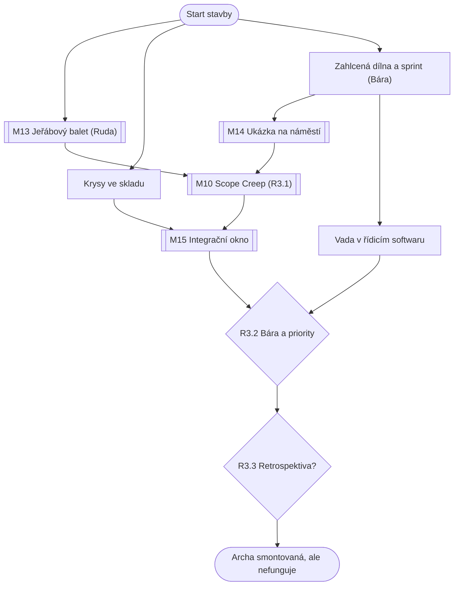

# Kapitola 3: Realizace – dva světy paralelně (kostra)

> Kostra kapitoly z kroku N2 [postupu návrhu](../12-postup-navrhu.md). V kroku N3 se rozroste
> v úplný návrh jako [kapitola 1](01-iniciace.md).
> Stav: **kostra ke schválení**, verze 0.1

## Přehled

| | |
|---|---|
| **Cíl hráče** | postavit rampu, zavřít trup se softwarem uvnitř a smontovat Archu |
| **Délka** | 70–90 minut (nejdelší kapitola) |
| **Patro v popředí** | oba světy paralelně ([koncepce](../07-dva-svety.md)) |
| **Výuková témata** | V12 plánování sprintu, V13 ranní porada, V14 hodnota, V15 změny, V16 rozpracovaná práce, V23 harmonogram, V24 ukázka, V25 integrace ([matice](../02-vyukova-matice.md)) |
| **Minihry** | M13 Jeřábový balet, M14 Ukázka na náměstí, M10 Scope Creep, M15 Integrační okno |
| **Rozhodnutí** | R3.1 bazén a svačiny, R3.2 Bára a priority, R3.3 retrospektiva |
| **Rudova vada** | mikromanažuje: chce rozhodovat i o věcech, kterým nerozumí |
| **Hraní za Báru** | ano, zhruba polovina kapitoly: dílna, sprint, ukázka |
| **Kometa** | zřetelně větší, ve dne je vidět i na obloze |

## Průběh v kostce

Kapitola se střídá ve dvou liniích. Hráč přepíná mezi Rudou a Bárou, když v jedné linii uvízne
nebo dokončí krok. Obě linie se potkávají u integrace.

**Ruda na rampě (svět plánu):**
1. **M13 Jeřábový balet:** jeden jeřáb (obsluhuje ho vrátný), beton musí zrát. Rudův způsob
   tu opravdu funguje. Tohle je jeho parádní disciplína.
2. **Krysy ve skladu:** sklad s materiálem na trup je plný krys. S kočkou Rizikovou (R2.3)
   za minutu, jinak dlouhé puzzle.
3. **Chybějící dovednost:** podle týmu z R2.1 chybí statik, nebo certifikátor. Puzzle se řeší
   oklikou (a stojí čas).

**Bára v dílně (svět iterací):**
4. **Zahlcená dílna:** všude rozdělané věci (V16). Puzzle: nejdřív dokončit, pak začít nové.
5. **Ranní porada a plánování sprintu** jako scéna s rozhodnutím (V12, V13): co se vejde do
   kapacity. Přeplnění zvýší technický dluh.
6. **M14 Ukázka na náměstí:** Bára ukáže obyvatelům prototyp nástupní aplikace a maketu kajuty.
   Babička chce velká tlačítka, rybáři místo na udice.
7. **Vada v řídicím softwaru:** Bára narazí na chybu. Jestli o ní řekne Rudovi, rozhoduje R1.3
   a Bářina důvěra.

**Spolu:**
8. **M10 Scope Creep (R3.1):** Pan Změna chce bazén v trupu a objednávání svačin v aplikaci.
   Kam který požadavek poslat a jak s ním naložit. Předseda sabotuje procesem: na každou změnu
   chce formulář ve třech kopiích.
9. **R3.2:** Ruda chce rozhodovat i o pořadí práce na softwaru. Pustí Báru k prioritám?
10. **M15 Integrační okno:** trup se v pevném termínu zavře. Co z řídicího systému musí být uvnitř
    a co může přijít později servisním poklopem.
11. **R3.3 Retrospektiva:** krátká scéna. Udělat ji, nebo „nemáme čas, stavíme“?
12. **Konec:** trup je zavřený, Archa smontovaná. Ruda ji slavnostně zapne a nic se nestane.

## Místa (rozpočet 6 scén, z toho 3 nové)

| Scéna | Nová / převzatá | Co se tu děje |
|---|---|---|
| Staveniště rampy s jeřábem | převzatá (kap. 2) | M13, chybějící dovednost |
| Hangár | převzatá (kap. 2) | integrace, R3.2, konec kapitoly |
| Náměstí | převzatá (kap. 1) | M14 ukázka, Pan Změna |
| Dílna (Bářin kout s maketami) | nová | rozpracovaná práce, sprint, vada |
| Sklad materiálu | nová | krysy, kočka Riziková |
| Trup Archy zevnitř | nová | M15, servisní poklop (vrátí se v kap. 4) |

## Postavy (rozpočet: 2 nové)

- **Vracející se:** Ruda, Bára, Pembok, tým (4 z R2.1), vrátný jako jeřábník, Pan Změna,
  Předseda, Ing. Framework (sprinty betonování, pokud mu hráč dal krabici), babička a obyvatelé
  na ukázce.
- **Nové:** **Scope Creep** (tvor, roste s každou neřízenou změnou) a **kočka Riziková**
  (jen při R2.3 = krysy).

## Hlavní graf

Dvě nezávislé linie dávají hráči vždy aspoň dvě rozdělané věci. Úzké místo je M15.

## Rozhodnutí

| ID | Kde | Volby | Příznak | Kde se vrátí |
|---|---|---|---|---|
| R3.1 | Scope Creep | bazén posoudit a vyjednat / přijmout bez řízení / odmítnout bez rozhovoru; svačiny zařadit podle hodnoty / protlačit schvalováním | `c3_bazen`, `c3_svaciny` | kap. 3–4: velikost Scope Creepa; kap. 4: důvěra obyvatel |
| R3.2 | hangár | pustit Báru k prioritám softwaru / rozhodovat sám | `c3_bara_priority` | kap. 4: řídicí systém dělá, co chtějí lidé, nebo co chtěl Ruda; Bářina důvěra; Rudův vývoj |
| R3.3 | hangár | retrospektiva / „nemáme čas“ | `c3_retro` | kap. 4: opakují se stejné chyby, morálka padá, člen týmu odchází s klíčovým předmětem |

Další příznaky: `c3_rezerva` (M13, dny rezervy), `c3_hodnota` (M14, přesnost seznamu práce),
`c3_creep` (M10, velikost tvora), `c3_integrace` (M15, počet nesladěných bodů),
`c3_vada_hlasena` (Bára řekla Rudovi o vadě), `c3_dluh` (technický dluh ze sprintu).

## Čte příznaky z dřívějška

| Příznak | Následek v kapitole 3 |
|---|---|
| `c1_bara_vyslechnuta` / Bářina důvěra | Bára o vadě v softwaru řekne, nebo mlčí (bible: R1.3) |
| `c1_faze2` | Předseda má páku: každá změna vyžaduje „analýzu dopadu na fázi 2“ |
| `c1_zmena_dohoda` | Pan Změna ví, že podepsaný požadavek platí; M10 je o kolo kratší |
| `c2_tym`, `c2_tym_pokryti` | chybějící dovednost znamená puzzle oklikou |
| `c2_rozdeleni` | `gantt`: Ruda naplánuje i software dopředu a obyvatelé ho na ukázce odmítnou; `krabice`: Framework zavede sprinty betonování a beton se rozpadne |
| `c2_vyjimky` | špatně zařazený interiér nebo bezpečnostní systém přinese varování (následek v kap. 4–5) |
| `c2_riziko_predem` | krysy: kočka Riziková; lano: jeřáb bez výpadku v M13 |
| `c2_rozpad` | mezery a překryvy z M04 jako překvapení v M13 a dílně |
| `c2_mosty` | integrační body pro M15; bez mostů je okno nejtěžší |

## Rozpočet

| | Rozpočet (D56) | Kostra |
|---|---|---|
| Délka | 70–90 min | odhad 75–90 min |
| Scény (nové) | 6 (3) | 6 (3) |
| Nové postavy | 2 | 2 (Scope Creep, kočka Riziková) |
| Předměty | 15 | odhad 12–15 |
| Repliky na jazyk | 450–550 | odhad 500–550 (dvě linie, hodně variant podle kap. 2) |
| Minihry | M13, M14, M10, M15 | M13, M14, M10, M15 |

**Riziko rozpočtu:** kapitola je nejhustší a nejvíc čte příznaky z dřívějška. Když přeroste,
zkrátí se nejdřív Integrační okno nebo Scope Creep ([rozpočty](../05-produkce.md#rozpočty-kapitol)).

## Otevřené otázky

- [ ] Jak hráč přepíná mezi Rudou a Bárou: kdykoli, nebo ve střídání daném příběhem?
- [ ] Kolik variant M13 a M14 podle `c2_rozdeleni` je únosné (plná varianta, nebo jen jiný průběh a hláška)?
- [ ] Který člen týmu odchází bez retrospektivy a s jakým předmětem (kap. 4)?
