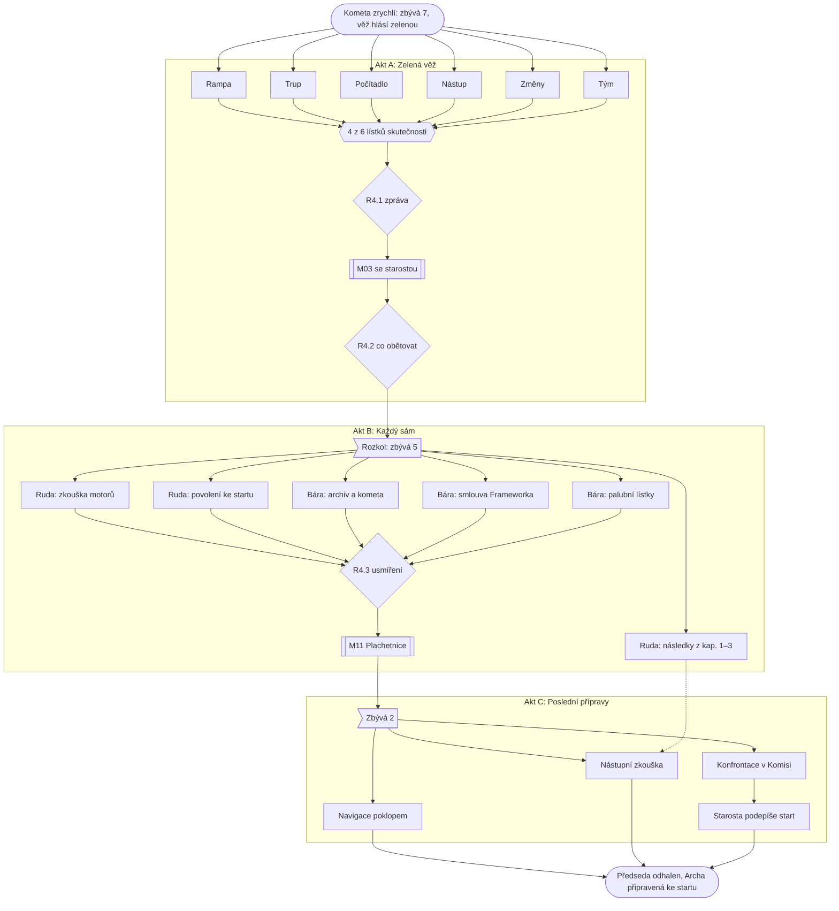

# Kapitola 4: Krize – všechno zelené

> Podrobný návrh kapitoly 4. Vznikl z kostry (N2, D62) v kroku N3
> [postupu návrhu](../12-postup-navrhu.md), až po hraní kapitol 2 a 3 v šedém prototypu (D74).
> Zadání autora: **co nejširší graf závislostí, rozpočet smí být překročen.**
> Stav: **tvar schválen** (D77: titulek, překročený rozpočet, dva poslové, 4 lístky), verze 0.3;
> podrobné dokumenty ke schválení: [místnosti a předměty](04-mistnosti.md), [karty puzzlů](04-puzzly.md),
> [průchod](04-pruchod.md), [osnovy dialogů](04-dialogy.md).
> Úplný graf a jeho rozbor: [graf závislostí](../13-graf-zavislosti.md#kapitola-4-krize).

## Přehled

| | |
|---|---|
| **Titulek kapitoly** | *Všechno zelené* / *All Green* (D77) |
| **Cíl hráče** | zjistit, jak na tom Archa doopravdy je, ustát rozkol s Bárou, odhalit Předsedu a připravit Archu ke startu |
| **Délka** | 60–80 minut (rozpočet 45–60, vědomé překročení, viz [rozpočet](#rozpočet)) |
| **Patro v popředí** | spojka: co se nesladilo, srazí se ([koncepce](../07-dva-svety.md)) |
| **Výuková témata** | V17 měření a reporting, V18 eskalace, V05 komunikace, V20 vedení týmu, V19 poučení, V25 integrace ([matice](../02-vyukova-matice.md)) |
| **Minihry** | M03 Souboj argumenty se starostou (rozhodující), M11 Plachetnice; malé hádanky: tabule ukazatelů, konfrontace s důkazy |
| **Rozhodnutí** | R4.1 zpráva starostovi, R4.2 co obětovat, R4.3 usmíření; Bářina zpráva o Předsedovi (D59) |
| **Rudova vada** | reportuje zeleně (R4.1) |
| **Hraní za Báru** | ano, zhruba polovina kapitoly; po rozkolu sama odhalí Předsedu (D59) |
| **Kometa** | zrychlí, zbývá 7 → 1 den; celá kapitola ve večerní a noční paletě C |

## Tvar kapitoly

Kapitola má **tři akty**. Každý se rozvětví do několika souběžných linek a sbíhá se do
jednoho úzkého hrdla, jak to popisuje Ron Gilbert ([rozbor](../13-graf-zavislosti.md#jak-graf-číst)).

**Šířka:** ve výchozím stavu jde v jednom kole udělat až 7 kroků k cíli, se špatnými kapitolami
1–3 až 12 (kapitola 2 má 8, kapitola 3 má 7). Úzká hrdla jsou M03, R4.2, usmíření a M11.
Následky z dřívějška (babička, plošina, drolení, poklop, odešlý člen týmu, bazén) přidávají
Rudovi v aktu B **souběžné** linky, ne další kroky za sebou.

## Místo v koncepci Dva světy, jedna Archa

Kapitola 4 je **spojka v krizi**. Co se v kapitolách 2–3 nesladilo, se ukáže najednou, a ukáže
se to na dvou rovinách:
- **Metodicky:** ukazatele ve věži jsou zelené, protože každý měří něco jiného, než tvrdí. Na rampě
  dává smysl měřit plnění plánu (deník jeřábu proti rozpisu), u počítadla a nástupu jen to,
  co lidé opravdu dostanou (zkouška s obyvateli). Hráč si to ověří šesti malými hádankami
  ve dvou světech.
- **Vztahově:** rozhraní mezi světy se rozbije doslova. Ruda chce všechno zamknout, Bára
  všechno přepracovat, a dva dny spolu nemluví. Bára vypne vysílačku a předměty mezi nimi nosí
  dva poslové z týmu.
  Všechno, co jde udělat odděleně, se udělat dá. Archa ale nevzlétne, dokud se neusmíří.

Rudova vada je zelené hlášení. R4.1 je jeho volba, ale hráč ji dělá až po tom, co sám viděl,
jak to doopravdy vypadá (nebo co neviděl, když poslal zelenou hned).

## Výchozí stav

**Ruda** má z kapitoly 3 **Prof. Pemboka**, **hrnek kávy**, **kávové pero**, **krabici od bot**,
**plán cesty ke startu** a **rozpis rampy**. Při `c2_riziko_predem` = `usmev` má navíc
**kopie všeho, co Předseda podepsal** (obálka z kapitoly 2 na úsměv). **Bára** má
**svinovací metr** a **seznam pasažérů** z kapitoly 1, který teď konečně použije (D59).

**Klíč od servisního poklopu** (bez poklopu **plán zapojení trupu**) drží člen týmu
z `c3_odchazi`. Po posezení v kapitole 3 je v hangáru a klíč nedá z ruky: poklop otevře sám.
Bez posezení (`c3_retro` = ne) odešel a pracuje „na zkoušku“ u Ing. Frameworka v Komisi.

| Příznak z dřívějška | Jak se projeví v kapitole 4 |
|---|---|
| `c1_slib_vseho` ≥ 3 | starosta v M03 začne kolem „A fontánu jste slíbil.“; v R4.2 přibudou fontána a terasa, které nejde obětovat bez vyhraného kola |
| `c1_babicka` ≠ `spojenec` | babička sedí na lehátku na svém pozemku přímo pod lávkou rampy (P4.13); `spojenec`: přinese buchtu a v konfrontaci svědčí („Na pozemek se mě nikdo neptal. Kromě něj.“) |
| `c1_charter_kvalita`, `c1_mimo_rozsah` | dobré repliky do M03; s „co nepatří“ jde v R4.2 bazén obětovat bez kola |
| `c1_seznam_pasazeru` | hlavní důkaz (P4.21) |
| `c2_riziko_predem` = `usmev` | kopie podpisů nahradí v konfrontaci libovolný jiný důkaz |
| `c2_rozdeleni` | `gantt`: obyvatelé aplikaci nevěří, palubní lístky musí být papírové (P4.23 o krok delší); `krabice`: viz `c3_drolivy` |
| `c2_tym` | bez Norberta dá startovací klíč vrátný („Mám klíče od všeho.“); bez Věry drolení zpevní vrátný a trup navrtá Ruda |
| `c3_rezerva` < 0 | rampa bez odpalovací plošiny (P4.14) |
| `c3_drolivy` | rampa se drolí (P4.15) |
| `c3_poklop` | `ano`: navigace se nahraje poklopem; `netesni`: poklop se musí utěsnit (P4.16); `ne`: Věra navrtá trup podle plánu zapojení (P4.29) |
| `c3_retro`, `c3_odchazi` | bez posezení musí Ruda odešlého člena přemluvit zpátky (P4.12), jinak nemá klíč od poklopu |
| `c3_integrace` | počet nesladěných bodů na lístku Trup a počet úkonů při nahrávání (P4.29) |
| `c3_vada_hlasena` | neopravená vada: počítadlo v P4.3 ukáže 4 811 a Bára píše opravu (P4.25) |
| `c3_bara_priority` | `ne`: na lístku Trup je navíc „odpočet uvnitř, počítadlo venku“; počítadlo se nahrává v P4.29 |
| `c3_hodnota` | kolik obyvatel v P4.4 ví, kudy nastoupit (0–3) |
| `c3_creep`, `c3_bazen` | velikost Ještětoto na lístku Změny a v R4.2; bazén bez řízení, který v R4.2 zůstane, vytvoří P4.17 |
| `c3_dluh` | ≥ 2: zkouška počítadla v P4.3 hlásí i chyby a palubní lístky se tisknou dvakrát |
| `c2_mosty` bez `nastup` a bez `bara_zna_lavku` | aplikace nezná den lávky (P4.18 a P4.24) |
| `c3_krysy` = `aktovka` | krysy žijí v kanceláři Komise a v konfrontaci sežerou Předsedovi poznámky (vtip) |

## Scény

| # | Scéna | Nová / převzatá | Postavy | Co se tu děje |
|---|---|---|---|---|
| S1 | **Řídicí věž** | **nová** | dispečer Zelenka, starosta (M03) | úvod, tabule ukazatelů, R4.1, M03, R4.2 |
| S2 | **Staveniště rampy** (večer) | převzatá (kap. 2–3) | vrátný v jeřábu, obyvatelé s kufry, babička na lehátku (jen bez spojenectví), posel na staveništi (akt B) | lístky Rampa a Nástup, palivo, babička, plošina, drolení, nástupní zkouška |
| S3 | **Hangár s Archou** (večer) | převzatá (kap. 2–3) | tým, Ještětoto, Pan Změna (jen s bazénem) | lístky Trup, Změny a Tým, rozkol, zkouška motorů, usmíření, M11 |
| S4 | **Dílna** (večer) | převzatá (kap. 3) | Bára, posel ve dveřích | lístek Počítadlo, palubní lístky, oprava počítadla, posel |
| S5 | **Trup Archy zevnitř** (noc) | převzatá (kap. 3) | Ruda v poklopu, Bára, Věra (jen bez poklopu) | jen v aktu C: nahrání navigace; trup je od kapitoly 3 zanýtovaný, dovnitř se jde jen poklopem (v aktu A se jím jen podívá) |
| S6 | **Archiv** (noc) | převzatá (kap. 1) | Lumír (spí na pultu) | kometa v kartotéce, záznam, plán Komise |
| S7 | **Kancelář Komise** (noc) | převzatá (kap. 1–2) | Předseda, Ing. Framework, odešlý člen týmu, krysy (jen `aktovka`) | povolení ke startu, smlouva, odešlý člen, konfrontace |

**Cesta na radnici** (náměstí, vestibul) je jen přechod: východ „Na radnici“ ze staveniště nabídne
archiv, nebo Komisi. Večerní náměstí a vestibul tedy nepotřebují aktivní místa ani nové pozadí.
Sklad, hospoda a Mlžná pláň se nepoužívají.

## Postavy

**Vracející se:** Ruda, Bára, Prof. Pembok, tým (4 z R2.1, bez odešlého člena), vrátný,
starosta Bohumil, Předseda Věčný, Ing. Framework, Lumír, babička (podle R1.2), obyvatelé
a rybáři, Pan Změna (jen s bazénem), Ještětoto (velikost podle `c3_creep`), kočka Riziková
(jen při `krysy`, hlídá sklad a v konfrontaci se jí Předseda bojí).

**Nová:**

| Postava | EN | Kdy | Co dělá |
|---|---|---|---|
| **Dispečer Zelenka** | **Mr Greenlight** | akt A ve věži | věří svým zeleným světlům („Zelená je klidná barva.“); neví, co které světlo měří, ale ochotně ukáže štítek; světla vyrobil projekt *Týdenní výměna žárovek* z Rudovy zdi slávy, jiné než zelené ve městě nejsou |

**Poslové** nejsou nové postavy, jsou to dva členové týmu (D77). **Posel ve dveřích dílny** stojí
mezi hangárem a dílnou, takže ho vidí Ruda z hangáru i Bára z dílny. **Posel na staveništi**
stojí u východu Na radnici, kudy chodí oba. Poslem se stane první, resp. druhý člen týmu podle
pořadí Klára, Kryštof, Zdenda, Pepa, Norbert, Věra, který v aktu B v týmu je (tým má v aktu B
vždy aspoň tři lidi). Pepa jako posel řekne „Za dva dny.“ a doběhne hned.

## Jak se hraje

- **Akt A:** jako kapitola 3, obě postavy se přepínají portrétem kdykoli a mohou si předávat
  předměty, když stojí ve stejné scéně. Zelenka dá oběma **vysílačku**: ověřený lístek postava
  nahlásí do věže sama (jedna replika) a světlo na tabuli hned změní barvu. Lístky se nikam
  nenosí a nejsou předměty.
- **Akt B:** portrét funguje dál, ale **Ruda a Bára spolu nemluví** a Bára vypne vysílačku.
  Ve stejné scéně se ignorují („S Rudou teď nemluvím.“ / „Vyřiďte Báře, že nemluvím.“).
  Předmět jde druhé postavě dát jen přes **posla**: použít předmět na kteréhokoli ze dvou
  poslů, ten odběhne, hned se vrátí a předmět má druhá postava v inventáři. Rozhovor s poslem
  řekne, co ta druhá právě dělá (nápověda k druhé lince), a nese Bářin vzkaz o Předsedovi
  (P4.26). Společné scény se v aktu B nehrají. Pembok a metr radí dál, každý své postavě.
- **Akt C:** zase spolu, Bára zapne vysílačku („Příjem.“). Tři úkoly za oba (P4.29–P4.31)
  začínají střihem, který přivede druhou postavu, jako společné scény v kapitole 3.
- **Čas běží po aktech.** Střihy: zbývá 7 (úvod) → 5 (rozkol) → 2 (po M11) → 1 (konec). Den
  v aktu B běží, ale nic nespotřebovává: rezervu `c3_rezerva` už hráč spotřeboval v kapitole 3,
  následky z ní jsou úkoly (plošina), ne odpočet.

## Průběh a puzzly

### Úvod (zbývá 7, večer)

1. **Kometa zrychlí.** Amplion: „Dnů do dopadu: sedm.“ Ruda: „Bylo devět!“ Pembok: „Kometa
   nečte Gantty.“ Tým je svolaný do nové řídicí věže u rampy. Dispečer Zelenka hrdě ukáže
   tabuli: šest ukazatelů, všechny zelené. Pan Změna mávne z okna: „Takže hotovo? Můžu objednat
   ohňostroj?“ Pembok tiše: „Zelená je barva naděje. Ne stavu.“ Bára se dívá na štítky.
   Podrobně v části [Úvod a konec](#úvod-a-konec).

### Akt A: Zelená věž (Ruda i Bára)

Pod každým světlem je štítek, co měří. Kdo si štítek přečte (nebo se zeptá Zelenky), ví,
co jít ověřit. **Lístek skutečnosti** nahlásí postava vysílačkou, Zelenka ho připne na tabuli
a světlo změní barvu na tu skutečnou.
Hráč potřebuje **4 lístky ze 6**, aby mohl poslat poctivou zprávu (R4.1). Zelenou jde poslat
kdykoli.

| # | Ukazatel na tabuli | Štítek: co doopravdy měří | Kdo ověří | Jak (puzzle) | Skutečnost podle stavu |
|---|---|---|---|---|---|
| **P4.1** | Rampa: hotovo 100 % | dodané pytle cementu | Ruda | říct si vrátnému o **deník jeřábu** („Nikdo se nikdy nezeptal.“) a porovnat ho s rozpisem rampy z M13 | zelená; žlutá bez plošiny (`c3_rezerva` < 0); červená při drolení nebo babičce na lehátku |
| **P4.2** | Trup: zapojeno | odškrtnuté řádky Rudova Gantta | Ruda | člen týmu s klíčem otevře poklop, Ruda se podívá dovnitř (bez poklopu přes okénko podle plánu zapojení) | počet nesladěných bodů z `c3_integrace`; při R3.2 = Ruda „odpočet uvnitř, počítadlo venku“ |
| **P4.3** | Místa: 4 812 / 4 812 | sedadla na výkresu | Bára | spustit zkoušku počítadla v dílně | 4 811 při neopravené vadě; chyby při `c3_dluh` ≥ 2 |
| **P4.4** | Nástup: připraven | vytištěné letáky | Bára | zeptat se obyvatel s kufry u rampy, kudy nastoupí, a zkusit s nimi, babičkou a rybáři vyjít na lávku | podle `c3_hodnota` 0–3 skupiny vědí, kam jít; babička na lehátku nejde; při `gantt` aplikaci nevěří |
| **P4.5** | Změny: žádné | formuláře v Předsedově šuplíku (prázdném) | Bára | změřit Ještětoto v hangáru metrem | délka podle `c3_creep`: „Tři metry. Minulý týden měl metr.“ |
| **P4.6** | Tým: spokojen 5/5 | podpisy na docházce (podepisuje Kryštof za všechny, bez Kryštofa automat) | Ruda | zeptat se každého z týmu v hangáru, jak se má (Ruda se ptá poprvé) | nálada podle `c3_retro`; bez posezení „chybí X, odešel k Frameworkovi“ |

- **Stopy:** štítky pod světly; Bára: „Kdo tu zelenou měří?“; Pembok podle stavu; každý
  ověřený lístek Zelenka okomentuje („Žlutá? Tu jsem tu ještě neviděl.“).
- **Chybné, ale logické pokusy:** přebarvit světlo kávou (★ „Hnědá. To je ještě horší.“),
  vyměnit žárovku (žádné jiné nejsou), zeptat se Zelenky na stav (ukáže na světla).
- **Bez posezení** (`c3_retro` = ne) lístek Trup v aktu A nejde (klíčník odešel), zbývá 5 z 6.
  Lístek Tým pak prozradí, kam odešel.

7. **R4.1 Zpráva starostovi (P4.7).** U telegrafu ve věži: **poctivě s variantami**
   (jen se 4 a více lístky; varianty vzniknou z červených a žlutých lístků) nebo **zelenou**
   (kdykoli). Pembok u zelené: „Jsi si jistý? Ty světla jsi neviděl.“ Zelenka u poctivé:
   „Žlutá ve zprávě? To se tu ještě nestalo.“
8. **M03 Souboj se starostou ve věži (P4.8).** Starosta přijede: po poctivé zprávě zjistit,
   proč to není zelené, po zelené oslavit a přidat ohňostroj. Pravidla v [minihrách](#m03-souboj-argumenty-se-starostou).
   Výsledek `c4_souboj` určí, kolik smí hráč v R4.2 obětovat bez starostova odporu.
9. **R4.2 Co obětovat (P4.9).** Tabule rozsahu ve věži. Kapacita do startu je menší než seznam
   práce (o to víc, čím větší je Ještětoto). Hráč vybírá, co z Archy vypadne: bazén, svačiny
   v aplikaci, odpočet na celé obrazovce, tlačítko Zpět, navigace hned (místo později poklopem),
   **Rudův pomník na rampě** (Ruda ho plánuje od kapitoly 1), fontána a terasa (jen při
   `c1_slib_vseho` ≥ 3). Každá obětovaná věc Ještětoto zmenší. Pomník obětuje Ruda jen nerad
   („Ten se počítá jako motivace.“). Výsledek `c4_obet`.
10. **Rozkol (střih).** Ruda: „Od teď nic neměníme. Zamykám.“ Bára: „Počítadlo a nástup se musí
    přepracovat.“ Ruda: „Ne.“ Bára odejde do dílny a zavře dveře. Při vysoké Bářině důvěře je
    to tiché a smutné, při nízké hlasité. Karta: **„Zbývá 5. Dva dny spolu nepromluvili.“**

### Akt B: Každý sám (zbývá 5)

**Ruda:**

| # | Puzzle | Řešení | Kdy |
|---|---|---|---|
| **P4.10** Zkouška motorů | dokázat, že Archu nastartuje sám | **startovací klíč** od Norberta (bez něj od vrátného); **sud paliva** na staveništi nechá vrátný jeřábem spustit do hangáru; v kokpitu klíč + start → motory naskočí a zhasnou: „Řídicí systém nepotvrdil nástup.“ Ruda: „…Báro?“ | vždy |
| **P4.11** Povolení ke startu | razítko Komise na start | Předseda: „Analýza dopadu startu na fázi 3. Formulář 3-F. Fronta je tamhle.“ Fronta na frontu znovu (vtip z kap. 1). Pembok: „Tohle razítko nedostaneš. A on to ví.“ | vždy |
| **P4.12** Odešlý člen týmu | vrátit klíč od poklopu (nebo plán zapojení) | v Komisi u Frameworka; Gantt ani slib nezabere, jen přiznat chybu („Neposlouchal jsem.“) a nechat ho domluvit. Vrátí se s klíčem a řekne, že Framework s Předsedou „podepsali něco na fázi 3“ (svědectví) | jen `c3_retro` = ne |
| **P4.13** Babička na lehátku | uvolnit pozemek pod lávkou | vyslechnout ji (poprvé se jí někdo zeptá, proč tu sedí: na seznamu pasažérů není), potom jí dát **palubní lístek** od Báry přes posla. Při `odmitnuta` nejdřív donést kocoura, který se schoval v Arše | jen `c1_babicka` ≠ `spojenec` |
| **P4.14** Plošina | dostavět odpalovací plošinu | vrátný a jeřáb: jedno bednění a jedna betonáž (bez minihry, „dva dny“ doopravdy) | jen `c3_rezerva` < 0 |
| **P4.15** Drolivá rampa | zpevnit rampu | Věra namíchá správnou směs (bez Věry vrátný podle deníku) | jen `c3_drolivy` |
| **P4.16** Netěsný poklop | utěsnit poklop | těsnicí páska z dílny od Báry přes posla | jen `c3_poklop` = `netesni` |
| **P4.17** Bazén | dostat bazén z trupu | Pan Změna ho hlídá; nechat ho domluvit: chce bazén „pro všechny“. Nabídnout mu kašnu na náměstí (projekt z roku 1994 ve fázi 2) | jen bazén bez řízení, který v R4.2 zůstal |
| **P4.18** Rozpis po poslovi | Báře chybí den lávky | dát rozpis rampy poslovi | jen bez mostu *zkouška nástupu* |

**Bára:**

| # | Puzzle | Řešení | Kdy |
|---|---|---|---|
| **P4.19** Archiv v noci | dostat se k Lumírovi | vzít v dílně **kuchyňskou minutku** (z ranní porady v kap. 3), v archivu ji natáhnout u spícího Lumíra. Lumír: „V noci vydávám jen lidem, kteří měří.“ | vždy |
| **P4.20** Kometa v kartotéce | najít, kdo o kometě věděl | v kartotéce, kterou Ruda v kap. 1 seřadil podle skutečného zahájení, je nový lístek **„Pozorování komety (1994–dosud)“**, zastrčený mezi „příští rok“. Bára ho zařadí podle data z Lumírovy knihy: duben 1994, mezi výtah a Archu (květen 1994). Komise tedy viděla kometu měsíc předtím, než začala Archu. Lumír vydá přílohu: **hvězdářský záznam** podepsaný Předsedou: „Utajit. Fáze 2.“ | vždy |
| **P4.21** Plán Komise | spojit důkazy | **záznam** na **seznam pasažérů**: stejné datum, duben 1994. Komise věděla o kometě a chystala Archu jen pro sebe. Bára připíše datum na seznam → předmět **plán Komise** (seznam se v něj změní, záznam zůstane) | vždy |
| **P4.22** Smlouva | proč Framework sedí u Předsedy | v Komisi se Frameworka zeptat na referenci. Hrdě ukáže **smlouvu na fázi 3** („Krabice Věčnost. Na zkoušku navždy.“) a ochotně dá kopii pro „srovnání“ | vždy |
| **P4.23** Palubní lístky | lístek pro každého obyvatele | v dílně vytisknout z aplikace (počet míst z počítadla); při `gantt` navíc přepsat na papír, protože aplikaci obyvatelé nevěří; při `c3_dluh` ≥ 2 tiskne dvakrát | vždy |
| **P4.24** Den lávky | aplikace musí vědět, kdy je lávka | rozpis rampy od posla (P4.18) | jen bez mostu *zkouška nástupu* |
| **P4.25** Oprava počítadla | 4 811 → 4 812 | napsat opravu v dílně; nahraje se v aktu C | jen neopravená vada |
| **P4.26** Zpráva Rudovi (D59) | říct Rudovi, co ví | s plánem Komise promluvit s kterýmkoli poslem: „Vyřiďte Rudovi, co vím o Předsedovi.“ Jen při vysoké Bářině důvěře („Hned.“), jinak ★ „Ještě ne.“ | volitelné |

Bára posílá přes posla i **palubní lístek pro babičku** (P4.13) a **těsnicí pásku** (P4.16).
Ruda přes posla na staveništi posílá **rozpis rampy** (P4.18).

11. **R4.3 Usmíření (P4.27).** Když Ruda ví, že motory bez řídicího systému nenastartují a že
    razítko nedostane, a Bára má důkazy a lístky, přijde Bára do hangáru. Ruda stojí u tichých
    motorů. Volba: **„Plán nestačí. Potřebuju tě.“** nebo **„Plán byl dobrý. Jen ho nikdo
    nedodržel.“** Obě vedou dál (D12), mění Bářinu důvěru, Rudův vývoj a kapitolu 5. Bára
    řekne o Předsedovi teď, pokud to neudělala dřív (`c4_bara_rekla` = `hned` / `po_usmireni`).
    Při `po_usmireni` položí Rudovi na pult desky se svými důkazy: v konfrontaci je předkládá on.
12. **M11 Plachetnice na palubě Archy (P4.28).** „Archa je loď. Tak si na ni sedneme.“ Tým, Ruda
    a Bára. Pravidla v [minihrách](#m11-plachetnice). Vybrané zlepšení `c4_zlepseni` platí
    v kapitole 5. Střih: **„Zbývá 2.“** Člen týmu s klíčem od poklopu ho dá Rudovi: „Teď ho
    budete potřebovat oba.“

### Akt C: Poslední přípravy (zbývá 2, spolu)

13. **Navigace poklopem (P4.29).** Ruda otevře klíčem poklop a drží ho (u netěsného s páskou),
    Bára vleze do trupu a nahrává navigaci (plánovaně „později poklopem“ z M15), opravu
    počítadla a programy, které se v M15 zavřely nehotové. Přípojka, která zůstala venku, se
    natáhne poklopem: hráč přepíná, Ruda tahá kabel a Bára hlásí, kdy svítí. Po každém úkonu
    může Ruda říct „Stačí. Zavírám.“ (Rudova vada naposledy); co zůstane, je `c4_integrace`.
    **Bez poklopu** Věra navrtá trup podle plánu zapojení (bez Věry Ruda: „Nýtovačka byla lehčí.“).
14. **Nástupní zkouška (P4.30).** Obyvatelé s kufry a s palubními lístky přejdou po lávce do Archy
    a zase ven. Jde jen po rampě bez babičky na lehátku, s plošinou a bez drolení, a když aplikace
    zná den lávky. Ruda řídí frontu („Tohle je jediná fronta, kterou jsem kdy chtěl.“), Bára počítá.
    Výsledek `c4_nastup`.
15. **Konfrontace v Komisi (P4.31).** Předseda, Ing. Framework, starosta (přijde podepsat start).
    Předseda má tři výmluvy a na každou platí jiný důkaz:

| Výmluva | Důkaz | Náhrada |
|---|---|---|
| „O kometě jsme nevěděli.“ | hvězdářský záznam | kopie podpisů (`usmev`) |
| „Fáze 2 byla opatrnost.“ | plán Komise (seznam + záznam) | kopie podpisů |
| „Nikdo nám nic neprodal.“ | smlouva na fázi 3 | svědectví odešlého člena (P4.12); kopie podpisů |

    Špatný důkaz: Předseda „Fáze 2.“ a nic se nestane (D12). Při `c4_bara_rekla` = `hned`
    stojí Bára u toho a předkládá svou půlku důkazů sama; jinak předkládá Ruda všechno a Bára
    přijde až na konec. **Antiklimax:** Předseda „Já? Já jsem jen schvaloval.“ a ukáže sbalený
    kufr. Ruda mu podá palubní lístek: „Archa veze všechny. Fronta je tamhle.“ Framework:
    „Já jsem jen prodával krabice.“ a nabídne krabici „Krize“. Při `aktovka` mu krysy
    z aktovky sežerou poznámky.
16. **Povolení ke startu (P4.32).** Starosta podepíše start místo Komise: „Komise je
    pozastavena. Do fáze 2.“ Po zelené zprávě (R4.1) váhá: „Včera jste mi hlásil zelenou.“
    a podepíše až s lístky skutečnosti na stole (bez nich jen s Bářinými čísly).
17. **Konec kapitoly.** Zbývá 1. Archa je připravená ke startu. Podrobně v části
    [Úvod a konec](#úvod-a-konec).

## Rozhodnutí kapitoly

| ID | Kde | Volby | Příznak | Kde se vrátí |
|---|---|---|---|---|
| R4.1 | věž, telegraf | poctivě s variantami (4+ lístky) / zelenou | `c4_report` = `poctive` / `zelene`; `c4_listky` (0–6) | hned v M03 a P4.32; kap. 5: start na falešných datech, horší konec |
| R4.2 | věž, tabule rozsahu | co obětovat (seznam) | `c4_obet` (seznam), `c4_creep` (velikost Ještětoto po R4.2) | P4.17 (bazén); kap. 5: co v Arše chybí, reakce obyvatel v epilogu |
| R4.3 | hangár | „Plán nestačí. Potřebuju tě.“ / „Plán byl dobrý.“ | `c4_usmireni` = `priznal` / `trval` | kap. 5: spolupráce ve finálním puzzlu, Rudův vývoj, Bářina důvěra |
| Bára (D59) | akt B, posel | říct Rudovi hned (jen při důvěře) / až po usmíření | `c4_bara_rekla` = `hned` / `po_usmireni` | P4.31: konfrontace spolu, nebo Ruda sám |

**Stavové proměnné:** poctivá zpráva zvedne důvěru stakeholderů a Rudův vývoj o 1 (vada
„reportuje zeleně“), zelená ho nezvedne a důvěru sníží. Obětovaný pomník zvedne morálku týmu.
R4.3 = přiznat zvedne Bářinu důvěru a sladění světů.

**Další příznaky:**

| Příznak | Hodnoty | Nastaví | Čte |
|---|---|---|---|
| `c4_souboj` | 0–5 (vyhraná kola) | M03 | R4.2 (kolik jde obětovat bez odporu) |
| `c4_slib` | 0–5 (rychlé repliky v M03) | M03 | kap. 5 (starosta chce všechno, co slíbeno) |
| `c4_zlepseni` | jedno ze tří | M11 | kap. 5 |
| `c4_nastup` | 0–3 (kolik skupin obyvatel prošlo napoprvé) | P4.30 | kap. 5 (nástup) |
| `c4_integrace` | 0–3 (nesladěné body po P4.29) | P4.29 | kap. 5 (finální puzzle) |
| `c4_clen_zpet` | ano | P4.12 | kap. 5 (kdo stojí na rampě) |
| `c4_predseda` | `spolu` / `ruda` | P4.31 | kap. 5 (Předseda ve frontě), epilog |

## Graf závislostí puzzlů

Úplný graf (53 uzlů, tři scénáře stavu) je v [rozboru grafu závislostí](../13-graf-zavislosti.md#kapitola-4-krize).
Zdroj je `tools/graf/k4.mjs`; kdo mění puzzle tady, mění ho i tam. Souhrn:

| | Výchozí stav | Špatné kapitoly 1–3 |
|---|---|---|
| Kroků celkem / povinných | 30 / 18 | 38 / 27 |
| Nejkratší sled | 11 kol | 11 kol |
| Nejvíc kroků k cíli v jednom kole | 7 | 12 |
| Úzká hrdla | M03, R4.2, usmíření, M11 | M03, R4.2 |

Ve špatném stavu nejsou usmíření a M11 úzká hrdla, protože následky z dřívějška (babička,
plošina, bazén, odešlý člen) jdou dodělat i v aktu C. To je záměr: hráč, který v kapitolách 1–3
hodně pokazil, má víc práce, ale ne delší frontu.

## Minihry v kapitole 4

### M03 Souboj argumenty se starostou

- **Patro:** společný základ (komunikace se sponzorem). Rozhodující souboj hry ([M03](../04-minihry.md#m03-souboj-argumenty)).
- **Pravidla jako v kapitole 1:** 5 kol, výhra = aspoň 3 vyhraná kola. Starosta vznáší námitky
  a hráč odpovídá replikou. Dobrá replika se ukáže jen s podkladem. Rychlá replika (slib) kolo
  vyhraje a přičte 1 k `c4_slib`, slabá kolo prohraje. Prohra nic nebere (D12), jen se opakuje.
- **Námitky a podklady:**

| Kolo | Námitka po poctivé zprávě / po zelené | Dobrá replika z |
|---|---|---|
| 1 | „Včera bylo všechno zelené.“ / „Tak ohňostroj, ne?“ | lístek Rampa nebo Trup („Světla měřila pytle cementu.“) |
| 2 | „Lidé se mají nalodit, ne čekat.“ | lístek Nástup nebo Bářina čísla (`c3_hodnota`) |
| 3 | „Kolik jich poletí?“ | lístek Počítadlo („4 811. Opravujeme.“, nebo „4 812, ověřeno.“) |
| 4 | „A všechno, co jsem slíbil novinám?“ | charter: „co nepatří“ (`c1_mimo_rozsah`) nebo lístek Změny (Ještětoto) |
| 5 | „Proč bych vám měl věřit?“ | varianty ze zprávy (jen po poctivé) nebo lístek Tým |

  Při `c1_slib_vseho` ≥ 3 přibude před 1. kolo „A fontánu jste slíbil.“ (dobrá replika jen
  z charteru). Po zelené zprávě jde poctivě vyhrát jen s lístky, které hráč přesto sebral.
- **Výsledek:** `c4_souboj`, `c4_slib`. Kolik vyhraných kol, tolik věcí jde v R4.2 obětovat bez
  starostova „To ne!“.
- **Přeskočení:** Pembok vybere rychlé repliky; `c4_souboj` = 3, `c4_slib` = 2.

### M11 Plachetnice

- **Patro:** společný základ (poučení). Hraje se na palubě Archy v hangáru (bez nového pozadí,
  překryvná obrazovka s náčrtem lodi).
- **Mechanika** ([M11](../04-minihry.md#m11-plachetnice)): k lodi se umísťují **kotvy** (co brzdilo),
  **vítr** (co pomohlo) a **útesy** (co hrozí v kap. 5). Karty jsou události kapitoly a mluví
  za ně členové týmu: zelená světla, rozkol, posel, Ještětoto, babička, palivo bez řídicího
  systému, poctivá zpráva, Bářiny důkazy. Kotva i vítr jsou správně podle toho, jak to hráč
  zažil: rozkol je kotva, posel vítr, zelená zpráva kotva, poctivá vítr.
- **Lahve s poučením** připlouvají z Lumírovy krabičky Poučení (karta poučení z kap. 1, když ji
  hráč má, připluje první: „Zapomněli jsme se zeptat rybářů.“). Lahev jde přiřadit k útesu.
- **Konec:** hráč vybere **jedno zlepšení pro kapitolu 5**: *Ptát se dřív, než se zamkne*
  (víc času ve finálním puzzlu), *Jedna tabule pro oba* (Ruda vidí, co ví Bára), nebo
  *Říct to nahlas* (tým radí ve finále). Výsledek `c4_zlepseni`.
- **Bez posezení v kap. 3:** odešlý a vrácený člen řekne první kartu sám: „Odešel jsem, protože
  jsme si nikdy nesedli.“
- **Přeskočení:** Pembok vybere *Jedna tabule pro oba*.

### Malé hádanky (ne minihry)

- **Tabule ukazatelů (P4.1–P4.6):** šest světel, pod každým štítek; lístky se připínají
  přetažením nebo klepnutím. Žádné časování.
- **Konfrontace (P4.31):** dialog, ve kterém se na výmluvu odpovídá předmětem z inventáře.
  Tři výmluvy, nekonečně pokusů.

## Úvod a konec

### Úvod: večer ve věži (2–3 min)

1. Titulek *Kapitola 4: Všechno zelené*. Noc nad Nedostavěnicí, kometa je větší než měsíc.
2. Amplion: „Kometa Deadline zrychlila. Dnů do dopadu: sedm. Prosíme občany, aby panikařili
   ukázněně.“ Ruda: „Bylo devět!“ Pembok: „Kometa nečte Gantty.“
3. Řídicí věž. Dispečer Zelenka: „Všechno zelené. Jako vždycky.“ Tým se dívá na tabuli,
   Ještětoto na ní sedí a olizuje světlo Změny.
4. Bára si čte štítek pod Rampou: „Dodané pytle cementu.“ Pembok: „Zelená je barva naděje.
   Ne stavu.“ Úkol: *Zjistit, jak na tom Archa doopravdy je.*

### Konec kapitoly (zbývá 1)

1. Po podpisu starosty střih na rampu v noci. Archa stojí na plošině, lávka je prázdná, kufry
   obyvatel jsou srovnané v řadě („jediná fronta ve městě, která někam vede“).
2. Ve věži Zelenka vymění poslední zelenou žárovku za žlutou, kterou mu přinesla Bára: „Ta
   svítí míň. Ale svítí.“
3. Ruda a Bára na rampě. Při R4.3 = přiznal: „Zítra.“ Bára: „Zítra.“ (stále bez „termínu“, D60).
   Jinak stojí každý na jiném konci rampy.
4. Předseda stojí ve frontě na nástup s kufrem, Framework za ním s krabicí „Krize“. Při `aktovka`
   z kufru vykoukne krysa.
5. Obrazovka **„Co si Nedostavěnice zapamatovala“**: zpráva starostovi, co se obětovalo, usmíření,
   zlepšení, nástupní zkouška, kdo odhalil Předsedu. Pokračování příště.

## Kontrola proti zásadám (N3h)

- [x] **Gilbertův graf:** tři akty, každý se rozvětví a sbíhá do úzkého hrdla; ve výchozím
  stavu až 7 souběžných kroků k cíli, ve špatném až 12, úzká hrdla M03, R4.2, usmíření a M11 ([rozbor](../13-graf-zavislosti.md#kapitola-4-krize))
- [x] Pilíře vize: učí mechanika (tabule ukazatelů = co měřit v kterém světě, posel = co se stane,
  když rozhraní přestane mluvit), rozhodnutí mají váhu (R4.1 v M03 a P4.32, R4.2 v P4.17)
- [x] **Slovník D26:** ve hře „ukazatele“, „zpráva starostovi“, „co obětovat“, „posezení“,
  „Plachetnice“; žádný dashboard, reporting, eskalace, scope ani retrospektiva
- [x] Žádný puzzle na jazykové hříčce (D03): Zelenka / Greenlight je jen jméno
- [x] Nic nezávisí na najetí myší (D04); štítky jsou vidět vždy
- [x] Žádná slepá ulička: zelená zpráva jde kdykoli, M03 a M11 jdou přeskočit (D12), špatný
  důkaz v konfrontaci nic nestojí, posel donese cokoli a každý následek z dřívějška má řešení
- [x] Každý puzzle má aspoň dvě stopy ve světě (štítky, Zelenka, Pembok, metr, tým) a tři stupně
  nápovědy (D10); rozhodnutí R4.1–R4.3 mají jen 1. stupeň (K16 z kap. 3)
- [x] PEGI 12 (D11): Předseda není zatčen, jen pozastaven a postaví se do fronty
- [x] Bára neřekne „termín“ (D60); seznam pasažérů konečně použije (D59)
- [x] **Rozpočet (D56): překročen**, viz níže; schváleno autorem (D77)

## Soulad s kapitolami 1–3

| Co | Kde dřív | Jak navazuje kap. 4 |
|---|---|---|
| Týdenní výměna žárovek | kap. 1, Rudova zeď slávy | jediné žárovky ve městě jsou zelené; Zelenka je dostal z toho projektu |
| Vrátný „Nikdo se nikdy nezeptal.“, deník | kap. 1–3 | deník jeřábu pro lístek Rampa, palivo jeřábem, bez Norberta startovací klíč |
| Kartotéka seřazená podle skutečného zahájení | kap. 1, P1.5 | lístek komety jde zařadit stejným pravidlem (P4.20) |
| Lumírovo „Přílohy jen k lístkům na svém místě“ | kap. 1 | záznam o kometě je příloha (P4.20) |
| Fronta na frontu | kap. 1 | povolení ke startu (P4.11) |
| Seznam pasažérů | kap. 1, D59 | plán Komise (P4.21) |
| Kopie podpisů (obálka na úsměv) | kap. 2, R2.3 | náhrada za kterýkoli důkaz (P4.31) |
| Kuchyňská minutka | kap. 3, ranní porada | probudí Lumíra (P4.19) |
| Klíč od poklopu, plán zapojení, `c3_odchazi` | kap. 3, M15 | P4.2, P4.12, P4.29 |
| Navigace „později poklopem“ | kap. 3, M15 | P4.29 (plánované použití poklopu) |
| Framework „je teď u nás. Na zkoušku.“ | kap. 3, Předseda | Framework sedí v Komisi a má smlouvu na fázi 3 (P4.22) |
| Kašna z roku 1994 ve fázi 2 | kap. 1, kartotéka | Pan Změna dostane bazén do kašny (P4.17) |
| Rybáři a karta poučení „zapomněli jsme se zeptat rybářů“ | kap. 1, kap. 3 M14 | rybáři v nástupní zkoušce; karta jako první lahev v M11 |
| Odpočet a vrátný „Dva dny.“ | kap. 3 konec | plošina se v P4.14 opravdu staví dva dny |

### Zpětné úpravy dřívějších kapitol

- **Mapa následků v bibli:** nové příznaky `c4_listky`, `c4_slib`, `c4_creep`, `c4_nastup`,
  `c4_integrace`, `c4_clen_zpet`, `c4_predseda` doplněny (D77); kapitola 5 je čte.
- **Kapitola 3, konec:** Pepa (nebo kdo drží klíč) by měl v posledním střihu klíč od poklopu
  ukázat („Nedám ho z ruky.“), aby byl v kapitole 4 čitelný. Jedna replika.
- **Kapitola 1:** Rudova zeď slávy už má *týdenní výměnu žárovek* (V01). Beze změny, jen se
  ověří, že diplom říká „zelené“.

## Rozpočet

Zadání autora povoluje překročení (2026-11-02), autor ho schválil (D77). Při psaní obsahu
místností vyšlo 21 předmětů místo odhadovaných 19 (svědectví a kopie podpisů jsou ve variantách).

| | Rozpočet (D56) | Návrh | Proč |
|---|---|---|---|
| Délka | 45–60 min | 60–80 min | tři akty a dvě postavy; akt B je za oba souběžně |
| Scény (nové) | 5 (1) | 7 (1) + přechod na radnici | dílna a trup v aktu B a C nesou Bářinu a společnou linku; večerní verze 6 převzatých pozadí |
| Nové postavy | 1 | 1 (Zelenka) | – |
| Předměty | 10 | 21 (z toho 9 z dřívějších kapitol, 5 jen ve variantách; [seznam](04-mistnosti.md#předměty)) | každá souběžná linka potřebuje svůj předmět (deník, startovací klíč, minutka, záznam, smlouva, lístky) |
| Repliky na jazyk | 400–500 | osnova ≈ 713 ([dialogy](04-dialogy.md#součet); v jednom průchodu asi 470) | šest ukazatelů ve dvou až třech stavech, posel, konfrontace, varianty následků |
| Minihry | M11, M03 | M11, M03 + dvě malé hádanky | – |

**Kde ušetřit, kdyby bylo potřeba:** lístek Tým sloučit s lístkem Trup (−20 replik), konfrontaci
zkrátit na dvě výmluvy (−25), drolení a plošinu sloučit do jednoho úkolu (−15). Šířka grafu by
klesla nejvýš o jeden krok v kole.

## Otevřené otázky

- [x] Kolik krizí na rozhraní je únosné? → **všechny, které platí, ale každá je malá** (1–2 kroky)
  a běží souběžně v aktu B; k cíli vedou přes nástupní zkoušku a nahrání poklopem
- [x] Babiččin vedlejší úkol: jak dlouhý? → 2 kroky (vyslechnout, palubní lístek), při
  `odmitnuta` 3 (kocour); do 5 minut
- [x] Odhalení Předsedy: drama, nebo antiklimax? → **antiklimax** („Já jsem jen schvaloval.“)
  s pointou: Archa veze všechny, i jeho, na konci fronty
- [x] Titulek → *Všechno zelené* / *All Green* (D77)
- [x] Překročení rozpočtu → schváleno (D77)
- [x] Posel → **dva**: ve dveřích dílny a na staveništi u východu Na radnici (D77)
- [x] Kolik lístků na poctivou zprávu → **4 ze 6** (D77)
