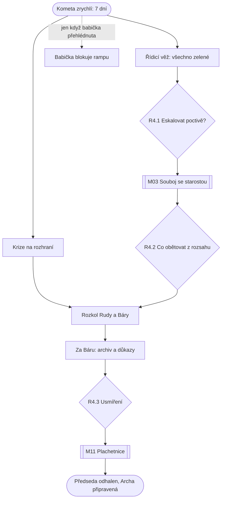

# Kapitola 4: Krize (kostra)

> Kostra kapitoly z kroku N2 [postupu návrhu](../12-postup-navrhu.md). V kroku N3 se rozroste
> v úplný návrh jako [kapitola 1](01-iniciace.md).
> Stav: **kostra ke schválení**, verze 0.1

## Přehled

| | |
|---|---|
| **Cíl hráče** | ustát krizi na rozhraní, odhalit Předsedu a připravit Archu ke startu |
| **Délka** | 45–60 minut |
| **Patro v popředí** | spojka: co se nesladilo, srazí se ([koncepce](../07-dva-svety.md)) |
| **Výuková témata** | V17 měření a reporting, V18 eskalace, V19 retrospektiva, V20 vedení týmu, V05 komunikace ([matice](../02-vyukova-matice.md)) |
| **Minihry** | M03 Souboj argumenty (rozhodující, se sponzorem), M11 Plachetnice |
| **Rozhodnutí** | R4.1 report, R4.2 co obětovat, R4.3 usmíření, Bářina volba (D59) |
| **Rudova vada** | reportuje zeleně (R4.1) |
| **Hraní za Báru** | ano, po rozkolu: odhalení Předsedy (D59) |
| **Kometa** | zrychlí; zbývá 7 dní. Večerní a krizové scény v paletě C |

## Průběh v kostce

1. **Kometa zrychlí.** Zbývá 7 dní. Ve městě panika.
2. **Řídicí věž hlásí, že je vše zelené.** Puzzle (bývalý Dashboard lží, V17): zelené ukazatele
   porovnat s tím, co je vidět ve scéně. U rampy dává smysl měřit plnění plánu, u softwaru
   to, co lidé opravdu dostali.
3. **Krize na rozhraní** podle `c3_integrace`: software nejde do zavřeného trupu, trup neunese
   zařízení, nástupní aplikace neví o změně rampy. Řeší se v trupu a dílně (servisní poklop).
4. **Babička blokuje rampu** jen tehdy, když ji hráč v kap. 1 přehlédl (`c1_babicka`). Pak
   vedlejší úkol na staveništi. Spojenkyně babička naopak pomůže.
5. **R4.1:** Ruda musí za sponzorem. Eskalovat poctivě s variantami, nebo dál reportovat zeleně?
6. **M03 Souboj argumenty se starostou** přímo ve věži. Repliky z charteru (kap. 1), Bářiných
   dat a výsledků kap. 3. Kdo v kap. 1 slíbil všechno, má souboj tvrdší.
7. **R4.2:** co obětovat z rozsahu, aby se stihl start (bazén, vyhlídková terasa, svačiny…).
8. **Rozkol.** Ruda chce všechno zamknout, Bára všechno přepracovat. Pohádají se.
9. **Za Báru (D59):** Bára jde do archivu. Seznam pasažérů z kap. 1 a Lumírova kartotéka
   prozradí, že Předseda o kometě ví léta a projekt držel ve „fázi 2“ úmyslně. Ing. Framework
   se s ním spojil, protože oba žijí z toho, že se nic nedokončí. Jestli to Bára Rudovi řekne
   hned, rozhoduje její důvěra.
10. **R4.3 Usmíření:** Ruda přizná, že plán nestačí, nebo trvá na svém.
11. **M11 Plachetnice:** retrospektiva po usmíření. Tým vybere jedno zlepšení pro kap. 5.
    Bez retrospektivy v kap. 3 (R3.3) tu chybí člen týmu.
12. **Konfrontace v kanceláři Komise:** Předseda odhalen. Archa je připravená ke startu.

## Místa (rozpočet 5 scén, z toho 1 nová)

| Scéna | Nová / převzatá | Co se tu děje |
|---|---|---|
| Řídicí věž | nová | dashboardy, R4.1, souboj se starostou |
| Staveniště rampy (večer) | převzatá (kap. 2), večerní verze | babička, krize na rozhraní |
| Hangár a trup (večer) | převzatá (kap. 2–3), večerní verze | krize na rozhraní, rozkol, Plachetnice |
| Archiv (večer) | převzatá (kap. 1), večerní verze | Bářin úsek, důkazy proti Předsedovi |
| Kancelář Komise (večer) | převzatá (kap. 1), večerní verze | odhalení Předsedy a Frameworka |

## Postavy (rozpočet: 1 nová)

- **Vracející se:** Ruda, Bára, Pembok, tým, starosta, Předseda, Ing. Framework, Lumír,
  babička (podle R1.2), Pan Změna, Scope Creep (velikost podle kap. 3), kočka Riziková.
- **Nová:** rezerva 1, např. dispečer řídicí věže, který věří svým zeleným světlům.

## Hlavní graf

Babička je volitelná větev, která přibude jen při špatné volbě v kap. 1.

## Rozhodnutí

| ID | Kde | Volby | Příznak | Kde se vrátí |
|---|---|---|---|---|
| R4.1 | řídicí věž | eskalovat poctivě s variantami / dál zeleně | `c4_report` = `poctive` / `zelene` | kap. 5: start na falešných datech, horší konec |
| R4.2 | po souboji | co obětovat z rozsahu | `c4_obet` | kap. 5: co v Arše chybí a jak na to reagují obyvatelé (epilog) |
| R4.3 | hangár | přiznat, že plán nestačí / trvat na svém | `c4_usmireni` | kap. 5: spolupráce ve finálním puzzlu, Rudův vývoj, Bářina důvěra |
| Bára (D59) | archiv | říct Rudovi hned / až po usmíření | `c4_bara_rekla` | kap. 4: konfrontace s Předsedou; Bářina důvěra |

Další příznaky: `c4_souboj` (M03, výsledek), `c4_zlepseni` (M11, jedno zlepšení pro kap. 5),
`c4_babicka_vyreseno`.

## Čte příznaky z dřívějška

| Příznak | Následek v kapitole 4 |
|---|---|
| `c1_slib_vseho` | sponzor trvá na všem, souboj je tvrdší, chybí prostor pro vyjednávání |
| `c1_babicka` | `prehlizena`, `odmitnuta` nebo `neodhalena`: blokuje rampu, vedlejší úkol; `spojenec`: pomůže |
| `c1_charter_kvalita` | repliky do souboje; dobré „mimo rozsah“ usnadní R4.2 |
| `c1_seznam_pasazeru` | hlavní důkaz proti Předsedovi (D59) |
| `c2_riziko_predem` = úsměv | Ruda Předsedu podezíral dřív; konfrontace je kratší |
| `c2_rozdeleni`, `c2_vyjimky` | `gantt`: obyvatelé odmítají software; `krabice`: rampa se drolí; špatné výjimky: bezpečnostní systém bez certifikace nebo nechtěný interiér |
| `c3_integrace` | počet a druh krizí na rozhraní |
| `c3_bara_priority` | řídicí systém dělá, co chtějí lidé, nebo co chtěl Ruda |
| `c3_retro` | bez retrospektivy odchází člen týmu s klíčovým předmětem |
| `c3_creep`, `c3_bazen` | velký Scope Creep sežere kus kapacity |
| `c3_vada_hlasena` | nenahlášená vada se projeví v krizi |

## Rozpočet

| | Rozpočet (D56) | Kostra |
|---|---|---|
| Délka | 45–60 min | odhad 50–60 min (bez babičky 45) |
| Scény (nové) | 5 (1) | 5 (1) |
| Nové postavy | 1 | 0–1 |
| Předměty | 10 | odhad 8–10 |
| Repliky na jazyk | 400–500 | odhad 450–500 (hodně variant podle příznaků) |
| Minihry | M11, M03 | M11, M03 |

**Riziko rozpočtu:** kapitola nejvíc čte příznaky a každá varianta stojí repliky. V N3 rozhodnout,
které následky budou celé scény a které jen věta nebo jiný předmět.

## Otevřené otázky

- [ ] Kolik krizí na rozhraní je únosné (jedna podle nejhoršího nesladěného bodu, nebo všechny)?
- [ ] Babiččin vedlejší úkol: jak dlouhý, aby trestal, ale nezdržel o víc než 10 minut?
- [ ] Odhalení Předsedy: dramatická scéna, nebo komický antiklimax („Já? Já jsem jen schvaloval.“)?
