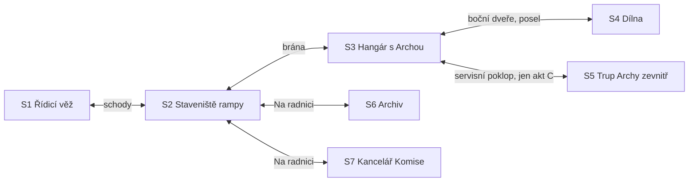

# Kapitola 4: obsah místností a matice předmětů

> Krok N3a a N3d [postupu návrhu](../12-postup-navrhu.md). Co je v každé scéně kapitoly 4,
> jaké předměty kapitola má a jak hra reaguje na jejich použití. Návrh kapitoly je
> v [04-krize.md](04-krize.md), puzzly v [04-puzzly.md](04-puzzly.md).
> Stav: **hotovo**, verze 0.2 (tvar D77, kontrola N4 zapracována v D78)

Sloupec *Prohlédnout* uvádí podstatu repliky, ne finální text. Finální texty vzniknou v kroku N6.
Ruda soudí, Bára měří: sloupec uvádí Rudovu verzi, Bářina je v poznámce, když nese stopu.
**Akty** A (zbývá 7), B (zbývá 5, Ruda a Bára spolu nemluví) a C (zbývá 2) podle
[návrhu](04-krize.md#jak-se-hraje). Celá kapitola je ve večerní a noční paletě C.

## Mapa scén

Všechny východy jsou otevřené od začátku. Výjimkou je trup: od konce kapitoly 3 je
zanýtovaný, takže dovnitř vede jen servisní poklop, a to až v aktu C (P4.29). Bez poklopu
vede dovnitř otvor, který Věra navrtá. **Na radnici** je přechod: střih přes večerní náměstí
a vestibul, pak nabídka *Archiv*, nebo *Komise*. Z archivu i z Komise se jde zpátky přes přechod: na
staveniště, nebo do druhé z nich. Jako v kapitole 1 vede do archivu schodiště z vestibulu
a do Komise výtah. Náměstí, vestibul, sklad, hospoda ani Mlžná pláň nemají
v kapitole 4 aktivní místa.

**Poslové (akt B, D77):** posel ve dveřích dílny je vidět z hangáru i z dílny. Posel na
staveništi stojí u východu Na radnici. Předmět použitý na posla má hned druhá postava.
Poslové se určí při rozkolu a do usmíření se nemění.

## S1 Řídicí věž (nové pozadí)

Prosklená věžička na kraji staveniště, postavená „na zkoušku“ ze zbytků lešení radnice. Na stěně
tabule se šesti světly a štítky, u okna Zelenkův pult s vysílačkami, v rohu telegraf ke
starostovi a krabice zelených žárovek. Po M03 se vedle tabule ukazatelů rozvine tabule rozsahu.
V aktu B a C je věž klidná: Zelenka sedí u tabule, která už ukazuje lístky.

| Prvek | Druh | Prohlédnout (podstata) | Použít / mluvit | Podmínka | Poznámka |
|---|---|---|---|---|---|
| Tabule ukazatelů | aktivní místo | šest světel; dokud nejsou lístky, všechna zelená („Za třicet let jsem neviděl nic tak klidného.“); lístky jsou barevné papíry připnuté přes sklo, zelená žárovka svítí skrz skutečnou barvou; počet lístků | – | – | P4.1–P4.6 |
| Štítky pod světly | aktivní místo (6) | Ruda přečte nápis, Bára i co znamená: Rampa *Dodané pytle cementu* („Pytle nejsou rampa.“), Trup *Odškrtnuté řádky Gantta* („Odškrtnuté není zapojené.“), Místa *Sedadla na výkresu*, Nástup *Vytištěné letáky*, Změny *Formuláře v šuplíku Komise* („Prázdný šuplík. Tak žádné změny.“), Tým *Podpisy na docházce* | – | – | hlavní stopy P4.1–P4.6; vidět vždy (D04) |
| Dispečer Zelenka | postava | v čepici s kšiltem, hrdý na svá světla; „Zelená je klidná barva.“ | dialog `zelenka`: co které světlo měří, odkud jsou žárovky, vysílačky; komentuje každý lístek | – | nová postava (EN Mr Greenlight) |
| Telegraf | aktivní místo | „Linka přímo ke starostovi. Píše se do ní jen dobrá zpráva.“ | použít → R4.1 (zelenou kdykoli, poctivě se 4 lístky) | akt A | P4.7 |
| Tabule rozsahu | aktivní místo | dílky práce, které se mají stihnout, a čára „Co se vejde do startu“; Ještětoto na ní zabírá dílky podle `c3_creep` | použít → R4.2 | po M03 | P4.9 |
| Krabice žárovek | aktivní místo | „Týdenní výměna žárovek. Zásoba na třicet let. Jen zelené.“ | vzít ★ „Zelenou za zelenou. To by nikdo nepoznal. Právě proto.“ | – | z Rudovy zdi slávy (kap. 1) |
| Okno | aktivní místo | rampa, hangár a kometa; v aktu B svítí jen okno dílny („Bára ještě nespí. Já taky ne.“) | – | – | |
| Starosta Bohumil | postava | přijede kvůli zprávě; po poctivé „Proč to není zelené?“, po zelené s nůžkami na pásku | M03 | po R4.1 | P4.8 |
| Ještětoto | postava | sedí na tabuli a olizuje světlo Změny | ★ s předměty | jen úvod (pak v hangáru) | gag |
| Schody | východ | – | → S2 | – | |

Vysílačky nejsou předmět ani aktivní místo. Hráč je má v aktu A a C v rohu obrazovky:
ověřený lístek postava nahlásí sama a v aktu B je vysílačka přeškrtnutá.

## S2 Staveniště rampy (převzaté z kap. 2–3, večer)

Pozadí kapitoly 3 ve večerní verzi. Rampa podle kapitoly 3: celá s plošinou, bez plošiny
(`c3_rezerva` < 0: prázdné bednění), nebo s prasklinami a hromádkami drti (`c3_drolivy`). Lávka
z rampy vede přes babiččin plot. Po nástupní zkoušce je na plošině křídou nakreslený obrys dveří
Archy (Archa stojí v hangáru, vyjede až v závěru kapitoly). Pod věží sedí na kufrech obyvatelé, u plotu rybáři s udicemi.
U brány hangáru stojí sud paliva.

| Prvek | Druh | Prohlédnout (podstata) | Použít / mluvit | Podmínka | Poznámka |
|---|---|---|---|---|---|
| Rampa | aktivní místo | „Hotová. Až nahoru.“ / bez plošiny: „Bez plošiny. Dva dny, říkal vrátný.“ / `c3_drolivy`: „Drolí se. Beton z ukázky.“ | – | – | P4.1, P4.14, P4.15 |
| Lávka | aktivní místo | bez spojenectví: „Vede přes babiččin plot. Kdo ji kreslil, se neptal.“; spojenec: „Babička na ni věší prádlo.“ | Bára → vyzkoušet nástup (P4.4); palubní lístky → nástupní zkouška nanečisto k obrysu dveří na plošině (P4.30) | P4.4 po rozhovoru s obyvateli; P4.30 v aktu C | P4.4, P4.30 |
| Vrátný v jeřábu | postava | „Večer jezdím pomaleji. Kvůli výhledu.“ | dialog `vratny`: deník jeřábu, sud paliva (B), plošina (B), startovací klíč (bez Norberta), drolení (bez Věry) | – | P4.1, P4.10, P4.14, P4.15 |
| Sud paliva | aktivní místo | „Palivo pro Archu. Sám ho neunesu. Nikdo ho neunese.“ | ★ zvednout („Ani na Gantt to není.“); vrátný ho spustí jeřábem do hangáru | akt B | P4.10 |
| Obyvatelé s kufry | aktivní místo (skupina) | sedí na kufrech pod věží; „Kudy se nastupuje?“ | Bára: mluvit → kdo ví, kudy jít (`c3_hodnota`), pak lávka (P4.4); akt C: palubní lístky (P4.30) | – | P4.4, P4.30 |
| Rybáři | aktivní místo (skupina) | udice delší než oni | mluvit: „Na Archu s udicemi, nebo vůbec.“ | – | P4.4, P4.30 |
| Babička | postava | `spojenec`: za plotem, buchta a noviny s lupou; jinak na lehátku na svém pozemku přímo pod lávkou; při `odmitnuta` cedule „Pozemek je můj.“, jinak noviny | dialog `babicka` | – | P4.13; v konfrontaci svědčí (spojenec) |
| Kocour | postava | `spojenec`: na plotě; `odmitnuta`: chybí, sedí na palubě Archy | – | – | P4.13 |
| Bednění plošiny | aktivní místo | „Bednění stojí. Beton ne.“ | vrátný → P4.14 | jen bez plošiny, akt B | P4.14 |
| Prasklina v rampě | aktivní místo | „Ukázka betonu. Ukázala, co umí.“; Bára: „Prasklina je delší než včera. O dva centimetry.“ | Věra (bez Věry vrátný s deníkem) → P4.15 | jen `c3_drolivy`, akt B | P4.15 |
| Rozpis rampy na plotě | aktivní místo | „Tohle mi pořád jde.“ | – | – | stopa P4.1 (rozpis má Ruda i v inventáři) |
| Dveře skladu | aktivní místo | zavřené; `kocka`: kočka spí na prahu; `aktovka`: „Prázdno. Krysy se odstěhovaly do Komise.“ | – | – | sklad se nepoužívá |
| Posel na staveništi | postava | druhý člen týmu podle pořadí (D77); „Nesu, co je potřeba. Hlavně ne náladu.“ | použít předmět → druhá postava ho má; mluvit → co dělá druhá postava, Bářin vzkaz (P4.26) | akt B | D77 |
| Kometa | aktivní místo | „Větší než měsíc. Měsíc se stydí.“ | – | – | |
| Schody do věže | východ | – | → S1 | – | |
| Brána hangáru | východ | – | → S3 | – | |
| Na radnici | východ | – | nabídka → S6, S7 | – | přechod |

## S3 Hangár s Archou (převzatý z kap. 2–3, večer)

Archa je smontovaná a zanýtovaná. Na boku je servisní poklop (bez poklopu hladké nýty
a malé okénko). U motorů stojí zkušební pult, ve střeše je otvor pro jeřáb. Tým sedí na bednách,
po žebříku se leze na palubu. V aktu B stojí v bočních dveřích dílny posel.

| Prvek | Druh | Prohlédnout (podstata) | Použít / mluvit | Podmínka | Poznámka |
|---|---|---|---|---|---|
| Archa | aktivní místo | „Hotová. Zvenku.“ | – | – | |
| Servisní poklop | aktivní místo | `ano`: zamčený, cedulka „B. B. 1994“; `netesni`: „Táhne z něj.“ (Bára: „Netěsní. O dva milimetry.“) | člen týmu s klíčem otevře → pohled dovnitř (P4.2); těsnicí páska (P4.16); klíč od poklopu → P4.29 | P4.29 jen v aktu C | P4.2, P4.16, P4.29 |
| Okénko v trupu | aktivní místo | jen bez poklopu: „Dovnitř se dá jen dívat.“ | plán zapojení → lístek Trup (P4.2) | bez poklopu | P4.2 |
| Motory | aktivní místo | „Čtyři trysky. Ještě nikdy nezapnuté. Jako já.“ | – | – | P4.10 |
| Zkušební pult motorů | aktivní místo | klíčová dírka, páčka Start, kontrolka „Řídicí systém“ | startovací klíč → zkouška motorů (s palivem); bez paliva ★ „Bez paliva startuje jen Gantt.“ | akt B | P4.10 |
| Otvor ve střeše | aktivní místo | „Tudy sem vrátný spustí cokoli. Říkal.“ | – | – | stopa P4.10 |
| Žebřík na palubu | východ / aktivní místo | „Odtud je vidět celé město. A kometa.“ | → paluba (M11 po usmíření); `odmitnuta`: kocour | – | P4.13, P4.28 |
| Ještětoto | postava | podle `c3_creep`: „Malý. Pořád.“ / „Už se nevejde do hangáru.“ | Bára: metr → lístek Změny | – | P4.5 |
| Docházka na stěně | aktivní místo | „Pět podpisů denně. Spokojenost pět z pěti.“; Bára: „Všechny podpisy psal Kryštof.“ (bez Kryštofa: „automat na podpisy“) | – | – | stopa P4.6 |
| Tým na bednách | postavy | kdo je v týmu (bez odešlého) | mluvit → „Jak se máš?“ (P4.6); Norbert → startovací klíč (akt B; jako posel na staveništi); člen s klíčem otevře poklop (P4.2) | – | P4.2, P4.6, P4.10 |
| Pan Změna | postava | sedí u hadice, cedule „Bazén pro všechny“ | dialog `zmena` → kašna (P4.17) | jen `c3_bazen_v_trupu` a bazén neobětovaný v R4.2 | P4.17 |
| Kalendář | aktivní místo | zbývá 7 / 5 / 2 | – | – | |
| Tabule z kap. 2, Rudův Gantt | aktivní místo | jako v kap. 3; Gantt: „Řádek 214: start. Úterý.“; řádek „Pomník (Ruda)“ z kap. 3 | – | – | |
| Boční dveře (posel ve dveřích dílny) | východ / postava | v aktu B v nich stojí první posel | → S4; použít předmět na posla → druhá postava; mluvit → co dělá druhá postava, vzkaz | – | D77 |
| Brána | východ | – | → S2 | – | |

## S4 Dílna (převzatá z kap. 3, večer)

Bářin kout. Tabule „Dělám / Hotovo“ má v aktu B nové lístky (*Počítadlo*, *Nástup*, *Palubní
lístky*). Vedle zkušebního počítače stojí tiskárna. Na polici „Někdy“ leží těsnicí páska,
půlka čidla a Rudův model rampy.

| Prvek | Druh | Prohlédnout (podstata) | Použít / mluvit | Podmínka | Poznámka |
|---|---|---|---|---|---|
| Zkušební počítač | aktivní místo | běží na něm počítadlo a nástupní aplikace | Bára: zkouška počítadla → lístek Počítadlo (akt A); tisk palubních lístků (akt B); oprava počítadla (akt B, jen vada) | – | P4.3, P4.23, P4.25 |
| Tiskárna | aktivní místo | „Tiskne pomalu. Ale tiskne.“ | – (tiskne se z počítače) | – | P4.23 |
| Kuchyňská minutka | aktivní místo | ve tvaru komety; „Patnáct minut. Ani o minutu víc.“ | vzít → minutka (v aktu A ★ „Na poradu teď není čas.“) | akt B | P4.19 |
| Police „Někdy“ | aktivní místo | půlka čidla, Rudův model, těsnicí páska; „Někdy je teď.“ | vzít těsnicí pásku | – | P4.16 |
| Tabule „Dělám / Hotovo“ | aktivní místo | akt A: prázdná; akt B: tři Bářiny lístky | – | – | gag |
| Bářina tabule seznamu práce | aktivní místo | po R4.2 jsou obětované karty přeškrtnuté | – | – | připomínka R4.2 |
| Papír a nůžky | aktivní místo | „Papír. Tomu lidé věří.“ | použít po tisku → papírové lístky | jen `gantt` | P4.23 |
| Mlha v rohu | aktivní místo | „Kus slona. Pořád tu je.“ | – | – | z kap. 2 |
| Posel ve dveřích | postava | viz S3 | – | akt B | D77 |
| Ruda (návštěva) | postava | v aktu A jako v kap. 3; v aktu B Bára: „S Rudou teď nemluvím.“ | – | – | |
| Dveře do hangáru | východ | – | → S3 | – | |

## S5 Trup Archy zevnitř (převzatý z kap. 3, noc, jen akt C)

Řez trupem jako v kapitole 3, ale zavřený. Dovnitř se dostane jen Bára: Ruda drží poklop
zvenku a je vidět jeho ruka. Na stěně tři přípojky, uprostřed zapojený řídicí počítač.
Bez poklopu vede dovnitř čerstvě navrtaný otvor.

| Prvek | Druh | Prohlédnout (podstata) | Použít / mluvit | Podmínka | Poznámka |
|---|---|---|---|---|---|
| Řídicí počítač | aktivní místo | „Mozek Archy. Zatím bez navigace.“ | použít → nahrání (P4.29): navigace, oprava počítadla (vada), úkony podle `c3_nesladeno` (bez bodu `lavka`) | akt C | P4.29 |
| Přípojka navigace | aktivní místo | konec kabelu u poklopu; „Ven to vede. Dovnitř to nevede.“ | Ruda tahá kabel, Bára hlásí, kdy svítí | akt C | P4.29 |
| Poklop zevnitř | aktivní místo | Rudova ruka drží poklop; „Držím. Pořád držím.“ | – | – | |
| Panel bezpečnostního systému | aktivní místo | podle `c2_vyjimky`: zapečetěný / „předělává se každý týden“ | – | – | varování (kap. 5) |
| Bazén | aktivní místo | jen `c3_bazen_v_trupu`, dokud ho Pan Změna nevypustí: „Kabel vede přes bazén. Doufám, že nevede do bazénu.“ | – | jen bez P4.17 | zastaví nahrávání (P4.29) |
| Okénko | aktivní místo | kometa | – | – | |
| Poklop / otvor | východ | – | → S3 | – | |

## S6 Archiv (převzatý z kap. 1, noc)

Sklep radnice v noci. Lumír spí na pultu s razítkem na čele, svítí jen lampa nad kartotékou.

| Prvek | Druh | Prohlédnout (podstata) | Použít / mluvit | Podmínka | Poznámka |
|---|---|---|---|---|---|
| Lumír | postava | spí; Ruda: „Číslo projektu… chrr.“ | Bára: minutka → probudí se: „V noci vydávám jen lidem, kteří měří.“ (Bára ukáže metr) | – | P4.19 |
| Kartotéka | aktivní místo | lístky v řadě podle skutečného zahájení (Rudova práce z kap. 1); mezi „příští rok“ nový lístek „Pozorování komety (1994–dosud)“ | Bára: zařadit lístek komety (P4.20) | po probuzení Lumíra | P4.20 |
| Lumírova kniha | aktivní místo | kniha skutečných dat zahájení; nový řádek „Pozorování komety: duben 1994. Komise.“ | číst | – | klíč k P4.20 |
| Regál s krabicemi | aktivní místo | – | Lumír vydá přílohu k zařazenému lístku | po P4.20 | P4.20 |
| Krabička Poučení | aktivní místo | prázdná; Lumír: „Poslal jsem ji dál.“ | – | – | M11 (první lahev) |
| Hluboký regál | aktivní místo | Bára: „Tady byl seznam. Teď je u mě.“ | – | – | připomínka P1.12 |
| Schody | východ | – | → přechod Na radnici (staveniště, Komise) | – | |

## S7 Kancelář Komise (převzatá z kap. 1, noc)

Komise úřaduje v noci („Ve dne je fáze 2.“). Ing. Framework má vlastní stůl s cedulkou
„Poradce Komise. Na zkoušku.“ U dveří stojí sbalený Předsedův kufr.

| Prvek | Druh | Prohlédnout (podstata) | Použít / mluvit | Podmínka | Poznámka |
|---|---|---|---|---|---|
| Předseda Věčný | postava | vlídný, razítko v ruce | dialog `predseda`: povolení ke startu (P4.11); konfrontace (P4.31, akt C) | – | P4.11, P4.31 |
| Fronta na frontu | aktivní místo | „Pořád stejná. To je jediná jistota ve městě.“ | postavit se ★ (P4.11) | – | vtip z kap. 1 |
| Ing. Framework | postava | u nového stolu, kufr s krabicemi | dialog `framework`: reference → kopie smlouvy (P4.22); konfrontace | – | P4.22 |
| Předsedův kufr | aktivní místo | sbalený, štítek „Archa, kajuta č. 1“; Bára: „Kajuta jedna. Na seznamu je jako první.“ | – | – | stopa P4.21 |
| Odešlý člen týmu | postava | třídí Frameworkovy krabice | dialog `clen_komise` (P4.12) | jen `c3_retro` = ne, do P4.12 | P4.12 |
| Razítko | aktivní místo | „Razítko na start. Poduška vyschlá. Úmyslně.“ | – | – | |
| Předsedova aktovka | aktivní místo | `aktovka`: hýbe se a šustí | – | jen `aktovka` | krysy, gag v P4.31 |
| Cedule | aktivní místo | „Úřední hodiny: příští fáze“ | – | – | |
| Výtah | východ | „Do půlky patra. Pořád.“ | → přechod Na radnici (staveniště, archiv) | – | |

## Předměty

Dohromady **21 předmětů**: 9 z dřívějších kapitol (kopie podpisů jen při `usmev`), 12 nových,
z toho 5 předmětů je jen ve variantách. V jednom průchodu jich hráč uvidí 15–18. Ikony nových
předmětů podle stylové bible (D52). Lístky skutečnosti nejsou předměty (hlásí se vysílačkou).

| # | Předmět | Kdo | Kde vznikne | Kdy | Spotřebuje se | Poznámka |
|---|---|---|---|---|---|---|
| 1 | Prof. Pembok | Ruda | z kap. 1 | – | ne | nápověda |
| 2 | Hrnek kávy | Ruda | z kap. 1 | – | nikdy | |
| 3 | Kávové pero | Ruda | z kap. 1 | – | ne | |
| 4 | Krabice od bot s lístky | Ruda | z kap. 2 | – | ne | ★; lístky rizik jako vtip |
| 5 | Plán cesty ke startu | Ruda | z kap. 2 | – | ne | ★ u Předsedy („Start je ve fázi 3.“) |
| 6 | Rozpis rampy | Ruda | z kap. 3 | – | ne (Bára si ho opíše, posel ho vrátí) | P4.1, P4.18 |
| 7 | Svinovací metr | Bára | z kap. 1 | – | ne | P4.5; nápověda za Báru |
| 8 | Seznam pasažérů | Bára | z kap. 1 | – | v P4.21 se změní v plán Komise | D59 |
| 9 | Kopie Předsedových podpisů | Ruda | z kap. 2 | jen `usmev` | v konfrontaci | náhrada za kterýkoli důkaz |
| 10 | Deník jeřábu | Ruda | vrátný | kdykoli | ne | P4.1; bez Věry P4.15 |
| 11 | Startovací klíč | Ruda | Norbert (bez Norberta vrátný) | akt B | v pultu | P4.10 |
| 12 | Kuchyňská minutka | Bára | dílna | akt B | u Lumíra („Budík. Konečně.“) | P4.19 |
| 13 | Hvězdářský záznam | Bára | archiv | po P4.20 | v konfrontaci | důkaz |
| 14 | Plán Komise | Bára | seznam pasažérů + záznam | po P4.20 | v konfrontaci | důkaz |
| 15 | Kopie smlouvy na fázi 3 | Bára | Framework | akt B | v konfrontaci | důkaz |
| 16 | Palubní lístky | Bára | dílna, tisk | akt B | v P4.30 | tisknou se znovu, kdykoli je potřeba |
| 17 | Klíč od poklopu (bez poklopu plán zapojení trupu) | Ruda | člen týmu ve střihu „Zbývá 2“; bez posezení P4.12 | akt C, nebo po P4.12 | v P4.29 | |
| 18 | Palubní lístek pro babičku | Ruda | Bára přes posla | jen bez spojenectví | u babičky | P4.13 |
| 19 | Těsnicí páska | Bára → Ruda | police „Někdy“ | jen `netesni` | na poklopu | P4.16 |
| 20 | Oprava počítadla | Bára | zkušební počítač | jen neopravená vada | v P4.29 | P4.25 |
| 21 | Svědectví | Ruda | odešlý člen týmu | jen bez posezení, po P4.12 | v konfrontaci | důkaz za smlouvu |

Bez posezení je předmět 17 i 21 od stejného člověka v jednom kroku (P4.12). Kocour
(`odmitnuta`) není předmět: když na něj Ruda na palubě promluví, jde s ním (jako kočka Riziková
v kap. 3).

**Kontrola slepých uliček:**
- Deník jeřábu dá vrátný kdykoli a nespotřebuje se, takže je i pro drolení bez Věry.
- Startovací klíč dá Norbert, jakmile začne akt B (jako posel na staveništi). Bez Norberta v týmu
  ho dá vrátný („Mám klíče od všeho.“). Odejít Norbert nemůže: tým má vždy Pepu, Kláru nebo Věru.
- Palubní lístky se tisknou znovu, kolikrát je potřeba („Tiskárna nemá fázi 2.“), takže lístek
  pro babičku je nic nestojí.
- Minutka zůstane u Lumíra, ale Lumír je pak vzhůru až do konce kapitoly.
- Klíč od poklopu přinese člen týmu sám ve střihu „Zbývá 2“. Bez posezení ho Ruda získá v P4.12,
  které jde i v aktu C.
- Důkazů je pět (ve variantách sedm) a na tři výmluvy stačí tři. Špatný důkaz se v konfrontaci
  vrátí.
- Seznam pasažérů se v plán Komise změní, ale záznam zůstane, takže se oba důkazy dají použít
  zvlášť.

## Matice předmětů

✔ = řešení, ★ = vlastní reakce (vtip), – = výchozí reakce. V aktu B dává použití předmětu
na druhou postavu vždy stejnou odpověď („Vyřiďte to přes posla.“). Předměty mezi sebou:
záznam + seznam pasažérů ✔ (plán Komise), deník + rozpis rampy ✔ (lístek Rampa), plán
cesty + kopie smlouvy ★ („Fáze 3 je na plánu až za startem. Takže nikdy.“), krabice od
bot + kopie podpisů ★ („Zapsané riziko. Úsměv.“).

### Rudovy předměty

| Předmět ↓ / cíl → | Zelenka / tabule | Telegraf | Vrátný | Babička | Obyvatelé | Pan Změna | Ještětoto | Posel | Zkušební pult | Poklop | Předseda | Framework | Starosta |
|---|---|---|---|---|---|---|---|---|---|---|---|---|---|
| Pembok | ★ („Tohle světlo měří tebe.“) | ★ | ★ | ★ | – | ★ | ★ | ★ | – | – | ★ | ★ | ★ |
| Hrnek kávy | ★ („Hnědá. To je ještě horší.“) | ★ | ★ („Za jízdy nepiju.“) | ★ | – | ★ | ★ (vypije a vyroste) | ★ | ★ („Palivo to není.“) | – | ★ | – | – |
| Kávové pero | ★ (dopsat na štítek ★ „Zelenka by to vymazal.“) | ★ | – | – | – | ★ | – | – | – | – | ★ | ★ | ★ |
| Krabice od bot | ★ („Tady jsou lístky, co neměří nic.“) | – | – | – | – | – | ★ („Na tebe lístek mám. Malý.“) | ★ | – | – | ★ (`usmev` jinak) | ★ („Krabice! Kolega!“) | – |
| Plán cesty | ★ | ★ | – | – | ★ | – | – | – | – | – | ★ („Start je ve fázi 3.“) | ★ | ★ |
| Rozpis rampy | ★ | – | ✔ s deníkem (P4.1) | ★ („Lávka přes můj plot. Na papíře.“) | – | – | – | ✔ (P4.18) / ★ | – | – | – | – | – |
| Deník jeřábu | ★ („Tady je, co se opravdu stalo.“) | – | ✔ (bez Věry drolení, P4.15) / ★ | – | – | – | – | ★ | – | – | – | – | ★ |
| Startovací klíč | – | – | ★ („Ten jsem neměl. Jediný.“) | – | – | – | ★ | ★ | ✔ (P4.10) | ★ („Jiný zámek.“) | ★ | – | – |
| Palubní lístek pro babičku | – | – | – | ✔ (P4.13) | ★ | ★ („Mám už tři.“) | ★ | ★ | – | – | ★ | – | – |
| Těsnicí páska | ★ (přelepit světlo ★ „Nevidím, nevím.“) | – | – | – | – | – | ★ | – | – | ✔ (P4.16) | – | – | – |
| Klíč od poklopu | – | – | – | – | – | – | – | – | – | ✔ (P4.29, akt C) / ★ před ním („Až budeme dva.“) | – | – | – |
| Kopie podpisů | ★ | – | – | – | – | – | – | – | – | – | ✔ (P4.31) / ★ dřív („Výborně. Další kopie.“) | ★ | ★ |
| Svědectví | – | – | – | – | – | – | – | – | – | – | ✔ (P4.31) / ★ dřív | ★ („To je pomluva. S podpisem.“) | ★ |

### Bářiny předměty

| Předmět ↓ / cíl → | Zelenka / tabule | Ještětoto | Obyvatelé / lávka | Lumír | Kartotéka | Framework | Předseda | Posel | Ruda | Zkušební počítač | Babička |
|---|---|---|---|---|---|---|---|---|---|---|---|
| Metr | ★ („Světlo měří tři centimetry. Víc o něm nevím.“) | ✔ (P4.5) | ★ (lávka: „Dost široká pro kufr. Ne pro dva.“) | ★ (ukázat po minutce ✔) | ★ | ★ („Měříte krabice?“) | ★ | ★ | ★ (akt A) | – | ★ |
| Seznam pasažérů | ★ | – | ★ („Nikdo z nich na něm není.“) | ★ | ★ | ★ | ★ („To je pracovní verze.“) | ★ (akt B „Ještě ne.“) | ★ „Ještě ne.“ (akt A) | – | ★ |
| Kuchyňská minutka | ★ | ★ („Tik. Tak. Ještě.“) | – | ✔ (P4.19) | – | ★ („Patnáct minut? Moje porady jsou delší.“) | ★ | ★ | – | ★ | – |
| Hvězdářský záznam | ★ | – | – | ★ | – | ★ | ★ („To je… soukromé pozorování.“) | ★ | – | – | – |
| Plán Komise | ★ | – | ★ | ★ | – | ★ | ★ (před konfrontací: „Výborně. Založím to.“) | ✔ vzkaz (P4.26) | – | – | ★ („Tak proto se mě nikdo neptal.“) |
| Kopie smlouvy | ★ | – | – | ★ („Ta tu ještě není. Bude.“) | – | ★ („Ta je dobrá, že?“) | ★ | ★ | – | – | – |
| Palubní lístky | ★ („Zelená? Ne, bílé.“) | ★ („Tobě ne.“) | ✔ (P4.30, akt C) / ★ dřív („Až bude lávka.“) | ★ | – | ★ | ★ (v P4.31 Ruda) | ✔ jeden pro babičku (P4.13) | – | – | ★ (spojenec: „Já už ho mám. Ve srdci.“) |
| Těsnicí páska | – | ★ | – | – | – | – | – | ✔ (P4.16) | – | – | – |
| Oprava počítadla | – | – | – | – | – | – | – | ★ („Tu nahraju sama.“) | – | ★ („Až poklopem.“) | – |

Dát předmět Rudovi v aktu A jde přímo, když stojí ve stejné scéně. Lumír po probuzení
reaguje na důkazy jen archivářsky („Přílohu vrátit do konce fáze.“).

Cíl matice: každá kombinace, kterou hráči při playtestu (N8) zkusí víckrát, dostane ★. V matici
je **asi 115 vlastních reakcí** (63 u Rudy, 48 u Báry, 4 kombinace předmětů), víc než
v kapitole 3 (73): obě postavy mají víc předmětů i cílů. V N6 se škrtá nejdřív tady.
