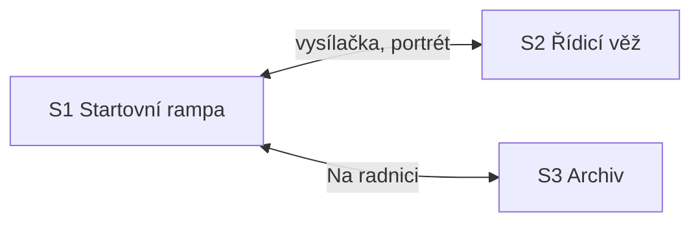

# Kapitola 5: obsah místností a matice předmětů

> Krok N3a a N3d [postupu návrhu](../12-postup-navrhu.md). Co je v každé scéně kapitoly 5,
> jaké předměty kapitola má a jak hra reaguje na jejich použití. Návrh kapitoly je
> v [05-uzavreni.md](05-uzavreni.md), puzzly v [05-puzzly.md](05-puzzly.md).
> Stav: **hotovo** (schváleno v D79), verze 0.1

Sloupec *Prohlédnout* uvádí podstatu repliky, ne finální text. Finální texty vzniknou v kroku N6.
Ruda soudí, Bára měří: sloupec uvádí Rudovu verzi, Bářina je v poznámce, když nese stopu.
Celá kapitola je jedno ráno pod kometou, která zabírá půl oblohy (ranní verze palety C).

## Mapa scén

Ruda chodí mezi rampou a archivem (přechod **Na radnici** přes ranní náměstí a vestibul, jako
v kapitole 4). Bára zůstává ve věži až do části C: věž stojí na kraji rampy a z okna je vidět
Archa. Postavy se přepínají portrétem a vysílačkou si říkají, co vidí. Předměty si nepředávají.
Vrátný přejde z rampy do věže po P5.6. V části C sejde Bára z věže na rampu (střih).

## S1 Startovní rampa (nové pozadí)

Horní konec rampy: zabetonovaná plošina, na ní Archa s velkými dveřmi a lávkou.
Fronta obyvatel s kufry stojí na lávce a na rampě, dole je vidět staveniště a jeřáb s prázdným
hákem. U Archy stojí bezpečnostní pult s klíčem, vedle dřevěné pódium s mikrofonem a pentlí.
Za Archou je kus lávky, který z rampy není vidět.

| Prvek | Druh | Prohlédnout (podstata) | Použít / mluvit | Podmínka | Poznámka |
|---|---|---|---|---|---|
| Archa | aktivní místo | „Hotová. Zvenku i zevnitř. Poprvé.“ | – | – | |
| Dveře Archy a páka | aktivní místo | „Dveře. Na páku. Ruční, jako všechno, co funguje.“ | páka → otevřít (P5.1), zavřít a zamknout (P5.11) | – | P5.1, P5.11 |
| Ještětoto | postava | ve dveřích; velikost podle `c4_creep`: „Malý. Pořád.“ / „Ještětototo. Větší než dveře.“; v tlamě kartičky s přáním | mluvit → přání (P5.11) | – | P5.11 |
| Fronta na lávce | aktivní místo (skupina) | obyvatelé s kufry a palubními lístky; „Nejdelší fronta, kterou jsem kdy chtěl.“ | mluvit → kdo stojí a proč (P5.2) | – | P5.1, P5.2 |
| Rybáři | aktivní místo (skupina) | udice delší než dveře | mluvit → udice (P5.2) | jen uvíznou | P5.2 |
| Babička | postava | `spojenec`: s buchtou a kocourem v kleci; jinak s kufrem a prázdnou klecí | dialog `babicka`: kocour (P5.2); spojenec ★ buchta | – | P5.2 |
| Kocour | postava | pod rampou na babiččině pozemku | mluvit → jde s Rudou | jen když utekl | P5.2 |
| Pan Změna | postava | s plovacími kruhy („Pro všechny.“); po odpočtu za Archou na lávce | dialog `zmena`: poslední přání (P5.10) | – | P5.10 |
| Za Archou | východ / aktivní místo | „Za Archou nic nevidím.“ | jít → Pan Změna (P5.10) | po Bářině hlášení | P5.10 |
| Předseda | postava | `hned`: na konci fronty bez kufru („Kajutu jedna dostala paní Pozemková.“); `po_usmireni`: s kufrem „kajuta č. 1“ zkouší předběhnout | ★ dialog; `aktovka`: z kufru vykoukne krysa | – | gag |
| Ing. Framework | postava | za Předsedou s krabicí „Krize“ a novou „Předání“ | dialog `framework`: krabice „Předání“ ★ („Návod na všechno. Je prázdná.“) | – | ★ P5.5 |
| Tým | postavy | čtyři členové u pódia (vrácený člen s nimi) | mluvit → stránka návodu (P5.5); Norbert → pečeť (P5.4) | – | P5.4, P5.5 |
| Norbert ve frontě | postava | bez Norberta v týmu: s kufrem a razítkem v kapse („Jsem cestující.“) | mluvit → k pultu (P5.4) | jen bez Norberta | P5.4 |
| Vrátný | postava | stojí u jeřábu s čepicí v ruce; „Poslední jízda byla v pět. Nikdo nečekal.“ | dialog `vratny`: „Povedete Archu?“ (P5.6); R5.1 | – | P5.6, P5.15 |
| Bezpečnostní pult | aktivní místo | řada pojistek se štítky, startovací klíč v zámku, místo „Pečeť“; Bára: „Pevné pořadí. Nic se nemění. Rudův svět.“ | *Zkouška pojistek* (P5.4, *Ptát se dřív*); po odpočtu pojistky (P5.10–P5.14); klíč → „Na tři“ | – | P5.4, P5.10–P5.14 |
| Kočka Riziková | postava | sedí na bezpečnostním pultu | ★ | jen `kocka` | gag |
| Pódium | aktivní místo | pentle, mikrofon, cedule „Slavnostní start. Program: 1. Projev.“ | po předání → R5.2 | část C | P5.16 |
| Rudův pomník | aktivní místo | jen neobětovaný v R4.2: „Nedokončený. Jako všechno, co bylo moje.“ | ★ | jen neobětovaný | R5.2 |
| Starosta | postava | u pódia s nůžkami na pentli | dialog `starosta`: sliby (`c4_slib`), zpráva (`c4_report`); R5.2 | – | P5.16 |
| Jeřáb | aktivní místo | prázdný hák; „Celý projekt visel na jednom háku.“ | – | – | |
| Kometa | aktivní místo | „Půl oblohy. Druhá půlka se bojí.“ | – | – | |
| Na radnici | východ | – | → S3 (přes přechod) | – | |

## S2 Řídicí věž (převzatá z kap. 4, ráno)

Věž z kapitoly 4 v ranním světle. Tabule ukazatelů s lístky skutečnosti (barevné papíry přes
zelená světla). U okna Bářin řídicí pult se třemi kamerami (lávka, dveře, paluba), Zelenkův pult
s vysílačkami, plechovka žluté barvy a štětec.

| Prvek | Druh | Prohlédnout (podstata) | Použít / mluvit | Podmínka | Poznámka |
|---|---|---|---|---|---|
| Řídicí pult | aktivní místo | „Navigace, dveře, počítadlo, odpočet. Všechno živé.“ | *Předstartovní kontrola* (P5.8), *Seznam lístků* (P5.8), *Šipky na palubě* (P5.2), *Uzavřít nástup* (P5.9), *Zamknout verzi* (P5.4), *Zkušební režim* (P5.7), hodnoty (P5.12), *Předat palubě* (P5.14) | – | hlavní místo Báry |
| Kamera Lávka | aktivní místo | lávka za Archou | dívat se → kdo na ní stojí (P5.10) | – | P5.10 |
| Kamera Dveře | aktivní místo | dveře zevnitř | dívat se → ocas Ještětota (P5.11) | – | P5.11 |
| Kamera Paluba | aktivní místo | chodby a kajuty | dívat se → kdo sedí, kde chybí šipky (P5.2) | – | P5.2 |
| Tabule ukazatelů | aktivní místo | lístky skutečnosti z kap. 4 (bez lístků jen zelená světla) | vzít lístky → legenda pro vrátného (P5.7); přečíst stav (P5.13) | – | P5.7, P5.13 |
| Plechovka žluté barvy | aktivní místo | „Zbylo z žárovky. Svítí míň. Ale svítí.“ | vzít → předmět | jen velká tlačítka obětovaná | P5.7 |
| Dispečer Zelenka | postava | sedí u tabule, kšilt v ruce; „Dneska nesvítí nic zeleně. Je to krásné.“ | dialog `zelenka`; komentuje pojistky z okna („Žlutá!… Zelená!“) | – | |
| Vrátný | postava | po P5.6 ve věži, mačká čepici | *Zkušební režim* (P5.7) | po P5.6 | P5.7 |
| Okno | aktivní místo | Archa, fronta, Ruda u pultu | – | – | |
| Telegraf | aktivní místo | „Dneska nic. Starosta je tady.“ | – | – | |
| Ruda (vysílačka) | – | – | zeptat se „Rudo, co děláš?“ (nápověda) | – | |

## S3 Archiv (převzatý z kap. 1 a 4, ráno)

Sklep radnice. Lumír sedí za pultem v kabátě, ale nejde. Na pultu krabička Poučení plná
lahví z Plachetnice. Kartotéka seřazená podle skutečného zahájení s lístkem komety na místě.

| Prvek | Druh | Prohlédnout (podstata) | Použít / mluvit | Podmínka | Poznámka |
|---|---|---|---|---|---|
| Lumír | postava | v kabátě, s kufrem, ale sedí; „Bez archivu nejdu.“ | dialog `lumir` (P5.3); krabička Poučení → jde | – | P5.3 |
| Krabička Poučení | aktivní místo | „Plná. Poprvé za čtyřicet let.“ (lahve z Plachetnice) | vzít → předmět (po rozhovoru s Lumírem) | – | P5.3 |
| Kartotéka | aktivní místo | „Pořád podle skutečnosti. Lístek komety je na místě.“ | ★ | – | připomínka P4.20 |
| Lístek Archy | aktivní místo | „Archa. Zahájeno 1994. Dokončeno: –“ | ★ („Ještě ne.“) | – | epilog |
| Regály | aktivní místo | „Čtyřicet let nedokončených projektů.“ | vzít ★ („Na Archu? To je fáze 4.“) | – | P5.3 |
| Schody | východ | – | → S1 (přes přechod) | – | |

## Předměty

Dohromady **13 předmětů**: 8 z dřívějších kapitol a 5 nových (plechovka barvy jen ve variantě).
Ikony nových předmětů podle stylové bible (D52).

| # | Předmět | Kdo | Kde vznikne | Kdy | Spotřebuje se | Poznámka |
|---|---|---|---|---|---|---|
| 1 | Prof. Pembok | Ruda | z kap. 1 | – | ne | nápověda |
| 2 | Hrnek kávy | Ruda | z kap. 1 | – | nikdy | ★ |
| 3 | Kávové pero | Ruda | z kap. 1 | – | ne | ★ |
| 4 | Krabice od bot | Ruda | z kap. 2 | – | v P5.5 se změní v provozní manuál | |
| 5 | Plán cesty ke startu | Ruda | z kap. 2 | – | ne | ★ („Poslední řádek: start. Splněno. Skoro.“) |
| 6 | Rozpis rampy | Ruda | z kap. 3 | – | ne | ★ |
| 7 | Deník jeřábu | Ruda | z kap. 4 | – | ne | P5.12 (váha), ★ |
| 8 | Svinovací metr | Bára | z kap. 1 | – | ne | nápověda za Báru |
| 9 | Stránky návodu | Ruda | tým na rampě | kdykoli | v P5.5 | počítají se (1–4) |
| 10 | Provozní manuál | Ruda | krabice od bot + 3 stránky | po P5.5 | v R5.1 (`poradne`) | |
| 11 | Krabička Poučení | Ruda | archiv | po rozhovoru s Lumírem | u Lumíra | P5.3 |
| 12 | Startovací klíč | Ruda | bezpečnostní pult | po P5.14 | v R5.1 | |
| 13 | Plechovka žluté barvy | Bára | věž | jen velká tlačítka obětovaná | na tlačítku | P5.7 |

Lístky skutečnosti jsou aktivní místo na tabuli, ne předmět (jako v kap. 4). Přání Ještětota
jsou kartičky v minihře dveří, ne předměty.

**Kontrola slepých uliček:**
- Krabice od bot se spotřebuje až v P5.5 a nic jiného ji nepotřebuje.
- Stránek je čtyři a stačí tři; tým má vždy čtyři lidi u rampy.
- Krabička Poučení nemá jiné použití než u Lumíra.
- Startovací klíč vznikne až po finále a předá se vždy (R5.1 má volbu bez podmínky).
- Plechovka barvy je ve věži, dokud ji Bára nepoužije.

## Matice předmětů

✔ = řešení, ★ = vlastní reakce (vtip), – = výchozí reakce. Předměty mezi sebou: stránky návodu
+ krabice od bot ✔ (manuál), deník jeřábu + rozpis rampy ★ („Hotovo podle plánu. Konečně se to
shoduje.“), krabička Poučení + krabice od bot ★ („Dvě krabice. Jedna s riziky, druhá s poučením.
Kdyby se potkaly dřív…“).

### Rudovy předměty

| Předmět ↓ / cíl → | Ještětoto | Fronta | Babička | Pan Změna | Předseda | Framework | Tým | Vrátný | Bezpečnostní pult | Starosta | Lumír |
|---|---|---|---|---|---|---|---|---|---|---|---|
| Pembok | ★ („Tvůj nejstarší pacient.“) | – | ★ | ★ | ★ („Tohle se do mě nezapíše.“) | ★ | – | ★ | ★ („Pojistky. Konečně něco, co neumíš obejít.“) | ★ | ★ |
| Hrnek kávy | ★ (vypije a zůstane sedět) | – | ★ | – | – | – | – | ★ („Za letu nepiju.“) | ★ („Na pult? Ne.“) | – | ★ |
| Kávové pero | – | – | – | ★ (podepsat přání ★ „Podpis je slib.“) | – | – | ★ (stránku napíšou samy) | – | ★ | – | ★ („Výpůjčka mimo archiv? Ne.“) |
| Krabice od bot | ★ („Na tebe tu lístek mám.“) | – | – | – | – | ★ („Kolega!“) | ✔ se stránkami (P5.5) | – | – | – | ★ |
| Plán cesty | – | ★ | – | – | ★ („Start byl ve fázi 3.“) | – | – | – | ★ | ★ | ★ |
| Rozpis rampy | – | – | ★ | – | – | – | – | ★ („Ten mi pořád jde.“) | – | – | – |
| Deník jeřábu | – | – | – | – | – | – | – | ★ („Tu si nechte. Já začnu nový. Lodní.“) | ✔ váha (P5.12) | – | ★ („Založím. Až se vrátím.“) |
| Stránky / provozní manuál | – | – | – | – | – | ★ („Prodám to.“) | – | ✔ v R5.1 / ★ dřív („To si přečtu v letu.“) | – | ★ | ★ |
| Krabička Poučení | ★ | – | – | – | ★ („Ta je prázdná, ne?“) | – | – | – | – | – | ✔ (P5.3) |
| Startovací klíč | – | – | – | ★ („Můžu měnit kurz?“) | ★ | – | ★ | ✔ (R5.1) | ★ („Ten už odjistil.“) | ★ | – |

### Bářiny předměty

Bára má ve věži jen metr a plechovku barvy. Metr: tabule ★ („Lístek měří deset centimetrů.
Pravdy je v něm víc.“), vrátný ★ („Čepice padesát osm. Na kapitána akorát.“), Zelenka ★, pult ✔
jako nápověda. Plechovka: tlačítko Start ✔ (P5.7), tabule ★ („Další žlutou? Ne.“), Zelenka ★
(„Kšilt nechte.“).

Cíl matice: každá kombinace, kterou hráči při playtestu (N8) zkusí víckrát, dostane ★. V matici
je **asi 50 vlastních reakcí** (42 u Rudy, 6 u Báry, 2 kombinace předmětů), méně než v kapitole 4
(115): kapitola je kratší a Bára má jen dva předměty.
