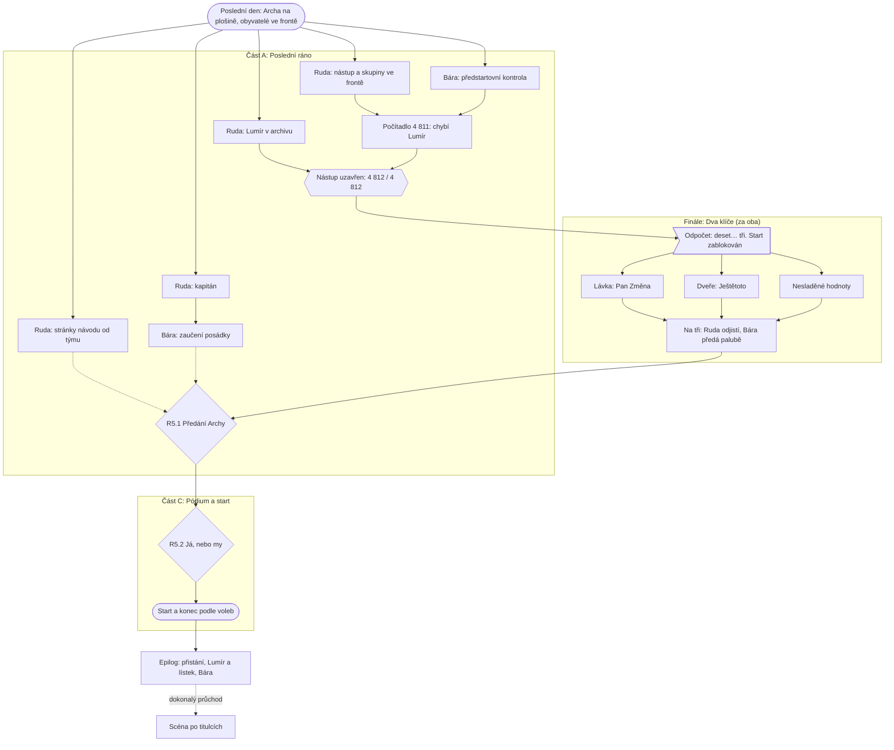

# Kapitola 5: Uzavření – Hotovo

> Podrobný návrh kapitoly 5. Vznikl z kostry (N2, D62) v kroku N3
> [postupu návrhu](../12-postup-navrhu.md) po kontrole kapitoly 4 (D78).
> Stav: **hotovo** (schváleno v D79, kontrola N4 zapracována v D80), verze 0.4; podrobné dokumenty: [místnosti a předměty](05-mistnosti.md),
> [karty puzzlů](05-puzzly.md), [průchod](05-pruchod.md), [osnovy dialogů](05-dialogy.md).
> Autorská kontrola (N4): [nálezy K1–K29](05-kontrola.md), zapracováno (D80).
> Úplný graf a jeho rozbor: [graf závislostí](../13-graf-zavislosti.md#kapitola-5-uzavření).

## Přehled

| | |
|---|---|
| **Titulek kapitoly** | *Hotovo* / *Done* (D79): první slovo, které ve městě nikdy nikdo neřekl |
| **Cíl hráče** | nalodit všech 4 812 lidí, spojit oba světy na startu, předat Archu posádce a říct na pódiu, čí je to zásluha |
| **Délka** | 25–35 minut (rozpočet 20–30, mírné překročení, viz [rozpočet](#rozpočet)) |
| **Patro v popředí** | spojka: integrace a start ([koncepce](../07-dva-svety.md)) |
| **Výuková témata** | V25 integrace, V21 uzavření a předání, V22 poučení, V20 vedení ([matice](../02-vyukova-matice.md)) |
| **Minihry** | žádná nová; finální puzzle za oba (*Dva klíče*) |
| **Rozhodnutí** | R5.1 předání, R5.2 já, nebo my |
| **Rudova vada** | hraje si na hrdinu: chce si připsat všechny zásluhy (R5.2) |
| **Hraní za Báru** | ano: Bára ve věži, Ruda na rampě, ve finále střídání v jednom puzzlu |
| **Kometa** | zabírá půl oblohy; dopadne do Mlžné pláně, metr za městem (D79) |

## Tvar kapitoly

Kapitola má **tři části**. Část A je široká (obě postavy, několik souběžných úkolů), finále je
kosočtverec přes obě postavy a část C je záměrně úzký, slavnostní závěr. Rozhodnutí jsou až
v ní, protože se dělají na pódiu a u dveří Archy před všemi.

**Šířka:** ve výchozím stavu jde na začátku udělat 5 kroků k cíli najednou (nástup, kontrola,
Lumír, kapitán, stránky návodu), se systémem ve světě iterací až 6. Úzká hrdla jsou uzavření
nástupu, „Na tři“ a R5.2; R5.1 je rozcestí se dvěma větvemi ([rozbor](../13-graf-zavislosti.md#kapitola-5-uzavření)).
Následky z kapitoly 4 přidávají do finále **souběžné** pojistky, ne delší řetěz.

## Místo v koncepci Dva světy, jedna Archa

Kapitola 5 je **spojka při startu**. Archa má dva startovací systémy a každý patří jinému
světu ([koncepce](../07-dva-svety.md)):

- **Bezpečnostní systém** na rampě je Rudův svět: pevný seznam pojistek v pevném pořadí,
  certifikovaný Norbertem, nic se nemění.
- **Řídicí systém** ve věži je Bářin svět: živá data o lidech, dveřích a navigaci, která se mění
  každou minutou.

Start se zasekne přesně na rozhraní: bezpečnostní systém nepustí start, dokud řídicí systém
nepotvrdí, že je všechno v pořádku, a řídicí systém to vidí, ale nesmí na rampě nic přepnout.
Každý vidí půlku. Hráč přepíná mezi Rudou na rampě a Bárou ve věži, vysílačkou si předávají,
co kdo vidí, a **sladí hodnoty, které se na obou pultech liší**: fyzikální hodnota (úhel rampy,
váha) platí z Rudova světa, údaje o lidech (počet, místa, dveře) z Bářina. To je pravidlo
z [M15](03-realizace.md) a z kapitoly 4, jen teď v jednom puzzlu a pod odpočtem.

Rudova vada je hrdinství. Kapitola mu ji ukáže třikrát: ve finále (bez Báry Archa neodstartuje),
při předání (Archu povede někdo jiný) a na pódiu (R5.2).

## Výchozí stav

Ráno po kapitole 4, zbývá 0 („Dnes“). Archa stojí na plošině, obyvatelé čekají ve frontě
na lávce s kufry a s palubními lístky z kapitoly 4. Ruda je na rampě, Bára ve věži.

**Ruda** má Prof. Pemboka, hrnek kávy, kávové pero (nebo propisku), krabici od bot, plán cesty ke startu,
rozpis rampy a deník jeřábu (když si ho v kap. 4 neřekl, dá mu ho vrátný na rampě, D81). **Bára** má svinovací metr a ráno přinesla z dílny plechovku žluté
barvy (zbyla z natřené žárovky). Ostatní předměty kapitoly 4 se spotřebovaly v konfrontaci, při
nástupní zkoušce a v poklopu; nepoužité důkazy si na konci kapitoly 4 vzal starosta „pro noviny“.

**Bezpečnostní pult (D80):** zkušební pult motorů vyjel s Archou z hangáru a stojí na rampě jako
bezpečnostní pult, spojený kabelem s panelem bezpečnostního systému v trupu. Norbert do něj ráno
zamkl startovací klíč: „Klíč patří do pojistek, dokud start nepovolí.“ (bez Norberta v týmu ho
zamkl vrátný: „Mám klíče od všeho.“) Po „Na tři“ ho pult vydá
a vrátný ho zasune v kokpitu.

**Počítadlo (D80)** počítá odbavené palubní lístky, ne lidi v Arše. Tým, vrátný, Zelenka
a starosta lístek odbaví u lávky a čekají u pódia. Ruda a Bára mají lístky **4 811 a 4 812**
a odbaví je až při startu: počítadlo doskočí na 4 812 v posledním záběru (D64).

**Vysílačky fungují** (usmíření v kap. 4). Při `c4_usmireni` = `priznal` Bára hlásí sama, co
vidí v kamerách, a hráč je ovládat nemusí; při `trval` odpoví jen na otázku (kamera, nebo „Věži,
co vidíš?“) a ve finále se zeptá „Na čí tři?“ (P5.14).

| Příznak z dřívějška | Jak se projeví v kapitole 5 |
|---|---|
| `c4_nastup_chybi` (D80) | skupiny, které neprošly nástupní zkouškou, uvíznou ze stejného důvodu: rybáři bez místa na udice, obyvatelé při `gantt` nebo `c3_hodnota` ≤ 1, babička při obětovaných velkých tlačítkách; každá je jeden krok (P5.2) |
| `c4_integrace` (0–3), `c3_nesladeno` | zbylé body (konec seznamu) se ve finále ukážou jako rozdílné hodnoty na obou pultech: úhel rampy, počet míst, váha (P5.12) |
| `c4_creep`, `c4_slib` | Ještětoto sedí ve dveřích Archy; drží v tlamě tolik přání, kolik je `c4_creep` (nejvýš 3), a při `c4_slib` ≥ 1 navíc starostův slíbený ohňostroj (P5.11) |
| `c4_report`, `c4_listky` | `zelene`: pojistka *Stav ověřen* navíc (P5.13); lístky skutečnosti doplní legendu pro kapitána, bez nich ji Bára ukáže na barvách (P5.7); starosta na pódiu „Hlásil jste zelenou, tak jsem to slíbil novinám.“; konec |
| `c4_usmireni` | Bára hlásí sama / jen na otázku; `trval`: „Na čí tři?“ (P5.14); konec |
| `c4_zlepseni` | finále: *Ptát se dřív, než se zamkne* = zkouška pojistek před odpočtem ukáže i hodnoty, stav a přání; *Jedna tabule pro oba* = Ruda vidí na svém pultu i Bářiny hodnoty a kamery; *Říct to nahlas* = tým u pultů hlásí, co která pojistka chce |
| `c4_obet` | neobětovaný pomník stojí u pódia (★, R5.2); obětovaná velká tlačítka: vrátný v zaučení nenajde start (P5.7); co v Arše chybí, okomentují obyvatelé v epilogu |
| `c4_bara_rekla` | `hned`: Předseda stojí na konci fronty s igelitkou, kufr „kajuta č. 1“ si Lumír nechal jako přílohu ke spisu („Založeno.“); `po_usmireni`: s kufrem zkusí předběhnout, fronta ho vrátí („Fronta je tamhle.“) |
| `c4_clen_zpet` | vrácený člen týmu napíše stránku návodu „Proč jsem odešel“ (★, P5.5) |
| `c2_tym` | bez Norberta v týmu stojí Norbert ve frontě jako cestující; pečeť je z kap. 3 (podpis z lavičky), takže jen ★ „Trup jsem podepsal z lavičky. Start vidím poprvé.“ |
| `c2_bezpecnost`, `c2_rozdeleni` (R2.2) | systém ve světě iterací (`c2_bezpecnost` = `bara`, nebo `krabice`; stejné pravidlo jako panel v kap. 3, D80): Norbert ho nezapečetí, dokud Bára nezamkne verzi (P5.4) |
| `c3_hotove` (M14) | bez karty *udice* nemají kajuty místo na udice: rybáři uvíznou (přes `c4_nastup_chybi`) a přivážou udice na Archu zvenku jako anténu (P5.2) |
| `c1_babicka` | `spojenec`: babička dá Rudovi buchtu na cestu a v epilogu svědčí; jinak jen ve frontě; scéna po titulcích |
| `c1_slib_vseho`, `c2_mosty`, `c2_vyjimky`, `c3_integrace`, `c3_bara_priority` | body sladění a Rudova vývoje pro konec ([Konce](#konce)) |
| `c3_krysy` | `kocka`: kočka Riziková sedí na bezpečnostním pultu; `aktovka`: z Předsedova kufru vykoukne krysa |
| Rudův vývoj, sladění světů, Bářina důvěra | konec a epilog ([Konce](#konce)) |

## Scény

| # | Scéna | Nová / převzatá | Postavy | Co se tu děje |
|---|---|---|---|---|
| S1 | **Startovní rampa** | **nová** | fronta obyvatel (babička s kocourem, rybáři, Pan Změna, Předseda, Framework), tým, vrátný, starosta, Ještětoto | nástup, stránky návodu, kapitán, bezpečnostní pult ve finále, předání, pódium, start |
| S2 | **Řídicí věž** (ráno) | převzatá (kap. 4) | Zelenka, vrátný (zaučení) | předstartovní kontrola, zaučení, řídicí pult ve finále, kamery |
| S3 | **Archiv** | převzatý (kap. 1, 4) | Lumír | Lumír nechce opustit archiv; v epilogu zakládá lístek Archy |

**Startovní rampa** je nové pozadí: horní konec rampy se zabetonovanou plošinou a Archou,
pohled zblízka na dveře, lávku a frontu. Staveniště rampy z kapitol 2–4 je vidět dole jako
pozadí, jeřáb stojí naposledy s prázdným hákem. **Na radnici** je přechod jako v kapitole 4
(ve vestibulu Ruda: „Výtah do půlky patra. I dnes.“):
ze startovní rampy vede do archivu přes ranní náměstí a vestibul. Hangár, dílna, trup, Komise,
sklad, hospoda a Mlžná pláň se nepoužívají (Mlžná pláň je vidět v konci).

## Postavy

**Vracející se:** Ruda, Bára, Prof. Pembok, tým (4 z R2.1, vrácený člen u rampy), vrátný,
dispečer Zelenka, starosta Bohumil, Lumír, babička a kocour, obyvatelé, rybáři, Pan Změna,
Ještětoto (velikost podle `c4_creep`), Předseda a Ing. Framework ve frontě, kočka Riziková
(jen `kocka`), Norbert (i mimo tým, jako cestující). **Nové: žádné.**

**Kapitán Archy (D79):** Archu převezme **vrátný**. Třicet let má průkaz na jediný jeřáb ve městě
a nikdo se ho nezeptal; řídí ho od kapitoly 2, zná rampu podle deníku a od kapitoly 1 říká
„Nikdo se nikdy nezeptal.“ V kapitole 5 se ho Ruda
konečně zeptá, jestli Archu povede (P5.6). Posádku tvoří rybáři („Na hvězdy koukáme
celý život. Ryby nebraly.“).

## Jak se hraje

- **Obě postavy hrají souběžně** jako v aktu A kapitoly 4: portrét přepíná kdykoli, vysílačka
  přenáší, co postava vidí („Věž, tady rampa.“). Předměty si nepředávají: Bára zůstane ve věži
  až do části C.
- **Ruda** chodí po startovní rampě a do archivu. **Bára** je ve věži: řídicí pult, kamery
  (lávka, dveře, paluba), tabule ukazatelů s lístky skutečnosti z kapitoly 4.
- **Odpočet** se spustí, jakmile Bára uzavře nástup (4 812 / 4 812 i s lístky Rudy a Báry). Na „tři“ se zastaví
  a čeká. Kometa na obloze roste, ale nic se neztratí (D12): odpočet počká, kolik je potřeba.
- **Čas:** jedno ráno. Střihy: ráno (úvod) → odpočet → start → přistání (epilog).

## Průběh a puzzly

### Úvod (dnes, ráno)

1. **Poslední den.** Amplion: „Dnů do dopadu: nula. Prosíme občany, aby se nalodili podle pořadí
   na lístku.“ Ruda: „Konečně termín, který nikdo neposune.“ Pembok: „Kometa se nepřeplánuje.
   A tohle už jsi říkal. Čtyřikrát.“ Fronta na lávce, Ještětoto ve dveřích Archy. Bára vysílačkou z věže: „Věž připravená.
   Odpočet čeká na nástup.“ Podrobně v části [Úvod a konec](#úvod-a-konec).

### Část A: Poslední ráno (Ruda i Bára)

**Ruda (startovní rampa, archiv):**

| # | Puzzle | Řešení | Kdy |
|---|---|---|---|
| **P5.1** Nástup | otevřít dveře Archy, aby fronta mohla nastoupit | páka u dveří; Ještětoto se stáhne na práh, fronta odbavuje lístky a nastupuje; tým, vrátný, Zelenka a starosta čekají odbavení u pódia | vždy |
| **P5.2** Skupiny ve frontě | kdo neprošel nástupní zkouškou (`c4_nastup_chybi`): **rybáři** nemají místo na udice (přivážou je na Archu zvenku), **obyvatelé** nevědí, na kterou palubu (Bára ve věži rozsvítí šipky), **babička** nenajde potvrzení lístku a uteče jí kocour (Ruda ho přinese a lístek potvrdí) | jen skupiny v `c4_nastup_chybi` |
| **P5.3** Lumír | v archivu: „Bez archivu nejdu. A archiv se do Archy nevejde.“ Na pultu stojí **krabička Poučení**, poprvé plná: v noci do ní Lumír založil lahve z Plachetnice. Vzít ji a dát Lumírovi: „Tohle je archiv. Zbytek jsou data.“ Lumír jde s krabičkou nastoupit | vždy (o chybějícím Lumírovi ví Bára, P5.8) |
| **P5.4** Pečeť bezpečnostního systému | systém se předělává každý týden; Norbert (z týmu, nebo u lávky jako cestující) nepodepíše nic, dokud Bára ve věži nezamkne verzi („Tahle verze. Žádná další.“); pak Ruda pustí před Norbertem zkoušku pojistek a Norbert připne pečeť | jen systém ve světě iterací |
| **P5.5** Návod pro posádku | říct si třem ze čtyř členů týmu o stránku: „Napiš, co musí vědět ten, kdo to po nás převezme.“ Stránky vložit do krabice od bot → **provozní manuál**. Gantt jako návod ★ („Řádek 214: start. Úterý. To je plán stavby, ne návod.“) | volitelné (R5.1) |
| **P5.6** Kapitán | zeptat se vrátného v kabině jeřábu: „Povedete Archu?“ → „Konečně se někdo zeptal.“ Sleze z jeřábu naposledy a jde do věže za Bárou; po odpočtu sejde ke dveřím Archy (bez otázky taky) | volitelné (R5.1) |

**Bára (řídicí věž):**

| # | Puzzle | Řešení | Kdy |
|---|---|---|---|
| **P5.7** Zaučení posádky | ve zkušebním režimu řídicího pultu nechat vrátného zkusit start. Zasekne se na světlech („Které je které? Všechna byla zelená.“): Bára mu napíše legendu („Zelená jet. Žlutá pozor. Červená stát.“) a připne k ní lístky skutečnosti z tabule, bez lístků ukáže barvy na žárovkách a plechovce. Při obětovaných velkých tlačítkách nenajde tlačítko Start: Bára ho natře žlutou barvou | volitelné (R5.1), po P5.6 |
| **P5.8** Předstartovní kontrola | spustit kontrolu na řídicím pultu: navigace ✔, dveře čekají, počítadlo nástupu. Po nástupu ukáže 4 809 odbavených a 2 u startu. Bára: „Plus my dva. To je **4 811**. Počítadlo je opravené. Takže to není chyba. Někdo chybí.“ Ze seznamu lístků zjistí, že chybí Lumír, a řekne to Rudovi (když Lumír nastoupil dřív, krok odpadne) | vždy |
| **P5.9** Uzavření nástupu | když Lumír odbaví lístek (4 810 a 2 u startu = 4 812): „Nástup uzavřen. Kromě nás dvou.“ → odpočet | vždy |

**Odpočet (střih).** Amplion odpočítává: „Deset… devět…“ Na „tři“ se zastaví. Bezpečnostní
   pult na rampě: „Start zablokován. Nástup nepotvrzen.“ Bára: „Řídicí systém nástup potvrdil.“
   Ruda: „Tak proč…“ Pembok: „Každý z vás vidí půlku.“

### Finále: Dva klíče (za oba)

Bezpečnostní pult na rampě má řadu pojistek. Každá potřebuje něco, co vidí jen řídicí systém
ve věži, nebo udělá jen Ruda na rampě. Pojistky jdou řešit v libovolném pořadí, „Na tři“ až
nakonec. Pravidla v [kartách P5.10–P5.14](05-puzzly.md#finále-dva-klíče).

| Pojistka | Co vidí Bára (věž) | Co udělá Ruda (rampa) | Kdy |
|---|---|---|---|
| **Lávka volná** (P5.10) | odbavený Pan Změna vylezl zadními dveřmi na lávku za Archou s posledním přáním („A ještě by se hodil…“); `priznal`: Bára to ohlásí sama, `trval`: až po kameře | Ruda ho za Archou nevidí; po Bářině hlášení jde kolem Archy a přání odloží: „Po přistání. Zapíšu si to.“ Pan Změna: „Poprvé mi někdo řekl kdy.“ a nastoupí | vždy |
| **Dveře zamčené** (P5.11) | řídicí systém hlásí „otevřeno“: ve dveřích trčí ocas Ještětota (ohlásí stejně jako lávku) | Ruda zavře dveře pákou; s ocasem ve dveřích vezme Ještětotovi z tlamy přání jedno po druhém a každé odloží („Po přistání.“). S každým se zmenší, až se vejde dovnitř | zavřít vždy; přání jen `c4_creep` ≥ 1 nebo `c4_slib` ≥ 1 |
| **Hodnoty sladěné** (P5.12) | řídicí pult ukazuje jinou hodnotu než bezpečnostní (úhel rampy, počet míst, váha nákladu podle zbylých bodů z kap. 3) | úhel převezme z rampy, počet lidí z věže, váhu změří deníkem jeřábu | jen `c4_integrace` ≥ 1, jeden pár na bod |
| **Stav ověřen** (P5.13) | lístky skutečnosti na tabuli (nebo Bářina čísla, když lístky nejsou) | Ruda zadá skutečný stav místo zeleného ze zprávy | jen `c4_report` = `zelene` |
| **Na tři** (P5.14) | Bára stiskne *Předat palubě* | Ruda otočí startovacím klíčem *Odjistit*; oba najednou: „Na tři.“ Při `trval` se Bára zeptá „Na čí tři?“ a Ruda musí říct „Na tvoje.“ | vždy, poslední |

Po „Na tři“ pult vydá **startovací klíč**: „Pojistky uvolněny. Klíč předejte posádce.“

### Část C: Pódium a start

1. **R5.1 Předání (P5.15).** U dveří Archy předá Ruda startovací klíč vrátnému, který tam čeká od odpočtu. **„Předat s návodem
    a zaučením“** jde jen s provozním manuálem (P5.5) a se zaučeným kapitánem (P5.6, P5.7):
    vrátný si přečte první stránku a přikývne. **„Však vy si poradíte.“** jde vždy: Ruda dá klíč
    vrátnému bez slova navíc. Vrátný: „Nikdo se mě nezeptal. Zase.“ Výsledek `c5_predani`.
2. **R5.2 Pódium (P5.16).** Starosta stojí na pódiu u Archy: „A teď ten, komu za to vděčíme!“
    Ruda u mikrofonu: **„Já.“** / **„My.“** U neobětovaného pomníku Pembok tiše: „Stojíš vedle
    sebe.“ Při „my“ Ruda jmenuje ty, které o něco požádal (stránky návodu, kapitán). Výsledek
    `c5_my`. Starosta reaguje podle `c4_report` a `c4_slib`.
3. **Start.** Tým, starosta a Zelenka nastoupí, Ruda a Bára odbaví lístky 4 811 a 4 812 poslední
    a počítadlo v kokpitu ukáže **4 812 / 4 812** (D64). Vrátný zasune klíč a otočí jím. Na sedadlech je vidět,
    že Ruda i Bára mají žluté ponožky. Člen týmu (první podle pořadí Pepa, Klára, Zdenda, Kryštof,
    Věra, Norbert): „Vy máte stejné ponožky.“ Bára: „Všimli jste si až teď.“ (D31). Odpočet
    dojede: „Tři. Dva…“ Pepa (v týmu): „Dny.“ „…Jedna.“ Konec podle [stavu](#konce).

## Rozhodnutí kapitoly

| ID | Kde | Volby | Příznak | Kde se vrátí |
|---|---|---|---|---|
| R5.1 | dveře Archy | s návodem a zaučením (jen s manuálem a zaučeným kapitánem) / „Však vy si poradíte.“ | `c5_predani` = `poradne` / `poradi` | epilog: přistání hladce, nebo posádka hledá vypínač; scéna po titulcích |
| R5.2 | pódium | „Já.“ / „My.“ | `c5_my` | Rudův vývoj, konec Hrdina, nebo Tým |

**Stavové proměnné:** „my“ zvedne Rudův vývoj o 1 (pátá vada, hrdinství). Předání s návodem
zvedne důvěru stakeholderů. Kapitola 5 jinak proměnné jen čte.

**Další příznaky:**

| Příznak | Hodnoty | Nastaví | Čte |
|---|---|---|---|
| `c5_kapitan` | ano | P5.6 | R5.1 |
| `c5_zauceni` | ano | P5.7 | R5.1 |
| `c5_manual` | 0–4 (stránky v krabici) | P5.5 | R5.1 (aspoň 3), R5.2 („my“ jmenuje autory) |
| `c5_lumir`, `c5_chybi_lumir`, `c5_pecet` | ano | P5.3, P5.8, P5.4 | jen stav kapitoly (uzavření nástupu, odpočet) |

Kapitola nemá další kapitolu, proto příznaky `c5_*` čtou jen R5.1, R5.2, konce a epilog.

## Konce

Konec se počítá při startu v pevném pořadí (D80): **1.** nízké sladění → Pomník, nebo Druhá etapa;
**2.** „my“ a vývoj ≥ 4 → Tým; **3.** jinak Hrdina. Kombinuje **sladění světů** (metodická osa) a **Rudův vývoj**
(osobní osa). **Bářina důvěra** mění jen epilog (D60): body 0–5 (`c1_bara_vyslechnuta` ≥ 2, ne `gantt`,
`c3_vada_hlasena`, `c3_bara_priority`, `c4_usmireni` = `priznal`), vysoká ≥ 4, střední 2–3, nízká ≤ 1 (D82);
kap. 4 čte jen první tři (vzkaz po poslovi, D78). Konce v bibli popisovaly i to, že Archa
odletí bez lidí nebo se rampa nedostaví. Kapitola 4 ale zaručuje, že rampa stojí a všichni jsou
nalodění (D12), proto se konce liší tím, **co se stane po startu** (D79, upřesňuje
[bibli](../03-pribehova-bible.md#konce)).

**Kometa (D79):** dopadne do Mlžné pláně, kterou nikdo nikdy nezmapoval, přesně metr za
cedulí města. Nikdo nemohl vědět, kam dopadne, proto bylo správné evakuovat. Ve všech koncích
město přežije a Archa se vrátí, nebo vůbec neodletí.

**Pracovní body sladění (0–7):** `c2_rozdeleni` = `povaha` (+2), `c2_vyjimky` = 2 (+1),
aspoň dva mosty v `c2_mosty` (+1), `c3_integrace` ≤ 1 (+1), `c4_integrace` = 0 (+1),
`c4_usmireni` = `priznal` (+1). **Vysoké sladění** je 5 a víc. Prahy se doladí po playtestech
(otevřená otázka bible).

**Rudův vývoj (0–5):** R1.1 bez slibu všeho, R2.2 podle povahy, R3.2 Bára určuje pořadí,
R4.1 poctivá zpráva, R5.2 „my“.

| Konec | Podmínka (pracovní) | Co se stane po startu |
|---|---|---|
| **Pomník** (jen plán) | sladění nízké a převažuje plán: `c2_rozdeleni` = `gantt`, nebo `povaha` s `c2_interier` = `ruda` (a `c2_bezpecnost` = `ruda`); při obou výjimkách špatně, nebo obou dobře rozhodne R4.3: `trval` → Pomník (D82) | Archa odstartuje přesně na vteřinu. Uvnitř nikdo neví, kde sedí: kajuty jsou „podle výkresu“ a navigace bez lidí (při `c3_gantt_v_aplikaci`: „V aplikaci byl Gantt. Lidé ne.“). Archa obletí město a přistane tam, kde začala. Kometa dopadne do Mlžné pláně. Rudovi postaví pomník za nejpřesnější start v dějinách města. Nedokončený |
| **Druhá etapa** (jen iterace) | sladění nízké a převažuje iterace: `c2_rozdeleni` = `krabice`, nebo `povaha` s `c2_bezpecnost` = `bara` (a `c2_interier` = `bara`); jinak R4.3: `priznal` → Druhá etapa (D82) | aplikace vede každého na jeho místo, kajuty jsou útulné, ale bezpečnostní systém z krabice má výškový limit „na zkoušku“: jeden metr. Kometa mine město o metr. Komise vyhlásí „fázi 3“, Archa visí metr nad rampou a Předseda vyhrál |
| **Hrdina** | sladění vysoké a ne Tým (vývoj ≤ 3, nebo R5.2 = „já“) | Archa vzlétne nad mraky, počká, až kometa dopadne, a přistane zpátky na rampě. Ruda dostane od starosty medaili a všechny zásluhy. Tým se rozejde; při „my“ to Ruda řekl, ale pozdě („Tým už je na jiných projektech.“) |
| **Tým** (pravý konec) | sladění vysoké, Rudův vývoj ≥ 4 včetně „my“ | Archa vzlétne, počká a přistane. Ruda na rampě řekne „my“ znovu, tentokrát bez mikrofonu. Tým jde rovnou na další projekt: sundat lešení z radnice |

**Epilog** (po přistání, startovní rampa a archiv):

1. **Předání (R5.1):** `poradne`: vrátný přistane hladce a na stránce Přistání najde podpis
   člena týmu („Díky, Věro.“); `poradi`: Archa přistane napodruhé a posádka hledá vypínač
   motorů („Kde se to vypíná?“ „Nikdo neříkal.“).
2. **Obyvatelé** podle `c4_obet`: co v Arše chybělo („Svačiny nebyly. Ale přistáli jsme.“,
   při obětovaných kulatých kajutách „Hranatá kajuta. Aspoň se netočí.“), a co zůstalo (při
   neobětovaných kulatých kajutách „Kajuty byly kulaté. Točila se mi hlava.“). Babička spojenkyně: „Na pozemek se mě zeptal.
   Tak jsem letěla.“
3. **Bára (D60):** **vysoká důvěra:** poprvé v životě řekne termín: „Večeře. Pátek. Osm. A přijdeš
   včas.“; **střední:** nabídne Rudovi další společný projekt („Lešení na radnici. Ty plán,
   já lidi.“); **nízká:** odchází na jiný projekt a Ruda zůstane na rampě sám.
4. **Lumír v archivu (V22):** zakládá lístek **„Archa. Zahájeno 1994. Dokončeno: dnes.“** jako první
   dokončený projekt v dějinách města (Pomník: „Dokončeno: skoro.“, Druhá etapa: „Fáze 3.“).
   Hráč vybere, které poučení napíše Ruda na kartu do krabičky Poučení (jen text, bez následku):
   *„Zeptat se dřív, než se zamkne.“*, *„Zelená není stav.“* nebo *„Dva světy, jedna Archa.“*
5. **Předseda** podle `c4_bara_rekla`: `hned`: pomáhá Lumírovi zakládat lístky („Konečně něco
   dokončuju.“); `po_usmireni`: stojí sám ve frontě na „fázi 3“, ve které nikdo není.

**Scéna po titulcích (D61):** jen za **dokonalý průchod**: konec Tým, vysoká Bářina důvěra,
`c5_predani` = `poradne`, `c4_report` = `poctive`, `c4_bara_rekla` = `hned` a `c1_babicka` =
`spojenec`. Komise je rozpuštěna, z radnice po 40 letech sundávají lešení a vrátný na jeřábu:
„Konečně něco dolů.“ Nedostavěnice poprvé něco dokončila. Pembok zaklapne deník: „Konečně
kapitola, kterou nemusím opravovat.“

## Úvod a konec

### Úvod: poslední ráno (1–2 min)

1. Titulek *Kapitola 5: Hotovo*. Ráno, kometa zabírá půl oblohy. Archa stojí na plošině.
2. Amplion: „Dnů do dopadu: nula. Prosíme občany, aby se nalodili podle pořadí na lístku.“
   Ruda: „Konečně termín, který nikdo neposune.“ Pembok: „Kometa se nepřeplánuje. A tohle už jsi
   říkal. Čtyřikrát.“ (úvodní trojhláška kap. 2–5 jako vtip, D81)
3. Fronta na lávce: babička s kocourem v kleci (prázdnou, jen když babička uvízne), rybáři s udicemi, Pan Změna s plovacími kruhy
   (s bazénem v kap. 3–4: „Pro všechny.“), na konci Předseda s kufrem a Ing. Framework s krabicí
   „Krize“. Ještětoto sedí ve dveřích Archy.
4. Vysílačka: Bára z věže „Věž připravená. Odpočet čeká na nástup.“ (`priznal`: „Dobré ráno,
   rampo.“; `trval`: „Věž.“). Úkol: *Nalodit všechny a odstartovat.*

### Konec hry

Start, konec, epilog a případně scéna po titulcích (viz [Konce](#konce)). Obrazovka **„Co si
Nedostavěnice zapamatovala“** shrne celou hru: pět Rudových vad a které se zlomily, sladění
světů a jeho stopy (rozdělení, mosty, poklop, nástup), Báru (epilog), předání a jméno konce.
Pak titulky.

## Kontrola proti zásadám (N3h)

- [x] **Gilbertův graf:** část A má 5 souběžných kroků k cíli (se systémem ve světě iterací 6), finále je
  kosočtverec přes obě postavy, část C je záměrně úzký závěr ([rozbor](../13-graf-zavislosti.md#kapitola-5-uzavření))
- [x] Pilíře vize: učí mechanika (každý pult vidí půlku, hodnoty se slaďují podle povahy),
  rozhodnutí mají váhu (R5.1 v epilogu, R5.2 v konci), absurdní ale fér (Ještětoto ve dveřích)
- [x] **Slovník D26:** ve hře „pojistky“, „předání“, „návod“, „zaučení“, „poučení“; žádná integrace
  ani retrospektiva; „certifikátor“ je Norbertovo povolání z kap. 2 a předávací protokol jen Kryštofův vtip
- [x] Žádný puzzle na jazykové hříčce (D03)
- [x] Nic nezávisí na najetí myší (D04); kamery ve věži jsou tlačítka
- [x] Žádná slepá ulička: odpočet počká, chybná hodnota ve finále se vrátí, R5.1 „Však vy si
  poradíte“ jde vždy (D12)
- [x] Každý puzzle má aspoň dvě stopy a tři stupně nápovědy (D10); puzzly na jeden krok
  1. a 3. stupeň, rozhodnutí jen 1. stupeň (D78)
- [x] PEGI 12 (D11): kometa dopadne do prázdné pláně, nikomu se nic nestane
- [x] Bára řekne „termín“ jen v epilogu s vysokou důvěrou (D60); žluté ponožky si někdo všimne (D31);
  na Archu se nalodí přesně 4 812 lidí (D64)
- [x] **Rozpočet (D56): mírně překročen**, viz níže; schváleno autorem (D79)

## Soulad s kapitolami 1–4

| Co | Kde dřív | Jak navazuje kap. 5 |
|---|---|---|
| Vrátný „Nikdo se nikdy nezeptal.“ | kap. 1–4 | Ruda se ho zeptá, jestli povede Archu (P5.6); bez otázky „Zase.“ (R5.1) |
| Počítadlo 4 811 | kap. 3 vada, kap. 4 oprava | po opravě 4 811 znamená, že někdo opravdu chybí (P5.8) |
| Krabička Poučení | kap. 1 (jediná karta), kap. 4 (M11) | plná lahví z Plachetnice; Lumír s ní opustí archiv (P5.3) |
| Lístky skutečnosti | kap. 4, tabule ukazatelů | legenda pro kapitána (P5.7), pojistka *Stav ověřen* (P5.13) |
| Žlutá barva | kap. 4 konec, Bářina žárovka | natřené tlačítko Start (P5.7) |
| Krabice od bot | kap. 2 | provozní manuál (P5.5) |
| Ještětoto a přání | kap. 3–4 | sedí ve dveřích, zmenší se odložením přání (P5.11) |
| Pan Změna | kap. 1–4 | poslední přání „po přistání“ (pojistka Lávka) |
| Norbert, bezpečnostní systém | kap. 2 (R2.2, výjimky), kap. 3 (varování) | pečeť, zamčená verze (P5.4) |
| Udice a místo na udice | kap. 3 M14 | rybáři ve frontě (P5.2) |
| Usmíření, zlepšení z Plachetnice | kap. 4 R4.3, M11 | finále (P5.10–P5.14) |
| Předseda s kufrem „kajuta č. 1“ | kap. 4 | fronta podle `c4_bara_rekla`, epilog |
| Žluté ponožky | D31, všechny kapitoly | všimnou si při startu |
| Mlžná pláň | kap. 2 (nikdo ji nezmapoval) | kometa dopadne tam (D79) |

### Zpětné úpravy dřívějších kapitol

- **Kapitola 4, M11 (D79):** zlepšení *Ptát se dřív, než se zamkne* znamená zkoušku pojistek před
  odpočtem (dřív „víc času ve finálním puzzlu“; finále nemá časový limit).
- **Kapitola 4, archiv (D79):** krabička Poučení je po M11 plná; v kapitole 4 zůstává prázdná
  („Poslal jsem ji dál.“), v noci po Plachetnici do ní Lumír založí lahve (jen text v kap. 5).
- **Kapitola 4 (D80):** P4.30 ukládá `c4_nastup_chybi` (kdo neprošel a proč); nepoužité důkazy si
  na konci vezme starosta „pro noviny“.
- **Kapitola 3 (D80):** panel bezpečnostního systému „předělává se každý týden“ i u krabice na
  všechno (jedno pravidlo s P5.4, návrh i prototyp).
- **Bible (D79, D80):** konce podle toho, co se stane po startu; kometa do Mlžné pláně; Tým už nepotřebuje
  vysokou důvěru (ta mění jen epilog); mapa následků s `c5_*`; startovní rampa a archiv v kap. 5.

## Rozpočet

| | Rozpočet (D56) | Návrh | Proč |
|---|---|---|---|
| Délka | 20–30 min | 25–35 min (špatné kapitoly 1–4 až 40) | dvě postavy souběžně, finále s až pěti pojistkami, 4 konce a epilog |
| Scény (nové) | 3 (1) | 3 (1) + přechod na radnici | – |
| Nové postavy | 0 | 0 | vrátný jako kapitán, Norbert jako cestující |
| Předměty | 5 | 4 nové + 9 z dřívějška (plechovka barvy jen ve variantě; [seznam](05-mistnosti.md#předměty)) | – |
| Repliky na jazyk | 200–300 | osnova ≈ 405 po N4 ([dialogy](05-dialogy.md#součet); v jednom průchodu asi 265) | 4 konce, 3 epilogy Báry, varianty skupin a pojistek |
| Minihry | žádná nová | žádná nová; finále *Dva klíče* je puzzle | – |

**Kde ušetřit:** konce Pomník a Druhá etapa zkrátit na jeden záběr s textem (−25 replik), stránky
návodu jen od dvou členů (−10), skupiny ve frontě sloučit do jedné (−8).

## Otevřené otázky

- [x] Kdo Archu převezme? → **vrátný jako kapitán, rybáři jako posádka** (D79)
- [x] Kde je archiv při evakuaci? → archiv zůstane ve městě, Lumír vezme jen krabičku Poučení (D79)
- [x] Co se stane s kometou? → dopadne do Mlžné pláně metr za městem, město přežije (D79)
- [x] Podmínky konců a scény po titulcích → pracovní body výše; prahy po playtestech
- [x] Titulek → *Hotovo* / *Done* (D79)
- [x] Schválení tvaru kapitoly a mírného překročení rozpočtu → schváleno (D79)
