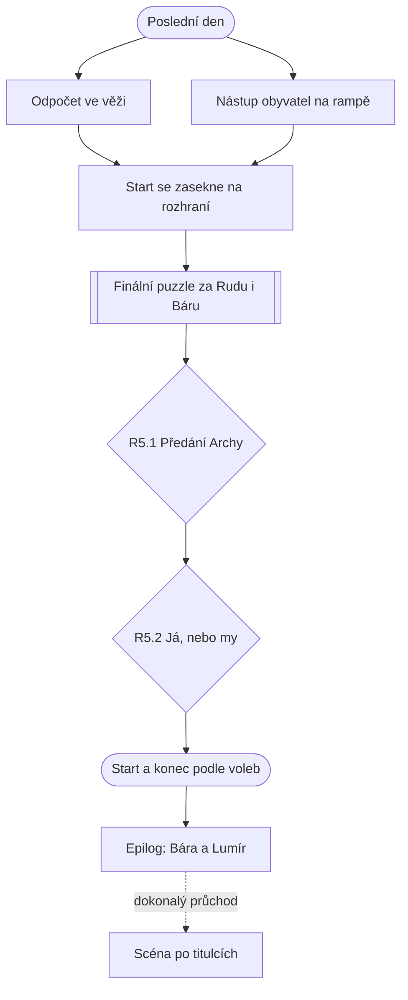

# Kapitola 5: Uzavření (kostra)

> Kostra kapitoly z kroku N2 [postupu návrhu](../12-postup-navrhu.md). V kroku N3 se rozroste
> v úplný návrh jako [kapitola 1](01-iniciace.md).
> Stav: **kostra ke schválení**, verze 0.1

## Přehled

| | |
|---|---|
| **Cíl hráče** | spojit oba světy, odstartovat Archu, předat ji a zapsat poučení |
| **Délka** | 20–30 minut |
| **Patro v popředí** | spojka: integrace a start ([koncepce](../07-dva-svety.md)) |
| **Výuková témata** | V21 uzavření a předání, V22 poučení, V25 integrace, V20 vedení ([matice](../02-vyukova-matice.md)) |
| **Minihry** | žádná nová; finální puzzle za oba |
| **Rozhodnutí** | R5.1 předání, R5.2 já, nebo my |
| **Rudova vada** | hraje si na hrdinu: chce si připsat všechny zásluhy |
| **Hraní za Báru** | ano, střídání obou postav v jednom puzzlu |
| **Kometa** | zabírá půl oblohy |

## Průběh v kostce

1. **Poslední den.** Obyvatelé čekají u rampy s kufry (babička s kocourem, rybáři s udicemi,
   Pan Změna s bazénovými plovacími kruhy).
2. **Odpočet ve věži.** Start se zasekne na rozhraní: bezpečnostní systém (Rudův svět) nepustí
   start, dokud řídicí systém (Bářin svět) nepotvrdí nástup všech.
3. **Finální puzzle za oba (V25):** hráč střídá Rudu na rampě a Báru ve věži v jednom puzzlu.
   Ani jeden to nezvládne sám. Obtížnost podle `c4_usmireni` a `c4_zlepseni`.
4. **R5.1 Předání:** komu a jak předat Archu (provozní manuál, zaučení posádky, nebo „však oni
   si poradí“).
5. **R5.2 Na pódiu:** Ruda poděkuje sobě, nebo řekne „my“.
6. **Start.** Konec podle stavových proměnných ([bible](../03-pribehova-bible.md#konce)).
7. **Epilog** podle Bářiny důvěry (D60) a archivář Lumír zakládá lístek prvního dokončeného
   projektu v dějinách města (V22).
8. **Scéna po titulcích** za dokonalý průchod (D61).

## Místa (rozpočet 3 scény, z toho 1 nová)

| Scéna | Nová / převzatá | Co se tu děje |
|---|---|---|
| Startovní rampa s Archou a obyvateli | nová | nástup, Ruda ve finálním puzzlu, pódium, start |
| Řídicí věž | převzatá (kap. 4) | Bára ve finálním puzzlu, odpočet |
| Archiv | převzatá (kap. 1) | Lumír a poslední lístek (epilog) |

## Postavy (rozpočet: 0 nových)

Vracejí se všichni podle předchozích voleb: tým, babička, obyvatelé, starosta, Pan Změna,
Lumír, Scope Creep (velikost podle kap. 3–4), kočka Riziková. Předseda a Ing. Framework se
mihnou jen podle konce (např. ve frontě na „fázi 3“).

## Hlavní graf

## Rozhodnutí

| ID | Kde | Volby | Příznak | Kde se vrátí |
|---|---|---|---|---|
| R5.1 | rampa | předat s manuálem a zaučením / „však oni si poradí“ | `c5_predani` | epilog: Archa po startu funguje, nebo posádka hledá vypínač |
| R5.2 | pódium | „já“ / „my“ | `c5_my` | Rudův vývoj, rozhodnutí mezi konci Hrdina a Tým |

## Čte příznaky z dřívějška

| Příznak | Následek v kapitole 5 |
|---|---|
| Sladění světů (`c2_rozdeleni`, `c2_mosty`, `c3_integrace`, R3.1) | volba konce: Pomník, Druhá etapa, nebo Hrdina / Tým |
| `c2_tym_pokryti`, `c2_vyjimky` | bez certifikátora nebo se špatně zařazeným bezpečnostním systémem nejde start bez náhradního puzzlu |
| `c4_report` | `zelene`: start na falešných datech, horší konec |
| `c4_obet` | co v Arše chybí; reakce obyvatel v epilogu |
| `c4_usmireni`, `c4_zlepseni` | obtížnost finálního puzzlu |
| `c4_integrace`, `c4_nastup` | nesladěné body ve finálním puzzlu; kolik skupin obyvatel nastoupí napoprvé (D77) |
| `c4_slib`, `c4_creep` | starosta chce všechno, co slíbil v M03; velikost Ještětoto při startu |
| `c4_clen_zpet`, `c4_bara_rekla` | kdo stojí na rampě; Předseda ve frontě na nástup, epilog |
| Rudův vývoj (0–5) | Hrdina (2–3), nebo Tým (4–5) |
| Bářina důvěra | varianta epilogu (D60) |
| vše výše na maximu | scéna po titulcích (D61) |

## Rozpočet

| | Rozpočet (D56) | Kostra |
|---|---|---|
| Délka | 20–30 min | odhad 20–30 min |
| Scény (nové) | 3 (1) | 3 (1) |
| Nové postavy | 0 | 0 |
| Předměty | 5 | odhad 3–5 |
| Repliky na jazyk | 200–300 | odhad 250–300 (4 konce, 3 epilogy, scéna po titulcích) |
| Minihry | žádná nová | žádná nová |

## Otevřené otázky

- [ ] Kdo Archu převezme (posádka z obyvatel, tým, babička jako kapitánka)?
- [ ] Kde je archiv při evakuaci: Lumír ho vzal na palubu Archy?
- [ ] Přesné podmínky konců a scény po titulcích (prahy proměnných až po playtestech)
